# chaosrack

**An analog computer in the browser** — a rack of instruments for dynamical
systems and live signals, rendered in real time by a Go→WebAssembly core and
driven from an analog-equipment control surface: knobs with fine-trim rings,
seven-segment LED readouts, toggle switches, concentric selector dials.

**[Live demo](https://chaosrack.magnetosphere.net/)** — the whole rack in a tab: pick a model, turn the knobs, rotate the scene.

**79 models in five kinds**, and they are no longer mostly attractors.
Continuous **flows** — Lorenz, Rössler, Chua and the rest of the classics,
plus all nineteen of J. C. Sprott's 1994 cases (A–S). Discrete **maps**, which have
no dt and no path between iterates: Hénon, Ikeda, Clifford, de Jong,
Gumowski–Mira, Tinkerbell, and Chirikov's area-preserving standard map.
**Parametric** figures, and a **sequence walk** that draws arithmetic rather
than integrating anything — and can be given weight and dropped on the floor,
where a rigid-body solver lets it land, slide and settle. **Geometry and
solids**, including the rack's own panels as printable STL, and a **terminal**
running a real Bash shell in the page, which you can rotate while it runs — and
a whole **desk** you can rotate and still work in. And
**live audio** — as a spectrogram, on an XY scope, or read back as an
attractor through a delay embedding, in a cube or in a sphere.

And a **ripple tank** to look through: a fluid surface, stepped by the wave
equation, that refracts whatever the rack is drawing. Drag to make waves, or
put a speaker in the tank and let the sound do it. The walls run from a hard
boundary that rings with its own echoes to open water a wave leaves for good.
It is the oldest analog computer here — a ripple tank computed diffraction by
having water do it, and was read by looking at the pattern.

Rotate and zoom them, **type your own system** — as derivatives or as a map —
route audio into any parameter, **measure whether what you are looking at is
actually chaotic** by its largest Lyapunov exponent, paint with persistence,
or pin Model Out to a speaker and **hear the system itself**. An homage to the
analog computers at [glensstuff.com](https://glensstuff.com).

**Live:** [chaosrack.magnetosphere.net](https://chaosrack.magnetosphere.net/) · [tinygo build](https://chaosrack.magnetosphere.net/tinygo/)

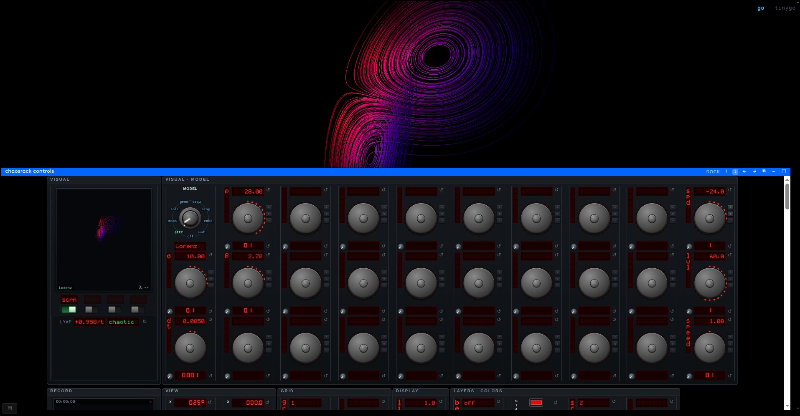

## Contents

<!-- BEGIN TOC -->

<!-- generated by `uitool readme` — do not edit by hand -->
- [Contents](#contents)
- [Run](#run)
  - [Serverless](#serverless)
- [What's inside](#whats-inside)
- [Models](#models)
  - [Attractors](#attractors)
  - [Maps](#maps)
  - [Solids](#solids)
  - [Geometry](#geometry)
  - [Sequences](#sequences)
  - [Scope](#scope)
  - [Embeddings](#embeddings)
  - [Audio](#audio)
- [Which control does what, on which model](#which-control-does-what-on-which-model)
  - [The global controls](#the-global-controls)
  - [The audio-driven models](#the-audio-driven-models)
  - [Test signals](#test-signals)
  - [Distortion — THD, THD+N, SINAD, ENOB](#distortion--thd-thdn-sinad-enob)
  - [RTA — octave bands](#rta--octave-bands-1)
  - [Transfer function — magnitude, phase, coherence](#transfer-function--magnitude-phase-coherence)
  - [Loudness — LUFS, loudness range, true peak](#loudness--lufs-loudness-range-true-peak)
  - [Wow & flutter — speed stability](#wow--flutter--speed-stability)
  - [Waterfall — cumulative spectral decay](#waterfall--cumulative-spectral-decay)
  - [Controls that pull in the same direction](#controls-that-pull-in-the-same-direction)
- [Reaching the machine](#reaching-the-machine)
  - [From another machine: pairing](#from-another-machine-pairing)
  - [On a machine with other people on it](#on-a-machine-with-other-people-on-it)
- [The rack](#the-rack)
  - [Visual](#visual)
  - [Visual · Model](#visual--model)
  - [Record](#record)
  - [View](#view)
  - [Grid](#grid)
  - [Display](#display)
  - [Layers · Colors](#layers--colors)
  - [Lattice](#lattice-1)
  - [Spectro](#spectro)
  - [Section](#section)
  - [Water](#water)
  - [Physics](#physics)
  - [Console](#console)
  - [Style](#style)
  - [Presets](#presets)
  - [Counter](#counter)
  - [Distortion](#distortion)
  - [Loudness](#loudness)
  - [Wow & Flutter](#wow--flutter)
  - [Features](#features)
  - [Timing](#timing)
  - [Scope 1](#scope-1)
  - [Gen 1](#gen-1)
  - [Scope 2](#scope-2)
  - [Gen 2](#gen-2)
  - [Scope 3](#scope-3)
  - [Gen 3](#gen-3)
  - [Scope 4](#scope-4)
  - [Gen 4](#gen-4)
  - [Synth](#synth)
  - [String](#string)
  - [FM](#fm)
  - [Wave · Noise](#wave--noise)
  - [Filter](#filter)
  - [Amp](#amp)
  - [Keys](#keys)
  - [Matrix](#matrix)
  - [Mixer](#mixer)
  - [Mod](#mod)
- [Physical dimensions](#physical-dimensions)
- [Solid models (STL)](#solid-models-stl)
- [Recording](#recording)
- [Gallery](#gallery)
  - [Animated tour](#animated-tour)
  - [The control surface](#the-control-surface)
  - [Chaos monkey jam sessions](#chaos-monkey-jam-sessions)
  - [Contact sheets (stills)](#contact-sheets-stills)
- [Audio](#audio-1)
- [FVF — Harmonic Wobbulator](#fvf--harmonic-wobbulator)
  - [The hardware it models](#the-hardware-it-models)
- [Testing & tooling](#testing--tooling)
- [Build](#build)
- [Related / prior art](#related--prior-art)
- [Dependency Graph](#dependency-graph)
- [Lines of Code](#lines-of-code)

<!-- END TOC -->

## Run

No build step — the WebAssembly is embedded in the server binary:

```
go run github.com/0magnet/chaosrack@master serve
```

Then open:
* [127.0.0.1:8080/](http://127.0.0.1:8080/) — standard Go build
* [127.0.0.1:8080/tinygo/](http://127.0.0.1:8080/tinygo/) — smaller TinyGo build

With no subcommand, `chaosrack` is the rack's panel, in the terminal you run it
from: beside an open page on a host, or typed in the page's own terminal, where
the page is the same repo built for js/wasm.

(The same entrypoint is also at `github.com/0magnet/chaosrack/cmd/chaosrack`.)

### Serverless

There are two builds, and the difference is whether the binary is *in* the page.

**The deployed pages fetch it.** `make pages` writes
[index.html](index.html) · [go/index.html](go/index.html) ·
[tinygo/index.html](tinygo/index.html), which are 70 KB, 52 KB and 52 KB and
ask for the `.wasm` in `assets/` as an ordinary resource — the copy already in
this repository, so no binary is duplicated to publish it. That is better than
inlining on every axis that matters to a page someone loads: only the runtime
actually being run is fetched, where the inlined dual page carried both and
transferred 9.5 MB to start one of them; `instantiateStreaming` compiles the
module *while* it downloads instead of after; no base64 is parsed and nothing
is inflated in JavaScript; and the host serves `.wasm` gzipped, so the binary
costs the same on the wire either way — 5.7 MB for the Go build.

**`make onefile` builds the other one.**
[chaosrack-standalone.html](chaosrack-standalone.html)
([download](https://chaosrack.magnetosphere.net/chaosrack-standalone.html)) is 12.3 MB
with both runtimes gzipped and base64'd inside it, and it needs nothing else at
all: no server, no sibling files, no network after it is saved. That is the one
to keep, mail, or open off a disk, and it is why the inlining code is still
here rather than deleted with the payload the deployed pages stopped carrying.

Gzipping before base64 matters more than it sounds, and still does for that
build. A 6 MB wasm base64s to 8.4 MB of JavaScript source the browser must
receive, parse and `atob` before anything starts; gzipped it is 2.2 MB.
`DecompressionStream` does the inflating — no library, present since Chrome 80,
Firefox 113 and Safari 16.4 — and where it is missing the page falls back to
fetching the wasm as an ordinary resource, which works beside a server and not
inside the single file, where there is nothing to fetch.

In that build the payload sits at the **end of the document**, in a
`text/plain` script element the boot code reads with `textContent`, and the
boot code sits after it. The browser does not care; everything that reads the
page without running it does. A crawler fetches a bounded prefix and discards
the rest — Google documents 2 MB, measured on the uncompressed bytes — so with
the payload in `<head>` the page's own description sat at about byte
13,500,000 and was never read by anything. It is at 16,667 now, and the
deployed pages have no payload in front of it at all.

It is also written out **unescaped**, which is worth a line because the two
ways of getting that wrong look nothing alike. In a JavaScript string literal
`html/template` turns every `+` into a six-byte unicode escape and every `/`
into an escaped slash, which JavaScript decodes back — correct, and about
1.4 MB a page. In the element it
now lives in, the same escaper turns `+` into `&#43;`, which is not base64 any
more and fails only in the browser, at `atob`, with the page otherwise looking
perfectly well-formed. `pkg/server` types it so neither happens, and
`page_test.go` decodes what the template actually wrote and requires a wasm
back out of it.

## What's inside

- **Flows — the continuous catalog:** Lorenz, Rössler, Chua, Aizawa, Thomas,
  Halvorsen, Chen, Dadras, Rabinovich–Fabrikant, Burke–Shaw, Lü,
  Newton–Leipnik, the 4-D **hyperchaotic Rössler**, and all of **J. C.
  Sprott's cases A–S** — plus Lissajous, the Graphic Artist (four-oscillator
  XY art), platonic solids and geometric primitives. Every built-in flow's
  default parameters are **certified chaotic in CI** by a Lyapunov-exponent
  test run under the app's own integrator (a periodic-window default shipped
  once; never again).
- **Maps — the discrete catalog:** Hénon, Ikeda, Clifford, de Jong,
  Gumowski–Mira, Tinkerbell and the **Chirikov standard map**. A map is not a
  slow flow: there is no dt and no trajectory *between* iterates, so they are
  drawn as points — joining consecutive iterates of a chaotic map would
  scribble a hairball across the very structure the map exists to show.
  Hénon's determinant is −b everywhere and Chirikov's is exactly 1, and both
  are asserted in the tests, because a mistyped coefficient looks plausible
  and measures wrong. The standard map is the one system here with **no
  attractor at all** — being area-preserving, nothing contracts onto
  anything — so it is drawn as an ensemble of orbits rather than one, and you
  can watch the invariant curves break into a chaotic sea as K passes 0.9716.
- **A shell, three ways.** The **Terminal** model puts
  [websh](https://github.com/0magnet/websh) — a Bash interpreter compiled to
  wasm — on a quad *inside* the scene, so a running `for` loop rotates and
  zooms like any other model; double-click to type, `Esc` to give the keyboard
  back. The **Desk** switch is the other arrangement: a
  [window manager](https://github.com/0magnet/desk) floating *over* the scene,
  with terminals and a file manager in real windows, and the model still
  integrating behind them — not a wallpaper but a system you can keep tuning
  from the rack while you work on top of it. Dragging where there is no window
  still rotates what is underneath. And the **Desk** *model* is the third: the
  whole window manager on a quad, inside the scene, rotating with everything
  else. That one needed something from desk to be possible at all — a window is
  more than its pane, and its title, buttons and border are DOM, which cannot be
  sampled into a texture — so desk's compositor now *redraws* the frames with
  Canvas2D into the canvas it already draws the panes into, and chaosrack
  samples that. Nothing types into it while it is a model: use the switch to
  work in the windows, the model to look at them. **Contain** is the fourth and
  turns the whole thing inside out — the desk becomes the environment and
  chaosrack a window *on* it, minimizing to the desk's panel like anything else,
  with the model still running behind.
- **Optionally, your actual machine.** Everything above runs in the tab and
  touches nothing. Two flags change that, and both are off:
  `chaosrack serve --shell` puts a **host shell** app in the desk — xterm-go attached
  over a WebSocket to a pty running your `$SHELL`, resizing with the window
  because a resize becomes a `TIOCSWINSZ` and so a `SIGWINCH`. `chaosrack serve --fs`
  is the one that does more than it looks like: websh's shell and the file
  manager both work against an `afero.Fs`, so a single host-backed
  implementation makes `ls`, `cat`, `grep`, globbing and redirection all land
  on the real filesystem while the interpreter stays in the tab. `--fs-root`
  confines it. See [Reaching the machine](#reaching-the-machine).
- **A host shell that behaves like one.** With `--shell`, typing
  `host` in the desk's terminal attaches a shell on this machine to
  THAT terminal, the way ssh does on a desktop: it takes over the terminal you
  typed it in, and `exit` puts you back at your prompt with the
  scrollback intact. `open host` still gives it a window of its own if
  that is what you want.

  Add `--reconnect` and a NAMED shell outlives the thing displaying it.
  `host build` twice is the same shell the second time, with whatever
  it printed in between replayed into it — so a long compile survives closing
  the window, and survives closing the browser. The name is yours to choose
  rather than invented, because only you know whether a new window is meant to
  be the old one; a plain `host` is an ordinary shell that ends with
  its socket.

  What ends a detached shell is the idle timeout (`--reconnect-idle`,
  an hour by default, negative for never) or stopping the server. That second
  one is not a figure of speech: stopping the process kills them, deliberately,
  because otherwise a shell that ignored the resulting SIGHUP would be
  reparented to init and keep running as you with nothing left that knows it is
  there.
- **Color by what you are hearing.** The gradient's fifth source is the sound
  itself. On a delay embedding it is not one tint over the whole figure: the
  trail IS a window of audio, so each stretch of it is colored by the
  short-time spectrum of the moment it was drawn from, and a bass thump and a
  cymbal are different colors on the same curve. Models whose trail is not a
  clock take the current feature as one tint instead. Pick **audio** on the
  SRC ring, and a colormap on the MAP ring beside it.
- **Points, or a line, or anywhere between.** The **Points** knob in the Trace
  module is a count, not a switch: 0 draws the solid trace, and lowering it
  breaks the line into that many points, further apart as the number falls.
  Each point is one vertex wide, so a point for every vertex IS the solid line
  and there is no separate setting to keep in step. Useful where a figure
  folds over itself and a continuous line becomes a thicket.
- **Four 3-D desktops, reproduced.** Putting windows in three dimensions is
  not a new idea and the good ones are not mine, so the desk can wear four of
  them: **Looking Glass** (Sun, 2003) leans the windows into a legible stack
  and lets you turn one over and read its back; the **Cube** (Compiz, 2006)
  hangs workspaces on the faces of a cube the arrow keys spin; **Metisse**
  (2004) lets you shift-drag a window to any angle and keep typing into it;
  and **BumpTop** (2009) gives the windows weight and drops them into a pile
  on top of the rack. They are reproductions rather than pictures — the
  windows are real, the shells in them are running, and a window turned forty
  degrees still takes the keyboard, because a CSS 3-D transform is a real
  projection and the browser hit-tests what it draws. The **style** knob that
  picks between them is in the **Desk** module, which appears only once there
  is a desk to apply it to — turn one on first with the **Desk** switch, the
  **desk** backdrop, or the **desk** model.
- **Analysis — is this actually chaotic?** The **largest Lyapunov exponent**
  of whatever is on screen, measured on demand by the same estimator that
  guards the catalog's defaults in CI, with a plain-language verdict beside
  the number. Flows report per unit time and maps per iterate, and the readout
  says which, because 0.42 per second and 0.42 per iterate are not comparable.
  A polyhedron reports "no dynamics" rather than a decimal. It earns its place
  most in Custom mode: type a system and *read* whether you found chaos
  instead of guessing from the picture. Alongside it, a **bifurcation
  explorer** and a **recurrence plot**.
- **Turtle Path — a model that is arithmetic, not a flow:** reduce an integer
  sequence modulo *m* and the remainders repeat; the length of the repeat is
  the **Pisano period**. Read each term as turn-and-step and the walk draws a
  figure. In **DIM 3** the parity of the term still picks left or right and the
  parity of the *next* term picks yaw or pitch — reading the pair, because
  (Fₙ, Fₙ₊₁) mod *m* is the state of the recurrence and the Pisano period is
  the period of that pair. One pass decides the rest: the figure closes, drifts
  in a straight line, or screws away along an axis, and the Info overlay says
  which. Space adds two outcomes the plane cannot have — a helix, and closure
  after exactly three passes, from a rotation about a body diagonal. **The walk
  never finishes, and is never restarted:** the turtle is held mid-stride and
  extended at the Speed knob's rate, forever, with the oldest of the trail
  falling off the far end as new steps arrive — so a closed figure stands still
  while the color moves through it and an open one keeps walking into new
  territory. Because a step walked twice is a different fact about
  the figure than a step walked once, it comes back in a different color; the
  figure changes while you watch it. **TINT** is what a color means (step, pass,
  visits, heading, turn, term, age), **TRAIL** how much stays on screen (whole,
  long, short, comet), **CAM** where it is watched from — including **lock**, which
  cancels the drift and centers on the screw axis, both worked out exactly by
  the classification, so the figure stands still and turns on the spot while
  the walk runs through it, the way a scope's timebase holds a waveform — **CYCLE** steps to the next modulus on its own — and **PHYS** gives
  the figure weight, making it a rigid body in the plane of the screen inside a
  solid box the size of the frame — it falls, tips, settles, and can be picked
  up and thrown with the mouse (press on the figure to move it, beside it to
  turn the view). The walk keeps extruding at the head while the tail drops
  away, so the figure slides through its own body and marches. An analog
  computer was a physics simulator; GRAV — either way up — FRIC, BOUNCE and
  SPIN are the coefficients it would have been patched with. Powered by
  [0magnet/pisano](https://github.com/0magnet/pisano), whose command-line flags
  these knobs are.
- **Custom equation mode:** type `dx/dt`, `dy/dt`, `dz/dt` (and an optional
  4th dimension); every parameter you name automatically gets a control knob.
  `Edit eqn` seeds the editor from any built-in system. Flip **iterate** and
  the same expressions are read as a discrete map instead — `x = f(x,y,z)`
  rather than `x += dt·f` — so you can type Hénon as easily as Lorenz. The dt
  knob goes away, because a map has no timestep, and the typed system is
  published as a map rather than as a flow: everything downstream of the flow
  registry integrates what it finds, and read as a derivative Hénon's
  `1 − 1.4x² + y` is a slow crawl to a fixed point rather than the fractal on
  screen.
- **Two trail engines:** classic **scan** (the whole curve re-integrates every
  frame, so parameter and audio changes reshape it instantly) and the
  **Ring** switch's scope-style beam (only the advancing head integrates; the
  trail is its history, and knob changes bend the path from the head forward).
  **Persist** accumulates either into a long-exposure painting.
- **Colors module:** two knobs, and reading a setting means reading the pair.
  **SRC** is what the color follows — **off** / X / Y / Z / trail / **audio** —
  and **MAP** is how that value becomes a color. Off is a flat trace in the
  start swatch: the color follows nothing, which is a statement about the
  SOURCE, and it is where what used to be called the "mono palette" belongs. On
  the three delay embeddings the X / Y / Z positions are one signal at three
  lags, so they run the color along different directions of the same figure
  rather than showing three different quantities; **audio** paints the
  short-time spectral centroid along the trail, and only the embeddings have a
  trail that is a time axis, so elsewhere it is one flat tint. The src knob
  dims in the modes that never consult it — the spectrogram, the RTA and the
  transfer function each color one quantity of their own.
  The map ring carries the two swatch mixes, a raw **hue** sweep, and
  then the same six colormaps the spectrogram uses: **heat, blue, gray, turbo,
  viridis, magma**. They are the library's own tables, so a value paints the
  same color on the trace as it does in the spectrogram — and now literally the
  same knob paints both: the spectrogram had a second colormap control naming
  those six maps in the same order, and two knobs that had to be kept in step by
  hand were one knob too many. Which also means the swatch mixes reach it: set
  MAP to 2 or 3 and the spectrogram is painted in your own Palette colors,
  which neither knob could do before. The **period** and
  **shift** knobs beside them are a window onto the palette — period is how
  many times the map is crossed across the figure, shift is where the crossing
  starts — and both are audio-mod targets, so turning the period down to a
  slice and routing the shift makes the sound sweep the figure *along* turbo
  or magma rather than only tinting it. Past either end the map turns back
  instead of wrapping: a colormap's two ends are different colors, and joining
  them puts a seam across the figure that moves with the music.
  Reach for turbo or
  viridis over the hue sweep when the color is meant to be read rather than
  admired: a hue ramp is perceptually uneven, so equal steps in the gradient
  look like unequal steps in color and the banding that produces is an
  artifact of the color space rather than anything in the data —
  gradient stops and background, CRT **phosphor** presets (P31/P7/P33…) with
  afterglow for the scope modes.
- **Model Out — the model as a signal generator:** the model's own equations
  run at audio rate, and its x, y and z are three columns of the Mixer, MODEL
  X, Y and Z: pinned to a speaker they are heard, pinned to the rack's signal
  they are measured, and any scope can draw them. The pitch is the
  system's *own* orbital frequency — chaos chirps, periodic windows lock into
  tones, parameter changes are audible bifurcations — and SPD sets how fast the
  model runs, in exact musical intervals. A model with a trail but no
  equations (a parametric curve) plays its trail as a waveform.
- **Signal generators:** four oscillators, Gen 1 to 4 (sine/tri/square/saw/noise, and
  the test stimuli: white and pink noise, a log sweep and a polarity pulse), on a
  concert-pitch A0–A10 scale with octave dials and a clickable piano-key
  register display. Where each goes is the Mixer's; solo leaves one alone.
  They are the audio source for every audio-reactive feature, made in the tab,
  no server needed.
- **The Mixer:** every sound on the rack is a column of one pin matrix — the
  capture, the generators, Model Out, the keys, drums and tone matrix — and
  the rows are the speakers and the rack's own signal, which is what the
  meters, the audio models, the scopes and the Mod matrix read. A pin mixes a
  source in at its gain; a negative gain inverts it. The capture is measured
  and never played. The signal flow, and every control on the rack, is in the
  manual: [manual/](manual/), the same text the tooltips and the Info window
  show.
- **Two transports for the audio:** the WebSocket carries little-endian
  float32 samples in binary frames — it used to base64 them into text frames,
  which cost 4/3 of the bytes plus an encode and a decode per chunk for
  nothing. **WebTransport** (HTTP/3 over QUIC) is there as an option for the
  link that drops packets: it sends the same bytes as unreliable DATAGRAMS,
  so a lost packet costs exactly the ~12 ms it carried instead of stalling
  the feed for a round trip while TCP retransmits. Over loopback that buys
  nothing and the WebSocket stays the default; the payoff is a remote link.
  Unsupported browser, no server support, or a refused certificate all fall
  back to the WebSocket and say so.
- **Live audio, read as an attractor:** the **Takens embedding** turns a
  single signal back into a manifold — the delay vector (s(t), s(t−τ),
  s(t−2τ)) reconstructs something diffeomorphic to whatever produced it, so a
  pure tone draws a closed loop and music traces the geometry of the music.
  τ is the one parameter that matters and it used to be a rule of thumb; the
  **MEAS** button now measures it — the first minimum of the signal's average
  mutual information — along with the false-nearest-neighbor dimension. Once,
  on a button, deliberately: a knob that re-tuned itself every frame made the
  figure move with the music, which is the opposite of showing you its shape.
- **Shareable permalinks** capture the full state — mode, parameters,
  equations, colors, pose, audio-mod routing — in the URL, round-trip-tested.
  The same serialization backs **named presets**: save the view you are
  looking at, recall it later, without the address bar having to carry it.
  The rack remembers itself too — which modules are out, and in what order.
- **The rack rearranges:** every module has a switch in the Console's Modules
  section (the Console has none — it is where the switches live, so it is the
  one module that cannot be put away), and a module's header is a handle: drag
  it and it settles into whatever gap you drop it in. The tiling and the
  docking are their own libraries now — [rack-go](https://github.com/0magnet/rack-go)
  and [winbox-go](https://github.com/0magnet/winbox-go). Every module is
  pictured in [The rack](#the-rack).
- **Record what you see:** the [Record module](#recording) is a capture deck
  with a monitor — WebM through `MediaRecorder` or a GIF encoded in Go, the
  whole canvas or a rectangle you drag out of it, with a transport, a
  timecode, a media-size readout and a single-frame still button.
- **The spectrogram is the real one:** transform size, overlap, window
  function, magnitude scale and limits are all on the panel (its color is the shared MAP ring),
  matching [audioprism-go](https://github.com/0magnet/audioprism-go) — itself a
  Go port of vsergeev's audioprism, and the reference this was checked against
  frame by frame.
- **Fit and finish:** the control panel docks to any edge or floats, the
  whole interface scales, knobs come in six styles, a Template module
  documents every module slot, and rendering is devicePixelRatio-native.

## Models

Also published as one page per model at
**[chaosrack.magnetosphere.net/models/](https://chaosrack.magnetosphere.net/models/)**,
each with its equations, its captured figure, and a link that opens it running.
Same source as this section — `attractor.Catalog()`, which is the selector's own
registry — written out by `make site`, so adding a mode adds a page and
`make site-check` fails when it has not. The app is a canvas: a model can only
be *found* from outside it by a page that names it in text.

<!-- BEGIN MODELS -->

Every position of the model selector, in the order the knob turns through
them. A model that appears under two categories — the XY scope and the
Takens embedding are each both a Scope and an Audio model — is listed under
both, because that is what the selector does.

Each entry is captured from the running app by `uitool portraits`: a still,
a loop turning through all four positions of the palette knob, and the
**Parameters module as it stands for that model** — the knobs are the
system's own, so Lorenz's σ/ρ/β and the turtle's mod/seq/dim are different
panels under the same header. A model with no parameters of its own has no
such column. The prose is the same text the Info overlay shows.

### Attractors

[Rossler](#rossler) · [Lorenz](#lorenz) · [Chua](#chua) · [Aizawa](#aizawa) · [Sprott](#sprott) · [Thomas](#thomas) · [Halvorsen](#halvorsen) · [Chen](#chen) · [Dadras](#dadras) · [Rabinovich-Fabrikant](#rabinovich-fabrikant) · [Burke-Shaw](#burke-shaw) · [Lü](#lü) · [Newton-Leipnik](#newton-leipnik) · [Arneodo](#arneodo) · [Chen-Lee](#chen-lee) · [Dequan Li](#dequan-li) · [Three-Scroll](#three-scroll) · [Wang-Sun](#wang-sun) · [Lorenz Mod 2](#lorenz-mod-2) · [Simone](#simone) · [Hyper-Rössler (4D)](#hyper-rössler-4d) · [Sprott Morph](#sprott-morph) · [Sprott A](#sprott-a) · [Sprott B](#sprott-b) · [Sprott C](#sprott-c) · [Sprott D](#sprott-d) · [Sprott E](#sprott-e) · [Sprott F](#sprott-f) · [Sprott G](#sprott-g) · [Sprott H](#sprott-h) · [Sprott I](#sprott-i) · [Sprott J](#sprott-j) · [Sprott K](#sprott-k) · [Sprott L](#sprott-l) · [Sprott M](#sprott-m) · [Sprott N](#sprott-n) · [Sprott O](#sprott-o) · [Sprott P](#sprott-p) · [Sprott Q](#sprott-q) · [Sprott R](#sprott-r) · [Sprott S](#sprott-s) · [Custom equation](#custom-equation)

#### Rossler

| Rossler | turning | parameters |
| --- | --- | --- |
| 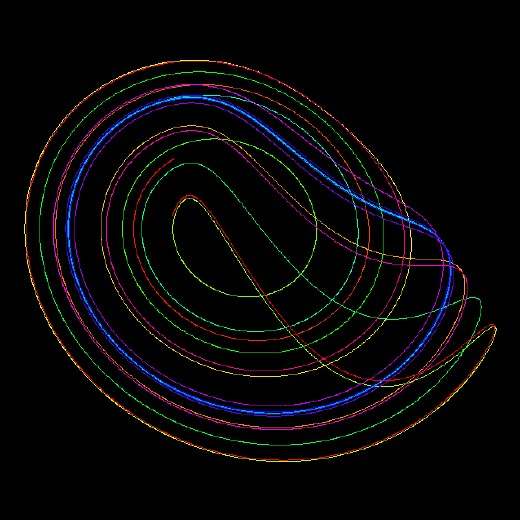 | 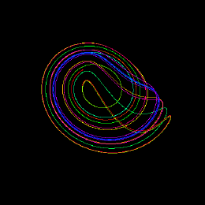 | 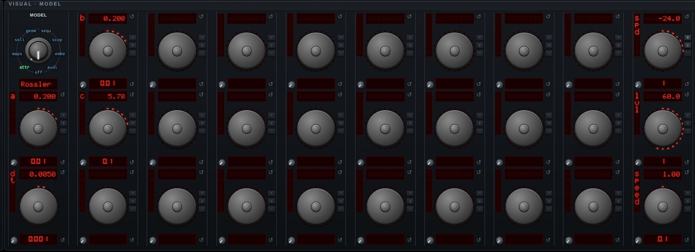 |

Rössler Attractor — Proposed by Otto Rössler in 1976 as a simpler system that produces chaotic behavior. Unlike the Lorenz system's two-lobed shape, the Rössler attractor has a single folded-band structure with an outward spiral that occasionally makes a large excursion in the z-direction.

```
dx/dt = −(y + z)
dy/dt = x + ay
dz/dt = b + z(x − c)
```

`#rossler` · 3-D flow

#### Lorenz

| Lorenz | turning | parameters |
| --- | --- | --- |
| 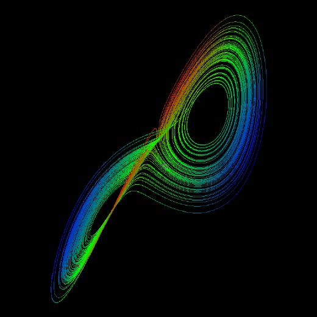 | 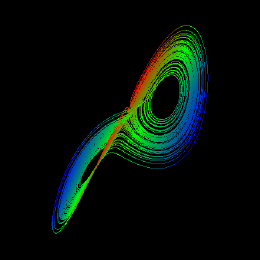 | 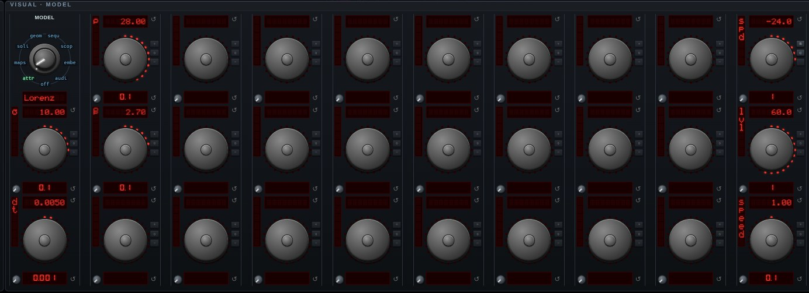 |

Lorenz Attractor — Discovered by Edward Lorenz in 1963 while modeling atmospheric convection. The butterfly-shaped trajectory arises from a simplified system of three coupled differential equations. It was one of the first systems shown to exhibit deterministic chaos, where tiny differences in initial conditions lead to vastly different outcomes.

```
dx/dt = σ(y − x)
dy/dt = x(ρ − z) − y
dz/dt = xy − βz
```

`#lorenz` · 3-D flow

#### Chua

| Chua | turning | parameters |
| --- | --- | --- |
| 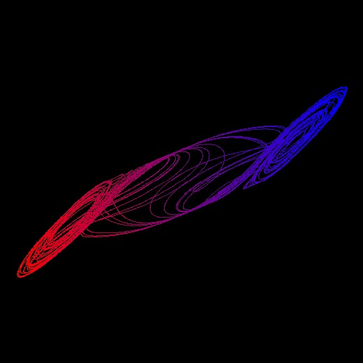 | 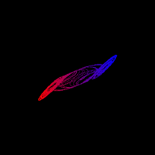 | 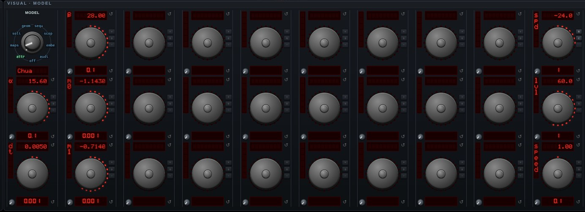 |

Chua's Circuit (Double Scroll Attractor) — Invented by Leon Chua in 1983, this is the first electronic circuit proven to exhibit chaos. The system features a piecewise-linear nonlinearity (the Chua diode) that creates the characteristic double-scroll pattern. It is also the basis for multi-scroll attractor generalizations.

```
dx/dt = α(y − x − h(x))
dy/dt = x − y + z
dz/dt = −βy
h(x) = m₁x + ½(m₀ − m₁)(|x+1| − |x−1|)
```

`#chua` · 3-D flow

#### Aizawa

| Aizawa | turning | parameters |
| --- | --- | --- |
| 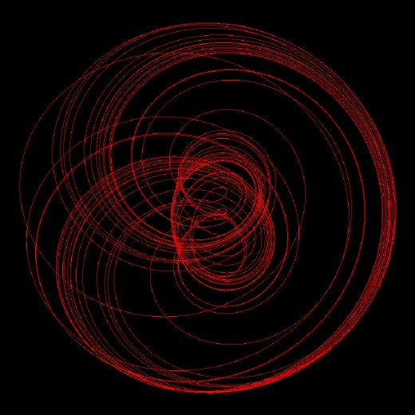 | 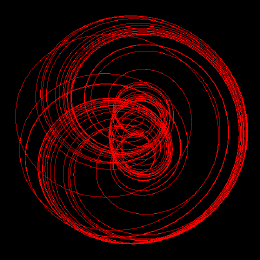 | 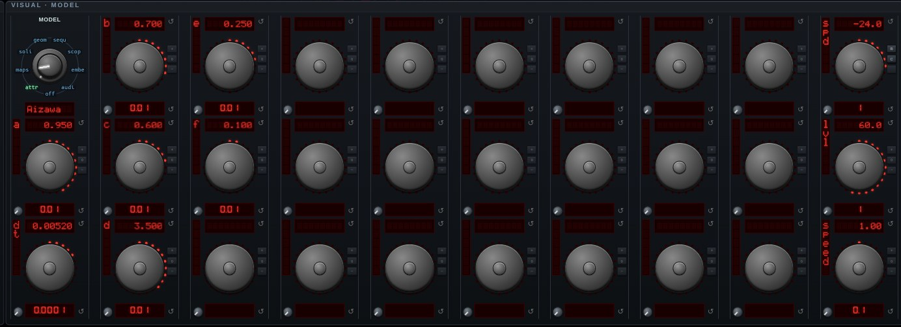 |

Aizawa Attractor — A chaotic system that produces a toroidal structure with a tendril extending from the center. The attractor has a visually striking shape that resembles a sphere with a tail, exhibiting both rotational symmetry and chaotic wandering.

```
dx/dt = (z − b)x − dy
dy/dt = dx + (z − b)y
dz/dt = c + az − z³/3 − (x² + y²)(1 + ez) + fzx³
```

`#aizawa` · 3-D flow

#### Sprott

| Sprott | turning | parameters |
| --- | --- | --- |
| 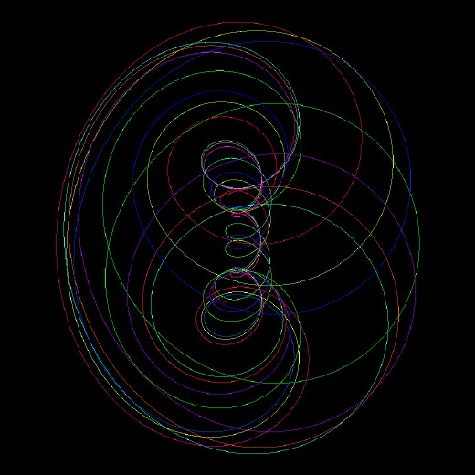 | 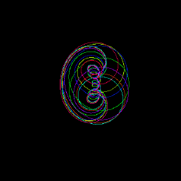 | 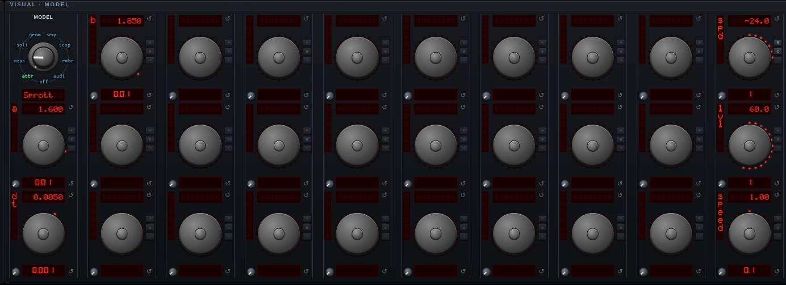 |

Sprott Attractor — One of many simple chaotic systems cataloged by Julien Clinton Sprott. These systems were discovered through systematic computer searches for chaotic flows with minimal terms, demonstrating that chaos can arise from remarkably simple equations.

```
dx/dt = y + Axy + xz
dy/dt = 1 − Bx² + yz
dz/dt = x − x² − y²
```

`#sprott` · 3-D flow

#### Thomas

| Thomas | turning | parameters |
| --- | --- | --- |
| 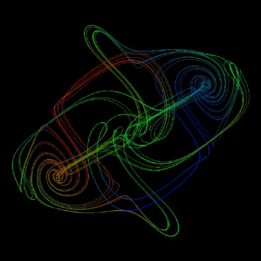 | 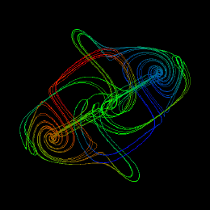 | 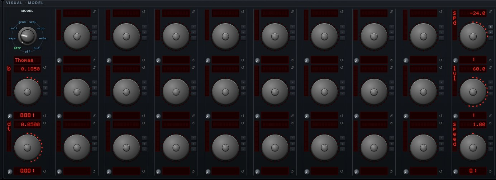 |

Thomas' Cyclically Symmetric Attractor — Introduced by René Thomas, this system has the elegant property of cyclic symmetry: each variable is damped and driven by the sine of the next variable in the cycle. The parameter b controls dissipation; as b decreases the system transitions from stable points through limit cycles to chaos.

```
dx/dt = −bx + sin(y)
dy/dt = −by + sin(z)
dz/dt = −bz + sin(x)
```

`#thomas` · 3-D flow

#### Halvorsen

| Halvorsen | turning | parameters |
| --- | --- | --- |
| 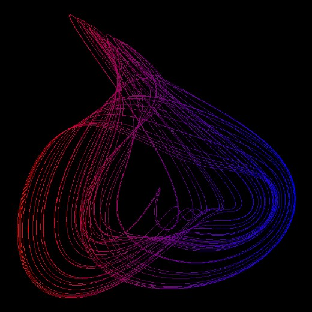 | 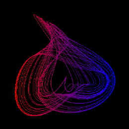 |  |

Halvorsen Attractor — A chaotic system with three-fold rotational symmetry, producing a distinctive pinwheel-like shape. The attractor consists of three intertwined lobes that spiral around each other, creating a visually complex but structurally symmetric trajectory.

```
dx/dt = −ax − 4y − 4z − y²
dy/dt = −ay − 4z − 4x − z²
dz/dt = −az − 4x − 4y − x²
```

`#halvorsen` · 3-D flow

#### Chen

| Chen | turning | parameters |
| --- | --- | --- |
| 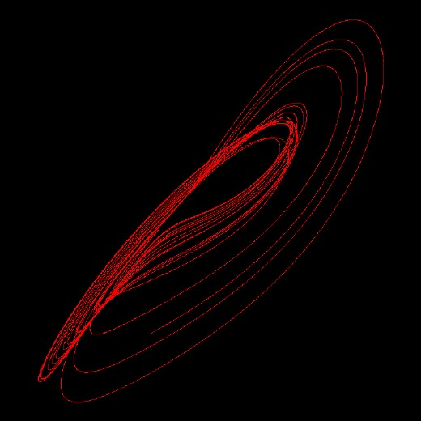 | 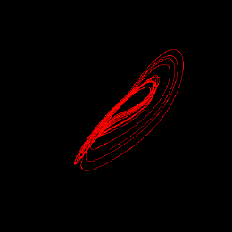 | 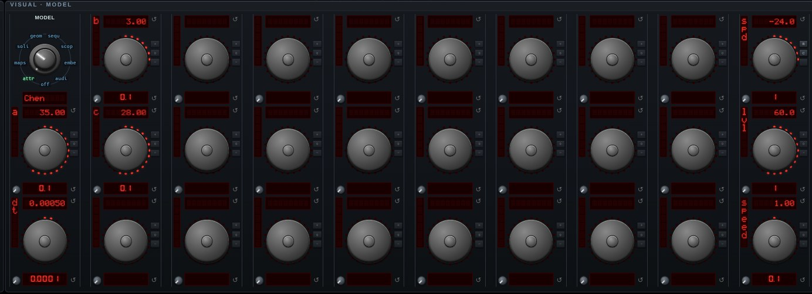 |

Chen Attractor — Discovered by Guanrong Chen in 1999, this system was found as a dual of the Lorenz system in a specific mathematical sense. It exhibits chaotic behavior with a distinctive two-scroll structure that differs from both the Lorenz and Rössler attractors.

```
dx/dt = a(y − x)
dy/dt = (c − a)x − xz + cy
dz/dt = xy − bz
```

`#chen` · 3-D flow

#### Dadras

| Dadras | turning | parameters |
| --- | --- | --- |
| 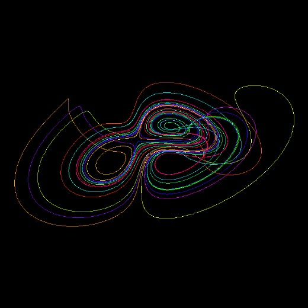 | 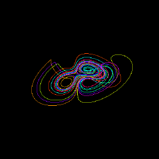 | 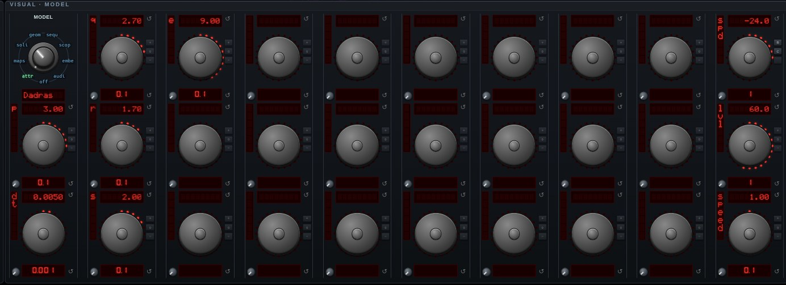 |

Dadras Attractor — A three-dimensional autonomous chaotic system with five parameters, introduced by Sara Dadras and Hamid Reza Momeni. The system exhibits rich dynamical behavior including period-doubling routes to chaos.

```
dx/dt = y − px + qyz
dy/dt = ry − xz + z
dz/dt = sxy − ez
```

`#dadras` · 3-D flow

#### Rabinovich-Fabrikant

| Rabinovich-Fabrikant | turning | parameters |
| --- | --- | --- |
| 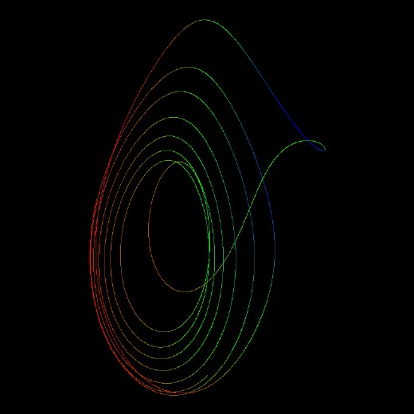 | 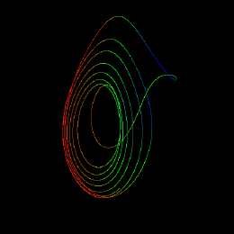 | 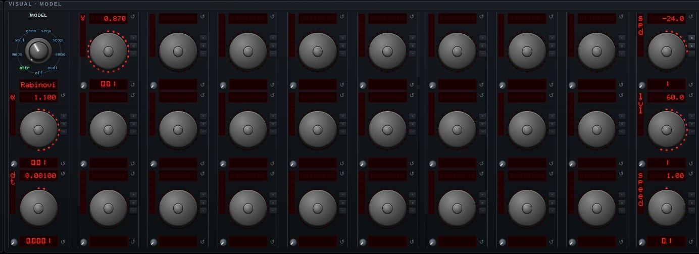 |

Rabinovich-Fabrikant Attractor — Derived by Mikhail Rabinovich and Anatoly Fabrikant from physical equations modeling the stochasticity of three interacting waves. The system is known for its complex topology and extreme sensitivity to parameters, producing intricate folded structures.

```
dx/dt = y(z − 1 + x²) + γx
dy/dt = x(3z + 1 − x²) + γy
dz/dt = −2z(α + xy)
```

`#rabinovich` · 3-D flow

#### Burke-Shaw

| Burke-Shaw | turning | parameters |
| --- | --- | --- |
| 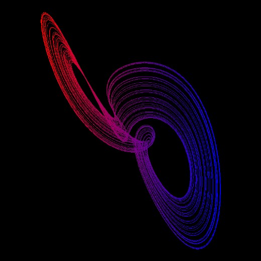 | 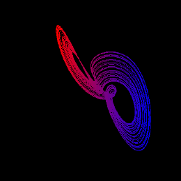 | 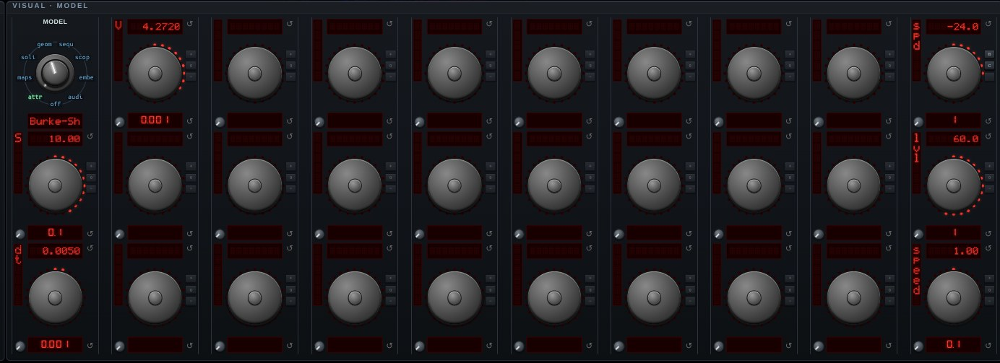 |

Burke-Shaw Attractor — Introduced by Bill Burke and Robert Shaw, this system exhibits chaotic behavior with a distinctive two-winged structure. It arises from the study of nonlinear dynamics and produces complex trajectories confined to a compact region of phase space.

```
dx/dt = −S(x + y)
dy/dt = −y − Sxz
dz/dt = Sxy + V
```

`#burkeshaw` · 3-D flow

#### Lü

| Lü | turning | parameters |
| --- | --- | --- |
| 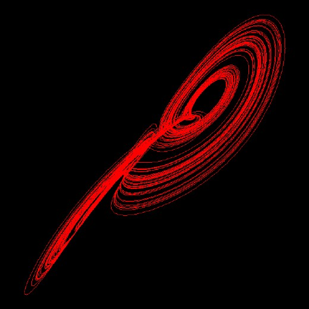 | 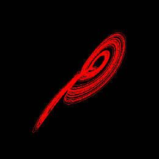 | 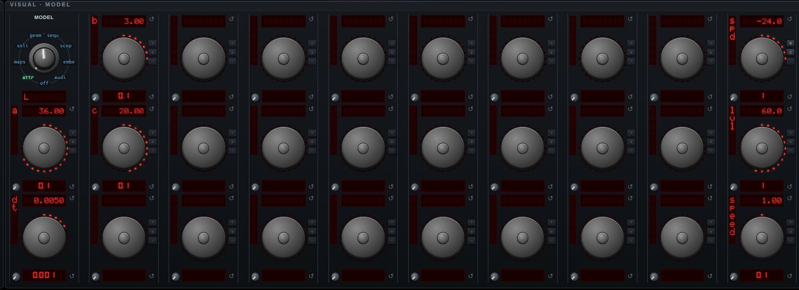 |

Lü Attractor — Discovered by Jinhu Lü and Guanrong Chen (2002), the third member of the Lorenz–Chen–Lü family; it forms a bridge between the Lorenz and Chen systems and produces a two-scroll butterfly.

```
dx/dt = a(y − x)
dy/dt = cy − xz
dz/dt = xy − bz
```

`#lu` · 3-D flow

#### Newton-Leipnik

| Newton-Leipnik | turning | parameters |
| --- | --- | --- |
| 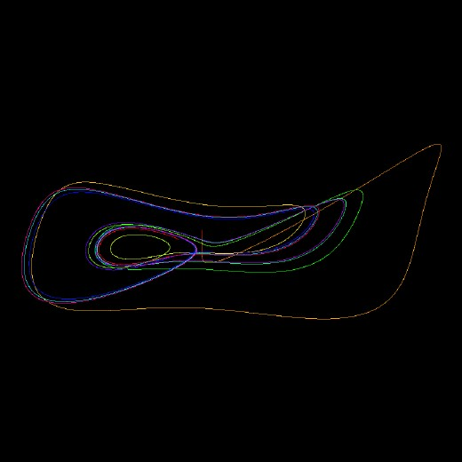 | 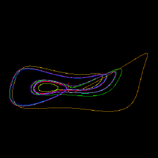 |  |

Newton–Leipnik Attractor — Arises from a rigid-body rotation model with a linear feedback torque; it has two coexisting scroll-shaped attractors.

```
dx/dt = −ax + y + 10yz
dy/dt = −x − 0.4y + 5xz
dz/dt = bz − 5xy
```

`#newtonleipnik` · 3-D flow

#### Arneodo

| Arneodo | turning | parameters |
| --- | --- | --- |
| 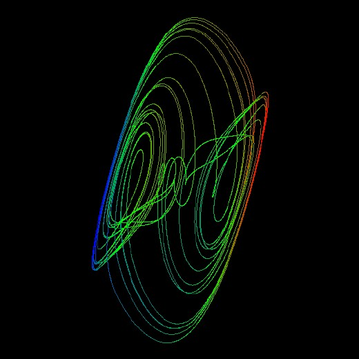 | 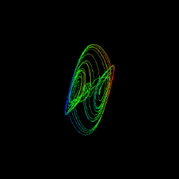 | 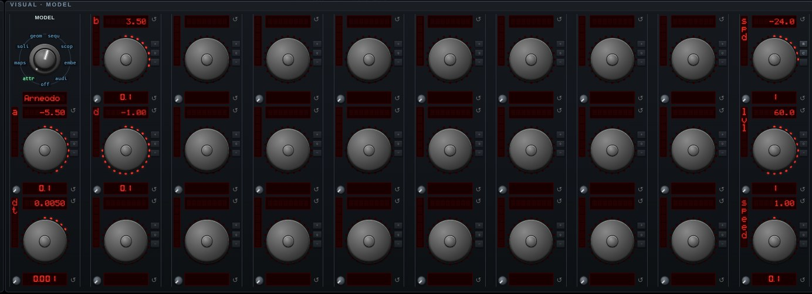 |

Arneodo Attractor — Arneodo, Coullet and Tresser (1981): a third-order jerk equation, x‴ = −ax − bx′ − x″ + dx³, written as three first-order equations. A spiral attractor whose loops fold back on themselves through the cubic term.

```
dx/dt = y
dy/dt = z
dz/dt = −ax − by − z + dx³
```

`#arneodo` · 3-D flow

#### Chen-Lee

| Chen-Lee | turning | parameters |
| --- | --- | --- |
| 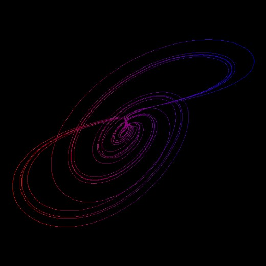 | 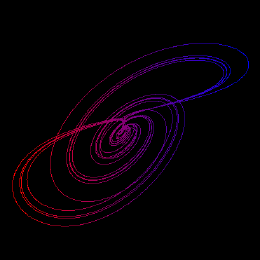 |  |

Chen–Lee Attractor — Chen and Lee (2004): the Euler equations of a rigid body in rotation, with linear feedback added to each axis. A two-wing attractor whose wings stand on the z axis.

```
dx/dt = ax − yz
dy/dt = by + xz
dz/dt = cz + xy/d
```

`#chenlee` · 3-D flow

#### Dequan Li

| Dequan Li | turning | parameters |
| --- | --- | --- |
| 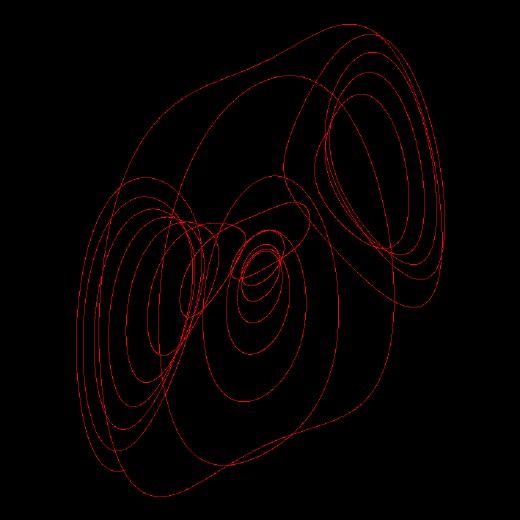 | 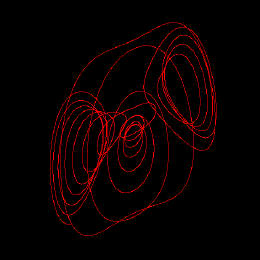 | 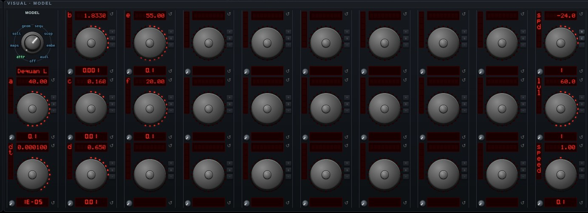 |

Dequan Li Attractor — Li (2008): a three-scroll attractor, the scrolls joined through the z axis. Stiff: its default step is small, and larger steps of dt make the trajectory leave the attractor.

```
dx/dt = a(y − x) + cxz
dy/dt = ex + fy − xz
dz/dt = bz + xy − dx²
```

`#dequanli` · 3-D flow

#### Three-Scroll

| Three-Scroll | turning | parameters |
| --- | --- | --- |
| 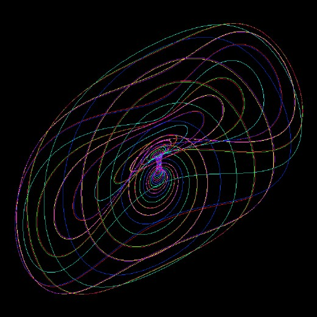 | 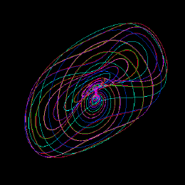 | 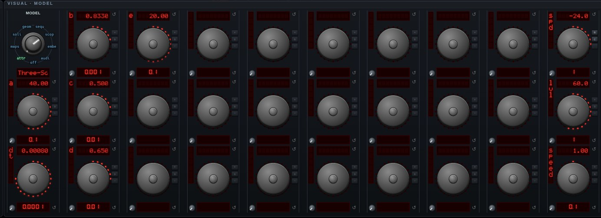 |

Three-Scroll Attractor — the three-scroll unified chaotic system (TSUCS): the Dequan Li system without the x term in dy/dt, which opens its three scrolls wider.

```
dx/dt = a(y − x) + cxz
dy/dt = ey − xz
dz/dt = bz + xy − dx²
```

`#threescroll` · 3-D flow

#### Wang-Sun

| Wang-Sun | turning | parameters |
| --- | --- | --- |
| 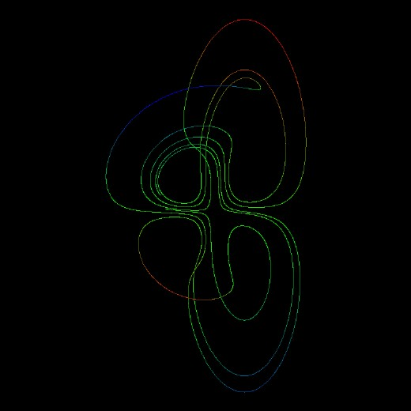 |  |  |

Wang–Sun Attractor — Wang and Sun (2010): a four-wing attractor, the trajectory passing between four lobes arranged around the z axis rather than the usual two.

```
dx/dt = ax + cyz
dy/dt = bx + dy − xz
dz/dt = ez + fxy
```

`#wangsun` · 3-D flow

#### Lorenz Mod 2

| Lorenz Mod 2 | turning | parameters |
| --- | --- | --- |
|  |  |  |

Lorenz Mod 2 Attractor — the second modified Lorenz system: the quadratic terms of the Lorenz equations rearranged so that the two wings fold into a single rotating body.

```
dx/dt = −ax + y² − z² + ac
dy/dt = x(y − bz) + d
dz/dt = −z + x(by + z)
```

`#lorenzmod2` · 3-D flow

#### Simone

| Simone | turning | parameters |
| --- | --- | --- |
|  |  |  |

Simone Attractor — a point drawn toward s·(sin(ay) + cos(bz), sin(az) + cos(bx), sin(ax) + cos(by)): the trigonometric map of the Simone attractor written as a flow, each coordinate driven by the other two. From Shashank Tomar's strange attractors. Chaotic for some (a, b) and periodic for others; b = 2.49 is chaotic.

```
dx/dt = s(sin(ay) + cos(bz)) − x
dy/dt = s(sin(az) + cos(bx)) − y
dz/dt = s(sin(ax) + cos(by)) − z
```

`#simone` · 3-D flow

#### Hyper-Rössler (4D)

| Hyper-Rössler (4D) | turning | parameters |
| --- | --- | --- |
|  |  |  |

Rössler Hyperchaos (1979) — Otto Rössler's 4-dimensional extension of his attractor, with two positive Lyapunov exponents (hyperchaos). A hidden fourth coordinate w feeds back into y; the plot is the (x,y,z) projection.

```
dx/dt = −y − z
dy/dt = x + ay + w
dz/dt = b + xz
dw/dt = −cz + dw
```

`#hyperrossler` · 4-D flow

#### Sprott Morph

| Sprott Morph | turning | parameters |
| --- | --- | --- |
|  |  |  |

Sprott Morph — The faithful version of the glensstuff.com Self-Programming Analog Computer, which stepped itself through the Sprott catalog by re-patching. Every Sprott A–S system is a quadratic 3-D flow — a point in the same 30-dimensional coefficient space Sprott's 1994 computer search ran in — so the machine morphs by sliding linearly between coefficient vectors while ONE trajectory keeps integrating: watch D melt into E. The sys knob parks the patch anywhere in the cycle (fractional = between systems, often chaotic in its own right); the rate knob makes it step itself, in systems per minute; the Console's PATCH readout shows the current wiring. Coefficients are extracted numerically from the catalog's own equations, and a divergence guard reseeds the trajectory when a blend flings it away.

`#sprottmorph` · 3-D flow

#### Sprott A

| Sprott A | turning |
| --- | --- |
|  |  |

Sprott A (Nosé–Hoover oscillator) — the first of J. C. Sprott's 1994 systems and the only conservative one: rather than settling onto a strange attractor it fills a chaotic sea.

```
dx/dt = y
dy/dt = −x + yz
dz/dt = 1 − y²
```

`#sprotta` · 3-D flow

#### Sprott B

| Sprott B | turning |
| --- | --- |
|  |  |

Sprott B — one of J. C. Sprott's simple chaotic flows (1994), realized as an analog circuit at glensstuff.com. Found by systematic search for the algebraically simplest systems that still produce chaos.

Five terms, two of them nonlinear (yz and xy). ∇·F = −1 everywhere, so a cloud of starting points loses volume at one steady rate, by a factor of e every unit of time. The equations are unchanged by (x, y, z) → (−x, −y, z), so the attractor is symmetric under a half turn about the z axis, or has a twin that is its half-turned copy.

```
dx/dt = yz
dy/dt = x − y
dz/dt = 1 − xy
```

`#sprottb` · 3-D flow

#### Sprott C

| Sprott C | turning |
| --- | --- |
|  |  |

Sprott C — one of J. C. Sprott's simple chaotic flows (1994), realized as an analog circuit at glensstuff.com. Found by systematic search for the algebraically simplest systems that still produce chaos.

Five terms, two of them nonlinear (yz and x²). ∇·F = −1 everywhere, so a cloud of starting points loses volume at one steady rate, by a factor of e every unit of time. The equations are unchanged by (x, y, z) → (−x, −y, z), so the attractor is symmetric under a half turn about the z axis, or has a twin that is its half-turned copy.

```
dx/dt = yz
dy/dt = x − y
dz/dt = 1 − x²
```

`#sprottc` · 3-D flow

#### Sprott D

| Sprott D | turning |
| --- | --- |
|  |  |

Sprott D — one of J. C. Sprott's simple chaotic flows (1994), realized as an analog circuit at glensstuff.com. Found by systematic search for the algebraically simplest systems that still produce chaos.

Five terms, two of them nonlinear (y² and xz). ∇·F = x, which changes sign at x = 0: volume grows where x > 0 and shrinks where x < 0, so the flow is dissipative only on average along the attractor.

```
dx/dt = −y
dy/dt = x + z
dz/dt = xz + 3y²
```

`#sprottd` · 3-D flow

#### Sprott E

| Sprott E | turning |
| --- | --- |
|  |  |

Sprott E — one of J. C. Sprott's simple chaotic flows (1994), realized as an analog circuit at glensstuff.com. Found by systematic search for the algebraically simplest systems that still produce chaos.

Five terms, two of them nonlinear (yz and x²). ∇·F = −1 everywhere, so a cloud of starting points loses volume at one steady rate, by a factor of e every unit of time.

```
dx/dt = yz
dy/dt = x² − y
dz/dt = 1 − 4x
```

`#sprotte` · 3-D flow

#### Sprott F

| Sprott F | turning |
| --- | --- |
|  |  |

Sprott F — one of J. C. Sprott's simple chaotic flows (1994), realized as an analog circuit at glensstuff.com. Found by systematic search for the algebraically simplest systems that still produce chaos.

Six terms, one of them nonlinear (x²). ∇·F = −0.5 everywhere, so a cloud of starting points loses volume at one steady rate, by a factor of e every 2 time units.

```
dx/dt = y + z
dy/dt = −x + 0.5y
dz/dt = x² − z
```

`#sprottf` · 3-D flow

#### Sprott G

| Sprott G | turning |
| --- | --- |
|  |  |

Sprott G — one of J. C. Sprott's simple chaotic flows (1994), realized as an analog circuit at glensstuff.com. Found by systematic search for the algebraically simplest systems that still produce chaos.

Six terms, one of them nonlinear (xz). ∇·F = −0.6 everywhere, so a cloud of starting points loses volume at one steady rate, by a factor of e every 1.7 time units.

```
dx/dt = 0.4x + z
dy/dt = xz − y
dz/dt = −x + y
```

`#sprottg` · 3-D flow

#### Sprott H

| Sprott H | turning |
| --- | --- |
|  |  |

Sprott H — one of J. C. Sprott's simple chaotic flows (1994), realized as an analog circuit at glensstuff.com. Found by systematic search for the algebraically simplest systems that still produce chaos.

Six terms, one of them nonlinear (z²). ∇·F = −0.5 everywhere, so a cloud of starting points loses volume at one steady rate, by a factor of e every 2 time units.

```
dx/dt = −y + z²
dy/dt = x + 0.5y
dz/dt = x − z
```

`#sprotth` · 3-D flow

#### Sprott I

| Sprott I | turning |
| --- | --- |
|  |  |

Sprott I — one of J. C. Sprott's simple chaotic flows (1994), realized as an analog circuit at glensstuff.com. Found by systematic search for the algebraically simplest systems that still produce chaos.

Six terms, one of them nonlinear (y²). ∇·F = −1 everywhere, so a cloud of starting points loses volume at one steady rate, by a factor of e every unit of time.

```
dx/dt = −0.2y
dy/dt = x + z
dz/dt = x + y² − z
```

`#sprotti` · 3-D flow

#### Sprott J

| Sprott J | turning |
| --- | --- |
|  |  |

Sprott J — one of J. C. Sprott's simple chaotic flows (1994), realized as an analog circuit at glensstuff.com. Found by systematic search for the algebraically simplest systems that still produce chaos.

Six terms, one of them nonlinear (y²). ∇·F = −2 everywhere, so a cloud of starting points loses volume at one steady rate, by a factor of e every 0.5 time units.

```
dx/dt = 2z
dy/dt = −2y + z
dz/dt = −x + y + y²
```

`#sprottj` · 3-D flow

#### Sprott K

| Sprott K | turning |
| --- | --- |
|  |  |

Sprott K — one of J. C. Sprott's simple chaotic flows (1994), realized as an analog circuit at glensstuff.com. Found by systematic search for the algebraically simplest systems that still produce chaos.

Six terms, one of them nonlinear (xy). ∇·F = y − 0.7, which changes sign at y = 0.7: volume grows where y > 0.7 and shrinks where y < 0.7, so the flow is dissipative only on average along the attractor.

```
dx/dt = xy − z
dy/dt = x − y
dz/dt = x + 0.3z
```

`#sprottk` · 3-D flow

#### Sprott L

| Sprott L | turning |
| --- | --- |
|  |  |

Sprott L — one of J. C. Sprott's simple chaotic flows (1994), realized as an analog circuit at glensstuff.com. Found by systematic search for the algebraically simplest systems that still produce chaos.

Six terms, one of them nonlinear (x²). ∇·F = −1 everywhere, so a cloud of starting points loses volume at one steady rate, by a factor of e every unit of time.

```
dx/dt = y + 3.9z
dy/dt = 0.9x² − y
dz/dt = 1 − x
```

`#sprottl` · 3-D flow

#### Sprott M

| Sprott M | turning |
| --- | --- |
|  |  |

Sprott M — one of J. C. Sprott's simple chaotic flows (1994), realized as an analog circuit at glensstuff.com. Found by systematic search for the algebraically simplest systems that still produce chaos.

Six terms, one of them nonlinear (x²). ∇·F = −1 everywhere, so a cloud of starting points loses volume at one steady rate, by a factor of e every unit of time.

```
dx/dt = −z
dy/dt = −x² − y
dz/dt = 1.7 + 1.7x + y
```

`#sprottm` · 3-D flow

#### Sprott N

| Sprott N | turning |
| --- | --- |
|  |  |

Sprott N — one of J. C. Sprott's simple chaotic flows (1994), realized as an analog circuit at glensstuff.com. Found by systematic search for the algebraically simplest systems that still produce chaos.

Six terms, one of them nonlinear (z²). ∇·F = −2 everywhere, so a cloud of starting points loses volume at one steady rate, by a factor of e every 0.5 time units.

```
dx/dt = −2y
dy/dt = x + z²
dz/dt = 1 + y − 2z
```

`#sprottn` · 3-D flow

#### Sprott O

| Sprott O | turning |
| --- | --- |
|  |  |

Sprott O — one of J. C. Sprott's simple chaotic flows (1994), realized as an analog circuit at glensstuff.com. Found by systematic search for the algebraically simplest systems that still produce chaos.

Six terms, one of them nonlinear (xz). ∇·F = x, which changes sign at x = 0: volume grows where x > 0 and shrinks where x < 0, so the flow is dissipative only on average along the attractor.

```
dx/dt = y
dy/dt = x − z
dz/dt = x + xz + 2.7y
```

`#sprotto` · 3-D flow

#### Sprott P

| Sprott P | turning |
| --- | --- |
|  |  |

Sprott P — one of J. C. Sprott's simple chaotic flows (1994), realized as an analog circuit at glensstuff.com. Found by systematic search for the algebraically simplest systems that still produce chaos.

Six terms, one of them nonlinear (y²). ∇·F = 2y, which changes sign at y = 0: volume grows where y > 0 and shrinks where y < 0, so the flow is dissipative only on average along the attractor.

```
dx/dt = 2.7y + z
dy/dt = −x + y²
dz/dt = x + y
```

`#sprottp` · 3-D flow

#### Sprott Q

| Sprott Q | turning |
| --- | --- |
|  |  |

Sprott Q — one of J. C. Sprott's simple chaotic flows (1994), realized as an analog circuit at glensstuff.com. Found by systematic search for the algebraically simplest systems that still produce chaos.

Six terms, one of them nonlinear (y²). ∇·F = −0.5 everywhere, so a cloud of starting points loses volume at one steady rate, by a factor of e every 2 time units.

```
dx/dt = −z
dy/dt = x − y
dz/dt = 3.1x + y² + 0.5z
```

`#sprottq` · 3-D flow

#### Sprott R

| Sprott R | turning |
| --- | --- |
|  |  |

Sprott R — one of J. C. Sprott's simple chaotic flows (1994), realized as an analog circuit at glensstuff.com. Found by systematic search for the algebraically simplest systems that still produce chaos.

Six terms, one of them nonlinear (xy). ∇·F = −1 everywhere, so a cloud of starting points loses volume at one steady rate, by a factor of e every unit of time.

```
dx/dt = 0.9 − y
dy/dt = 0.4 + z
dz/dt = xy − z
```

`#sprottr` · 3-D flow

#### Sprott S

| Sprott S | turning |
| --- | --- |
|  |  |

Sprott S — one of J. C. Sprott's simple chaotic flows (1994), realized as an analog circuit at glensstuff.com. Found by systematic search for the algebraically simplest systems that still produce chaos.

Six terms, one of them nonlinear (z²). ∇·F = −1 everywhere, so a cloud of starting points loses volume at one steady rate, by a factor of e every unit of time.

```
dx/dt = −x − 4y
dy/dt = x + z²
dz/dt = 1 + x
```

`#sprotts` · 3-D flow

#### Custom equation

| Custom equation | turning | parameters |
| --- | --- | --- |
|  |  |  |

Custom Equations — type your own system. The Equations module takes dx/dt, dy/dt and dz/dt (plus dw/dt for a 4-D system) as text and integrates them with forward Euler, the same way the classic attractors are stepped. The iterate switch reads the same expressions as a discrete MAP instead — x = f(x,y,z) rather than x += dt·f(x,y,z) — which has no dt and no path between iterates, so it draws as a cloud of points the way Henon and Ikeda do.

There is no eval: expressions are tokenized, converted to RPN and interpreted over a small value stack, so nothing but arithmetic can run. Grammar is + − × ÷ ^ with grouping and implicit multiplication (2x, 3(x+1)), the functions sin cos tan asin acos atan exp log ln sqrt abs sign sinh cosh tanh floor, the constants pi e tau, and the variables x y z w t. Any other name becomes a free parameter and is auto-exposed as its own knob.

`#custom` · 4-D flow

### Maps

[Henon](#henon) · [Ikeda](#ikeda) · [Clifford](#clifford) · [Peter de Jong](#peter-de-jong) · [Gumowski-Mira](#gumowski-mira) · [Tinkerbell](#tinkerbell) · [Chirikov Standard Map](#chirikov-standard-map) · [Bifurcation](#bifurcation) · [Poincaré Section](#poincaré-section)

#### Henon

| Henon | turning | parameters |
| --- | --- | --- |
|  |  |  |

Hénon map (M. Hénon, "A two-dimensional mapping with a strange attractor", 1976) — the example that showed a strange attractor needs neither a flow nor three dimensions, only a stretch and a fold. Zoom in anywhere on a filament and it resolves into more filaments: locally a line crossed with a Cantor set. Its Jacobian determinant is −b, so area contracts by exactly b every iterate no matter where you are.

```
x' = 1 − a·x² + y
y' = b·x
```

`#henon` · discrete map

#### Ikeda

| Ikeda | turning | parameters |
| --- | --- | --- |
|  |  |  |

Ikeda map (K. Ikeda, 1979) — light circulating in a nonlinear optical cavity, where each pass rotates the complex field by an amount that depends on its own intensity. That intensity-dependent rotation is the whole mechanism: the more energetic part of the beam turns further, and the attractor's hook is the result.

```
t = 0.4 − 6/(1 + x² + y²)
x' = 1 + u·(x·cos t − y·sin t)
y' = u·(x·sin t + y·cos t)
```

`#ikeda` · discrete map

#### Clifford

| Clifford | turning | parameters |
| --- | --- | --- |
|  |  |  |

Clifford attractor (Clifford Pickover) — a trigonometric map with no physical derivation, kept because of what it draws. Every parameter change reshapes it entirely, which makes the four knobs worth turning slowly.

```
x' = sin(a·y) + c·cos(a·x)
y' = sin(b·x) + d·cos(b·y)
```

`#clifford` · discrete map

#### Peter de Jong

| Peter de Jong | turning | parameters |
| --- | --- | --- |
|  |  |  |

Peter de Jong attractor — the same idea as Clifford's with the terms paired differently, and a different family of figures for it. Four knobs, an enormous space of shapes, and no way to predict which you will get.

```
x' = sin(a·y) − cos(b·x)
y' = sin(c·x) − cos(d·y)
```

`#dejong` · discrete map

#### Gumowski-Mira

| Gumowski-Mira | turning | parameters |
| --- | --- | --- |
|  |  |  |

Gumowski-Mira map (I. Gumowski and C. Mira, CERN, 1980) — written to study how a particle beam drifts turn after turn around an accelerator ring, and it produces organic, almost biological figures that look nothing like their origin. The shared nonlinearity g is applied twice per iterate, to x and then to the NEW x. Unlike the others here it is QUASI-PERIODIC at these settings rather than chaotic: the curves it draws are invariant curves the orbit winds around forever, not a fractal dust. Two orbits started a hair apart drift apart slowly instead of separating exponentially, which is why the figure looks woven rather than sprayed.

```
g(v) = μ·v + 2(1−μ)·v²/(1+v²)
x' = y + a(1 − b·y²)·y + g(x)
y' = −x + g(x')
```

`#mira` · discrete map

#### Tinkerbell

| Tinkerbell | turning | parameters |
| --- | --- | --- |
|  |  |  |

Tinkerbell map — a quadratic map of the plane whose orbit sweeps a curved, wing-like region. Bounded only for a narrow band of parameters; push the knobs and it escapes to infinity, which the renderer catches and reseeds rather than drawing NaNs.

```
x' = x² − y² + a·x + b·y
y' = 2·x·y + c·x + d·y
```

`#tinkerbell` · discrete map

#### Chirikov Standard Map

| Chirikov Standard Map | turning | parameters |
| --- | --- | --- |
|  |  |  |

Chirikov standard map (B. Chirikov, 1979) — the canonical AREA-PRESERVING map, and the one system here with no attractor at all. A kicked rotor: each iterate kicks the momentum by K·sin θ and lets the angle advance. Because area is preserved nothing contracts onto anything, so it is drawn as an ensemble of orbits rather than one — a single orbit would trace its own invariant curve and tell you nothing about the rest. Turn K up and watch the intact curves break into a chaotic sea with islands of stability stranded in it; near K ≈ 0.9716 the last curve spanning the phase space goes, and orbits can wander in momentum without bound.

```
p' = p + K·sin θ
θ' = θ + p'   (both mod 2π)
```

`#standardmap` · discrete map

#### Bifurcation

| Bifurcation | turning | parameters |
| --- | --- | --- |
|  |  |  |

Bifurcation Explorer — the fig-tree diagram, computed live. One parameter of the most recent flow mode sweeps its whole knob range across the x axis; each column integrates the system fresh at that value and plots the local maxima of z. Thin branches are periodic orbits, fan-outs are period-doubling cascades, filled bands are chaos — the route between them is the route to chaos. Pick the swept parameter in the Parameters module; visit an attractor and tune it to change the source system.

`#bifurcation` · parametric

#### Poincaré Section

| parameters |
| --- |
|  |

Poincaré Section — the continuous flow read as a discrete point set. The most recent flow mode is integrated privately and sampled only where it pierces a plane, going one way through it; what is left is the cross-section of the attractor, and the sheets that are invisible in the tangle are the whole picture here.

AXIS and POS place the plane (POS is a fraction of the attractor's own reach along that axis, so 0 is through the middle whatever the system's size); DIR chooses which way through it counts. One way is the default, and it is not a preference: a bounded flow that goes up through a plane has to come back down through it, so keeping both superimposes two different sections and the return map stops being a function.

VIEW picks the picture — PLANE draws the crossings where they physically are, FLAT lays the section out face on in the plane's own coordinates, and MAP is the FIRST-RETURN MAP: each crossing plotted against the next one. That last is where the route to chaos is legible — a periodic orbit is a handful of dots, a period-doubling is that set doubling, and a chaotic attractor is a single-humped curve, which is the logistic map's parabola surfacing inside a differential equation. The dotted 45° line is y = x, where the map's fixed points are.

The crossing point is INTERPOLATED between the two samples that straddle the plane rather than snapped to the nearer of them — snapping smears the section by up to half a step of arc, which on these attractors is the same size as the gap between the sheets it is supposed to show.

The same section is available as an overlay on the live attractor: Trace > Sect.

`#poincare` · parametric

### Solids

[STL File](#stl-file) · [Terminal](#terminal) · [Terminal Animation](#terminal-animation) · [Host Shell](#host-shell) · [Desk](#desk) · [Lattice](#lattice)

#### STL File

| STL File | turning | parameters |
| --- | --- | --- |
|  |  |  |

STL File — Load a stereolithograph (.stl, binary or ASCII) from disk with the Loader module's Load button and it renders as a rotating wireframe. Very large files are decimated to fit the 16-bit index pipeline.

`#stlfile` · geometry

#### Terminal

Terminal — a live terminal, drawn as a model. It is the same texture-on-a-plane path the spectrogram and the recurrence plot use, so it rotates, zooms and takes a gradient like any other model; what is on the texture is [xterm-go](https://github.com/0magnet/xterm-go), a Go port of xterm.js, rendering a real terminal grid with WebGL2. That last part is what makes this possible rather than merely desirable: a terminal drawn as DOM could not be sampled into a texture at all, and rasterizing DOM every frame is not a thing worth doing. xterm-go renders into a canvas, and a canvas is a texture source. Behind it runs [websh](https://github.com/0magnet/websh), a Bash interpreter compiled to wasm over an in-memory filesystem, so this is a session you can work in and not a picture of one: pipes, globs, redirection, `for` loops, all of it rotating with the model. **Double-click** the canvas to type into it and **Esc** to give the keyboard back — a double click because a single one is how you rotate the model, and the two must not be the same gesture. Focusing it silences the app's own key bindings automatically, since Pong, the Keys module and the hovered-knob arrows all already stand aside for a focused textarea, which is what a terminal captures keys on. It can also be the BACKDROP behind another model, the way the spectrogram can.

`#terminal` · geometry

#### Terminal Animation

| parameters |
| --- |
|  |

Terminal Animation — the same terminal-on-a-plane, with a drawing program on it instead of a shell. The catalog is [tuiwasm](https://github.com/0magnet/tuiwasm): twenty-one animations — fire, plasma, a matrix rain, an aquarium, a bonsai growing branch by branch, Langton's ant, falling sand — plus charts, tables and styled text. Pick one from the **animation** selector on this model's panel. The animations draw at half-block resolution: every cell is an upper or lower block glyph carrying its own foreground and background, which is two independently colored pixels per cell and roughly square ones, since a terminal cell is about twice as tall as it is wide. They run at the frame rate — the cells are written straight into xterm-go's buffer rather than encoded as escape sequences and parsed back, which is the difference between sixty frames a second and a wedged tab. Nothing is wired to the keyboard here, unlike the Terminal model: these draw, they do not read, and the animations quit on a keystroke. Like the terminal it can also be the BACKDROP behind another model.

`#termanim` · geometry

#### Host Shell

Host Shell — a real shell on the machine serving this page, drawn as a model. The Terminal model beside it is [websh](https://github.com/0magnet/websh), a Bash interpreter compiled into the wasm over a filesystem that exists only in the browser; this one is a pty on the host, reached through the same agent the desk's host pane uses. It needs the server to have been started with **--shell**, which also forces a loopback bind — the server refuses that flag on a listener the network can reach rather than warning about it. Without the flag the terminal still opens and says so, because an empty rectangle with no explanation is the worse answer. **Double-click** the canvas to type into it and **Esc** to give the keyboard back, exactly as for the Terminal model. It reached the screen before this as a window inside the Desk; as a model it is the shell without the window manager around it.

`#hostterm` · geometry

#### Desk

| parameters |
| --- |
|  |

Desk — a window manager, drawn as a model. The same texture-on-a-plane path the spectrogram, the recurrence plot and the Terminal use, with a whole [desk](https://github.com/0magnet/desk) on it: winbox windows, a [websh](https://github.com/0magnet/websh) shell in each, a file manager, all of them running while you rotate them.

It needed something from desk to be possible at all. A window is more than its pane — its title, buttons and border are DOM, and DOM cannot be sampled into a texture — so texturing the panes alone would give a desk of frameless rectangles. desk's WebGL compositor can now REDRAW the frames instead: each title bar is rasterized with Canvas2D, text and buttons and all, into the same canvas it draws the panes into, and that canvas is a complete picture of the desk.

Nothing types into it while it is a model, and that is the arrangement rather than an omission for the MOUSE: a click on a rotated quad would have to be cast through it to a texture coordinate and synthesized back into a DOM event at a place nothing is. What you get instead are two gestures. **Ctrl-drag** reaches the desk, so ctrl-dragging a title bar moves a window while an ordinary drag still turns the model; the **Pass-thru** switch in the Desk module swaps the two if you would rather drag windows directly and hold ctrl to turn. And the KEYBOARD does reach it: **double-click** the canvas to type into the focused window and **Esc** to give the keyboard back, the same pair the Terminal and Host Shell models use.

Aiming is the honest limitation — you are pointing at a projection, so a title bar is not where the pointer says it is. The **Desk** switch (Console → Window) puts the same windows on the page as ordinary DOM, which is the one to use for arranging them; rearrange there, then come back here to look at it. Flatten to work, rotate to admire. It can also be the BACKDROP behind another model, the way the spectrogram and the terminal can.

`#desk` · geometry

#### Lattice

| parameters |
| --- |
|  |

Lattice — a solid drawn in depth by terminals. [lattice](https://github.com/0magnet/lattice) is an ordinary terminal program that draws one cross-section of a turning solid in characters. Here 3N copies of it run, each in a terminal of its own, and the terminals are stacked as transparent sheets: N across each axis, three families each perpendicular to the other two. Whichever way the stack is turned, one family faces you and the other two are edge on, so the solid has depth from every side, and each family is brightened as it comes face on and dimmed as it goes edge on, so the solid stays as bright as it turns.

The terminals are real: each is xterm-go's emulator, and each program writes into it the same escape sequences it writes into any terminal. Only the drawing is the rack's, every character on a clear sheet, because a cell at the default background is clear, as it is in a translucent terminal. Seen from behind, a sheet reads mirrored, as glass does.

The solid is turned by the time of day, not by the rack: lattice -axis z -slice 6 in a real terminal of 24 columns by 12 rows beside the page draws the same slice at the same moment, because a terminal's size is the resolution — zoom it out and it draws a finer one.

The Lattice module (in the View bay) is how the sheets are drawn: their rows, style, look, opacity, which families there are and what the view turns. Its L draws any other model the same way, from that model's trail, mesh or dots.

`#lattice` · geometry

### Geometry

[Polyhedron](#polyhedron) · [Nested Cube](#nested-cube) · [Globe](#globe) · [Torus](#torus) · [Magnetosphere](#magnetosphere)

#### Polyhedron

| Polyhedron | turning |
| --- | --- |
|  |  |

Polyhedron — The regular solids and tilings, by Schläfli symbol {p,q}: faces of p sides, q of them at every corner. {3,3} is the tetrahedron, {4,3} the cube, {3,4} the octahedron, {5,3} the dodecahedron, {3,5} the icosahedron; where the corners make a full turn the faces tile the plane, and past it they tile the hyperbolic plane, drawn in Poincaré's disk. On a solid, morph cuts the corners through the rectified solid to the dual, op applies a Conway operator and kis raises a pyramid on every face.

`#polyhedron` · geometry

#### Nested Cube

| Nested Cube | turning |
| --- | --- |
|  |  |

Nested Cube — A cube within a cube, connected at the vertices, illustrating the relationship between inner and outer geometric structures.

`#nestedcube` · geometry

#### Globe

| Globe | turning | parameters |
| --- | --- | --- |
|  |  |  |

Globe — A wireframe sphere showing lines of latitude and longitude, similar to the graticule on a geographic globe. Latitude lines are horizontal circles parallel to the equator, longitude lines are great circles passing through the poles.

`#globe` · geometry

#### Torus

| Torus | turning | parameters |
| --- | --- | --- |
|  |  |  |

Torus — A doughnut-shaped surface of revolution generated by revolving a circle (radius r) around an axis at distance R from the center of the circle.

`#torus` · geometry

#### Magnetosphere

| Magnetosphere | turning |
| --- | --- |
|  |  |

Magnetosphere — A visualization of magnetic field lines surrounding a dipole, similar to Earth's magnetosphere that shields the planet from solar wind.

`#magnetosphere` · geometry

### Sequences

[Turtle Path](#turtle-path)

#### Turtle Path

| Turtle Path | turning | in 2-D (mod 30, closed) | parameters |
| --- | --- | --- | --- |
|  |  |  |  |

Turtle Path — Reduce an integer sequence modulo m and the remainders repeat; the length of the repeat is the Pisano period. Read each term as an instruction — odd turns left and steps forward, even turns right and steps forward, zero does neither — and the walk draws a figure.

In three dimensions the parity of the NEXT term decides whether the turn is a yaw or a pitch, which is not arbitrary: the pair (F_n, F_n+1) mod m is the state of the recurrence, and the Pisano period is the period of that pair. One pass decides the rest, without walking further: the figure either closes, drifts in a straight line, or screws away along an axis.

The walk never finishes and is never restarted — the turtle is held mid-stride and extended at the Speed knob's rate, forever, and TRAIL is how much stays behind it (whole, long, short, comet) as the oldest scrolls off the far end.

CAM is where it is watched from. Only follow cares where the head is; every other setting places the figure by its DRIFT, the one direction it is going overall, known exactly from one pass of the period rather than guessed at from the last few frames — and for a screw it centers on the axis the classification locates, so the figure turns on the spot instead of swinging around it. fit then only decides how big it is drawn, lock holds that size too, and auto fits a closed figure and locks one that drifts.

TINT is what a color means — step, pass, visits, heading, turn, term, age — and set COLORS SRC to trl to see it, or leave it on X/Y/Z to read position instead (a flat DIM 2 figure has no Z to follow).

MUL multiplies the Fibonacci sequence, CAP limits the terms read for sequences that may not repeat, CYCLE steps to the next modulus every so many seconds, and MOD 0 draws the sequence unreduced.

PHYS gives the figure weight: it becomes a rigid body in the plane of the screen — three degrees of freedom, the figure's own shape as its mass — inside a solid box the size of the frame, where GRAV (either way up), FRIC, BOUNCE and SPIN say how it behaves. Press on the figure and you can pick it up and throw it; press beside it and you are turning the view as usual. The walk keeps extruding while it lies there, new points arriving at the head and old ones dropping off the tail, so the figure slides through its own body and marches. PHYS off hands the placing back to CAM.

`#turtle` · parametric

### Scope

[Lissajous](#lissajous) · [Graphic Artist](#graphic-artist) · [Scope Pong](#scope-pong) · [Fourier Text](#fourier-text) · [Scope Clock](#scope-clock) · [Bouncing Ball](#bouncing-ball) · [XY Scope](#xy-scope)

#### Lissajous

| Lissajous | turning | parameters |
| --- | --- | --- |
|  |  |  |

Lissajous Curve — Named after Jules Antoine Lissajous (1822–1880), these are parametric curves formed by combining sinusoidal motions along each axis. Not a chaotic system — the curves are periodic and their shape depends on the frequency ratios and phase relationships between the three oscillations.

```
x(t) = sin(at)
y(t) = sin(bt)
z(t) = sin(ct)
```

`#lissajou` · parametric

#### Graphic Artist

| Graphic Artist | turning | parameters |
| --- | --- | --- |
|  |  |  |

Graphic Artist — a digital re-creation of Mitchell Waite's "Oscilloscope Graphic Artist" (Popular Electronics, November 1975), which drove a scope's X/Y inputs with harmonically related signals to draw 3-D-looking wireframes. Four relaxation oscillators A/B/C/D, each square or triangle: A is the fixed master and B/C/D lock to it at integer harmonics — the sync the original circuit was meant to enforce, and which a wiring error on real builds defeated, leaving them drawing an unstable blur. Carrier C is split ±45° and the B envelope modulates each phase; the two perpendicular components are what create the volume illusion on a flat scope, and here that component is lifted onto a real Z so the figure genuinely has depth.

```
VERT = levelA·A + levelB·(B · C₊₄₅)
HORIZ = levelD·D + levelB·(B · C₋₄₅)
```

`#graphicartist` · parametric

#### Scope Pong

| Scope Pong | turning | parameters |
| --- | --- | --- |
|  |  |  |

Scope Pong — An homage to the glensstuff.com analog Oscilloscope Pong: the whole game is one multiplexed beam tour driving the X/Y inputs, so the court, net, score ticks, paddles and ball share a single stroke — the faint diagonal beams are the retrace an unblanked scope really shows.

W / S move the left paddle, ↑ / ↓ the right; a side left alone for ~10 s returns to the machine player (it boots as a self-playing demo). First to 9 resets the match. Knobs: ball speed, paddle size, machine skill.

`#pong` · parametric

#### Fourier Text

| Fourier Text | turning | parameters |
| --- | --- | --- |
|  |  |  |

Fourier Text — An homage to the glensstuff.com Fourier Synthesis Character Generator, which built alphanumerics on a scope from summed harmonics. The banner's whole beam tour (strokes and retrace jumps alike) is one complex periodic signal x(t)+i·y(t); what's drawn is its reconstruction from only the first N harmonics — real harmonic synthesis, not a blur. One harmonic is an ellipse, so at low N the letters melt into loops; raise the harm knob and overtones sharpen them into legibility. Type the banner in the Console's TEXT field; Model Out plays the actual harmonic stack.

`#scopetext` · parametric

#### Scope Clock

Scope Clock — the time, drawn the way a scope draws anything: as ONE beam tour. The face, the twelve ticks and the three hands are a single path walked in order, because an X/Y display has one beam and no way to lift it — so the jumps between the end of one stroke and the start of the next are drawn too, and show as the faint diagonals an unblanked scope really shows. Scope Pong and the Fourier banner are built the same way; this is the same instrument told the time.

The beam is spaced evenly along the whole path rather than given a fixed number of points per stroke: the face is a full circle and a tick is a few hundredths of one, so per-stroke spacing would put most of the beam on the ticks and leave the circle dotted. Even spacing is also what a real scope does, since the beam moves at a rate rather than at a number of samples.

The hands are fractional throughout — the hour hand creeps with the minutes, the minute hand with the seconds — because a clock whose hands jump looks stopped in between. TRAIL and Persist apply as they do to any trace, so a long trail smears the second hand into a comet.

`#scopeclock` · parametric

#### Bouncing Ball

| Bouncing Ball | turning | parameters |
| --- | --- | --- |
|  |  |  |

Bouncing Ball — The classic analog-computer demo (Telefunken shipped it to sell integrators): two integrator chains under constant gravity, a comparator that flips the vertical velocity at the floor with a restitution loss, and wall reflections for the drift. The scope draws the familiar train of shrinking parabolic arcs; when the bounces decay away the machine re-kicks the ball, as the unattended trade-show loop did. Floor hits blip at a pitch set by impact speed (once audio is unlocked by any interaction). Knobs: gravity, restitution, drift. Try Persist to paint the full arc family.

```
y'' = −g, bounce: v ← −e·v at the floor
```

`#bounceball` · parametric

#### XY Scope

| XY Scope | turning | parameters |
| --- | --- | --- |
|  |  |  |

X/Y Scope — the classic two-channel oscilloscope figure, drawing the live audio's (left, right) sample pairs as a line strip. This is the goniometer, or stereo vectorscope, that sits on a mastering desk: correlated channels lie on a diagonal, anti-correlated on the other, and a phase difference opens the diagonal into an ellipse — which is how the display doubles as a stereo phase meter and a mono compatibility check, since what lies along the anti-correlated diagonal is exactly what disappears when the mix is summed to mono. The deflection is squared against the shorter side of the window, so the mono diagonal reads at 45° and a quarter-cycle phase difference draws a circle — not an ellipse the window's shape put there. An angle that cannot be trusted is the one thing a phase display may not have. A mono source is plotted against a lagged copy of itself, since a raw mono signal would otherwise be a featureless diagonal; the Stereo Embedding next door is the same figure with a third axis, and it does not fake a channel that is not there.

AXES turns the display 45° into mid/side — M=(L+R)/2 and S=(L−R)/2, the orientation broadcast goniometers ship in, where center content lies along one axis and difference content along the other, so width is an extent rather than the eccentricity of a tilted ellipse.

GAIN is the deflection; WIN the time base in milliseconds, short for the instantaneous phase relationship and long for the width of a whole mix; GLOW the afterglow, which is the control a hardware vectorscope is actually used through — at zero the frame is cleared as it always was, above it the trace decays instead, so a transient leaves something to read. LAG is how far a mono source is delayed against itself and SMTH how hard the beam is slew-limited between samples.

CORR is the correlation meter: +1.00 means the channels are identical and the figure is the diagonal line, 0 means unrelated and a round cloud, −1.00 means one is the other's polarity inverted — which is exactly the content that disappears when the mix is summed to mono, and the reason this display is a mono-compatibility check. It reads L against R whatever AXES is set to, because it is a property of the channels rather than of the way they are drawn.

`#xy` · audio

### Embeddings

[Takens Embedding](#takens-embedding) · [Stereo Embedding](#stereo-embedding) · [Polar Embedding](#polar-embedding)

#### Takens Embedding

| Takens Embedding | turning | parameters |
| --- | --- | --- |
|  |  |  |

Takens Delay Embedding — attractor reconstruction from a single signal (F. Takens, "Detecting strange attractors in turbulence", 1981). Each trail point is the delay vector (s(t), s(t−τ), s(t−2τ)) of the live audio: a pure tone draws a closed loop, music and speech trace the geometry of whatever produced them.

τ is the embedding delay, counted in samples at a fixed 48 kHz reference so that one knob position is one DURATION — the same delay whether the sound is arriving from a 48 kHz microphone or a 24 kHz server feed, which is what it was not when the number was read as raw samples of whatever happened to be playing. The default of 72 is 1.5 ms; the MEAS readout says what the current setting is in milliseconds.

MEAS measures τ rather than guessing it: the first minimum of the signal's average mutual information (Fraser & Swinney 1986), reported beside the false-nearest-neighbor embedding dimension m (Kennel et al. 1992). It also runs BY ITSELF, once, as soon as the mode has enough audio to measure — and again if the source is swapped, because τ is a property of what is playing. Once is the whole of it: nothing here re-tunes itself per frame, because a knob that moves with the music makes the figure move with it. Press the button to measure again, or turn the knob and it stays where you put it. An m above 3 means the trail you are looking at is a projection of a higher-dimensional reconstruction.

SRC picks which signal of the live pair is embedded. Takens' theorem takes ONE observable and this is the choice of which: the mix, either channel on its own, mid, or SIDE — what the two channels do not have in common, which on a real mix is the reverb and the room rather than the instruments, and which reconstructs a different manifold from the same recording.

WIN is how much time the figure spans, in milliseconds — short is live and legible, long draws a denser tangle that turns over more slowly; GAIN sets how large a full-scale sample draws. The scale is fixed — nothing auto-ranges, so quiet passages draw small and loud ones large, and the view never moves under you; the camera is fitted once to what full scale can reach, so peaks stay on screen.

SMTH is the beam smoothing between samples, and it is the trade between how much WINDOW is on screen and how smooth the line is, since both come out of one vertex budget: at 1 the figure is raw chords through four times as many samples, which is what to use to see a long window; at 16 it is a glass-smooth beam through a short one. A straight line from one delay vector to the next is a chord, and chords are the hard corners you can see — an artifact of the drawing, not something in the signal. The same knob serves the stereo and polar embeddings.

Audio comes from the active source — websocket stream, microphone, or the signal generators.

`#takens` · parametric

#### Stereo Embedding

| parameters |
| --- |
|  |

Stereo Embedding — the Takens trail built from the two channels instead of one channel's past. Takens' theorem manufactures the missing axes out of a signal's own history because there is only one signal; a stereo source has already measured two, so this mode plots them against each other and what you see is the real relationship between the channels — phase, polarity, correlation, width — rather than a reconstruction. Looked at head-on it is the goniometer (vectorscope) of a mastering desk, which is the XY Scope's figure; the third axis is what a scope with two deflection plates cannot give you.

AXES picks the assignment. L,R,L(t−τ) is the goniometer with a delay coordinate for depth: a tone that draws one ellipse edge-on unrolls into a helix, and τ still means what it means in the Takens mode. L,R,time sweeps the figure along a ribbon so successive cycles stack instead of overwriting — the only way to see a slow phase drift, which on a flat display just wobbles. The mid/side positions rotate the basis 45°: M=(L+R)/2 and S=(L−R)/2, so center content lies along one axis and difference content along the other and width is an extent rather than a tilt. τ is inert on the two time positions.

CORR is the correlation meter: +1.00 means the channels are identical and the figure is a diagonal line, 0 means they are unrelated and it is a round cloud, −1.00 means one is the other inverted (and the difference vanishes if the mix is summed to mono). A mono source reads "mono" and draws the diagonal, which is the correct picture of a signal with no stereo information in it — nothing here fakes a second channel out of a delayed copy of the first, because that delayed copy is exactly what this mode exists to stop pretending is a channel. The mid/side positions are the ones worth turning to then: S is zero and what is left is an honest two-coordinate delay embedding.

ALGN is an inter-channel DELAY, ±2 ms, and it is the fault a goniometer gets reached for: a spaced pair of microphones, a mis-clocked converter, a plugin reporting its latency wrong. An offset draws as a figure that opens into an ellipse and rotates as the frequency moves; dial the knob until the figure collapses back onto the diagonal and it reads how far apart the channels were. WIDE scales side against mid — the width control of a mid/side processor, applied to the drawing rather than to the audio, so it answers what widening would do and what would collapse if the result were summed to mono. Neither moves CORR, which goes on reading the source as it actually is.

WIN is how much time the figure spans, in milliseconds — a phase display is read over a few tens of them, past a couple of hundred it is a filled blob; GAIN sets how large a full-scale sample draws, and as in the Takens mode the scale is fixed and nothing auto-ranges.

Audio comes from the active source — the microphone, the signal generators, or a server feed. The feed asks the capture for the source as it was recorded, over the WebSocket and over WebTransport alike, so a stereo sink gives real stereo either way; a server or a device with only one channel to give reads "mono".

`#stereo` · parametric

#### Polar Embedding

| parameters |
| --- |
|  |

Polar Embedding — the Takens delay vector drawn in a sphere instead of a cube. The Takens mode plots (s(t), s(t−τ), s(t−2τ)) coordinate by coordinate, and each coordinate is one sample bounded to ±1 and multiplied by GAIN, so the reachable set is a cube: loud passages pile up against its faces and hardest of all against its corners, where all three coordinates peak together. That box is an artifact of writing the vector down in coordinates; nothing in the sound knows about the axes.

Here the vector is split into a direction and a length, the direction is kept exactly as it is, and only the length is passed through a curve that cannot exceed 1 — so the figure is bounded by a sphere, which looks the same from every angle, and no rotation finds an edge that is really the arithmetic showing through. The angles between successive delay vectors are untouched, which matters: those angles are the reconstructed geometry Takens' theorem is about, and a map that bent them would be drawing a different manifold.

MAP picks the curve. tanh is the soft clipper: near-linear when it is quiet, asymptotic to the surface when it is loud. Algebraic reaches the same surface more slowly, so the mid-range keeps more of its dynamics. Direction only throws the loudness away completely and puts every point on the surface — what is left is the angular motion the amplitude was hiding, so a figure that merely swelled and shrank before now moves. DRIVE is how hard the signal is pushed into the curve, and it does nothing on the direction-only position, where there is no length left to compress.

SRC picks which signal of the live pair is embedded, as in the Takens mode. τ and WIN mean exactly what they mean in the Takens mode, and the scale is fixed there too — nothing auto-ranges, so quiet draws small and loud draws large. The camera is fitted once to the sphere, which is the whole of what a bounded radius can reach, so peaks stay on screen without the room the cube's corner needed.

Audio comes from the active source — the microphone, a server feed, or the signal generators.

`#polar` · parametric

### Audio

[Spectrogram](#spectrogram) · [FVF Wobbulator](#fvf-wobbulator) · [Recurrence Plot](#recurrence-plot) · [RTA — Octave Bands](#rta--octave-bands) · [Transfer Function](#transfer-function) · [Waterfall — Spectral Decay](#waterfall--spectral-decay)

#### Spectrogram

| Spectrogram | turning |
| --- | --- |
|  |  |

Spectrogram — a scrolling short-time Fourier transform of the live audio: frequency up the plane, time scrolling right to left, magnitude as color. It is a display inspired by Vanya Sergeev's audioprism, written in Go (github.com/0magnet/audioprism-go) and drawn here as a texture on a plane in the same 3-D pipeline as every other model, so it rotates and zooms like one — and the same texture can be painted onto other geometry with the skin switch. The Spectrogram module exposes the whole chain: transform size, overlap, window function, magnitude scale and limits, and color scheme.

`#spectrogram` · audio

#### FVF Wobbulator

| FVF Wobbulator | turning | parameters |
| --- | --- | --- |
|  |  |  |

FVF — Harmonic Wobbulator. A software analog of the Frequency→Voltage→Frequency converter with balanced modulator designed at bunkerofdoom.com (hardware built 1984). The live audio's pitch is tracked, scaled/offset into a new carrier frequency, and ring- or AM-modulated back by the original signal — the metallic, glitchy 'very strange' timbre. Shown here as the processed spectrogram.

`#fvf` · audio

#### Recurrence Plot

| Recurrence Plot | turning | parameters |
| --- | --- | --- |
|  |  |  |

Recurrence Plot — the picture of when a signal returns to where it has already been (J.-P. Eckmann, S. O. Kamphorst and D. Ruelle, "Recurrence Plots of Dynamical Systems", 1987). Time runs along both axes, and the cell (i, j) is lit when the two samples are within ε of each other, so the main diagonal is always lit and everything else says how the signal repeats. A steady tone draws unbroken diagonals spaced by its period; a chaotic or noisy source breaks them into short segments; a held sound is a solid block, and the instant the source changes is an edge running across the square.

SRC picks what is being plotted: audio is the raw samples, embed is the Takens delay vector (s, s−τ, … s−(m−1)τ) of that same audio — the reconstructed phase space a recurrence plot is properly defined on, which removes the anti-diagonals a scalar signal shows because sin t equals sin(T/2 − t) — and traj is the most recent attractor's own trajectory, the way the Bifurcation explorer picks its system. τ is the Takens mode's own τ knob, so its MEAS button measures the delay for this plot too, and m is the embedding dimension.

WIN is how much history the square covers: milliseconds for the audio sources, tenths of that in the system's own time units for a trajectory. ε is the threshold as a fraction of the source's scale — full scale for audio, the attractor's own diameter for a trajectory, which is what makes one default readable across systems that differ in width by fifty times. It is never taken from the current level, deliberately: a threshold that follows the music makes the plot's density pulse with it instead of describing it.

RQA reads the picture back as three numbers — RR, the percentage lit and the number to turn ε by; DET, the share of that lying on diagonals, which is what separates a system from noise; and LAM, the share on verticals, which is states it sat in rather than passed through. Drawn as a texture on a square plane in the same 3-D pipeline as every other model.

`#recurrence` · audio

#### RTA — Octave Bands

| parameters |
| --- |
|  |

RTA — Octave Bands. The real-time analyzer a room is measured with: the spectrum split into fractional-octave bands and shown as a bar per band. A spectrogram shows every bin, which is right for watching sound move and wrong for asking what a room is doing to it — linearly spaced bins put nine-tenths of the picture above 2 kHz and squeeze the bass into a few pixels. Bands of equal RATIO drawn at equal widths is a logarithmic frequency axis, which is how hearing is organized and how every acoustics standard reports.

BAND picks the width: 1/1 is a hi-fi graphic equalizer's ten, 1/3 is what room measurement and ISO use, and the two finer settings find a single narrow resonance — a 1/12-octave band is about 6% wide, roughly the ear's own resolution in the midrange. The centers are the standard ones (ISO 266 / ANSI S1.11, the base-ten series), so a reading here is comparable with anybody else's.

FEED IT PINK NOISE from a generator's pink wave: fractional-octave bands get wider in hertz as they go up, so equal power per octave is what reads FLAT — a flat display on pink noise is the definition of a flat system, and it is the convention room measurement is done in. White noise rises 3 dB per octave on the same display, which is the difference between the two and the reason pink is the one used.

TOP and RNGE place the scale in dBFS; AVG is the meter's averaging, quick to rise and slow to fall as every level meter is; HOLD is the peak-hold decay in dB per second, which is what makes the display readable on music rather than only on noise — music excites part of the band at a time and the held peaks are the envelope that accumulates into the answer. SRC picks the channel.

`#rta` · audio

#### Transfer Function

| parameters |
| --- |
|  |

Transfer Function — what the thing between two channels did to the sound. Every other measurement here asks about ONE signal; this one asks about the RELATIONSHIP between two, which is the question a system is actually tuned by. Send a signal into a loudspeaker, a room, a filter or a cable, capture what comes back, and read what happened in between. That is what a system-tuning rig does, and chaosrack already carries two channels end to end.

MAGNITUDE is the frequency response in dB — flat is a system that changed nothing. PHASE is how far the output lags the input; a pure DELAY is a phase that falls linearly with frequency, and the slope IS the delay, which is what the DLY readout fits and what gets dialed into a delay line to line a speaker up. COHERENCE is the number that says whether to believe the other two: 1 means the output is fully explained by the input, and noise, a second source, a nonlinearity or a system that moved during the measurement all drive it down. A dip in the magnitude with the coherence still high is the system; the same dip with the coherence collapsed is the measurement giving up, and the curves are drawn together so the two can be told apart.

AVERAGING IS NOT OPTIONAL. From a single window coherence is exactly 1 at every frequency — for any two signals whatever, including two unrelated noises — so a display built on one window is a row of perfect scores that means nothing. AVG sets how many windows are folded in before the result is shown, and the curves are drawn only where the coherence clears COH and the stimulus actually reached the band.

REF says which channel is the reference, BAND how finely the bands are smoothed, RNGE the magnitude scale, SHOW which curves are drawn. Feed it pink noise or the log sweep from a generator (its pink and swp waves).

`#xfer` · audio

#### Waterfall — Spectral Decay

| parameters |
| --- |
|  |

Waterfall — Cumulative Spectral Decay. The measurement a loudspeaker is characterized by, and the one display here that could only exist in this app: every other analyzer draws its own flat panel and this is a genuine 3-D surface, so it rides the same pipeline the attractors do and drags, rotates, zooms and takes the gradient like any other model. Frequency runs left to right, logarithmically, because hearing is organized in ratios; level runs up; and TIME runs into the screen. Each line is the spectrum of what is left of the impulse response from a moment onwards, so a flat loudspeaker's surface falls away evenly and a RESONANCE is a ridge running back into the screen at one frequency. That is what this is for: a frequency response cannot tell a resonance from a broad lift, because they are identical in magnitude and nothing alike in time.

Feed it a generator's log sweep (its swp wave), with the sweep in one channel as the reference and what came back in the other. The impulse response is recovered by deconvolution and the surface rebuilt each time a sweep pass completes — so unlike every other audio mode the picture HOLDS STILL between passes, which is what makes it something to rotate and look at rather than something to freeze first.

LINE is how many slices the surface has and STEP how far apart they are in milliseconds, so the two are how deep it reaches in TIME: sixteen at 5 ms is the 80 ms a loudspeaker's resonances live in, thirty-two at 40 ms the 1.3 seconds a bar of music takes. FFT is the transform each slice is taken through, and it is a genuine trade — 1k resolves time best and the bass worst, 8k the other way, and a window longer than STEP means consecutive slices see the same audio. TOP and RNGE place the level scale in dBFS as they do on the RTA. DPTH is how far back the surface reaches on screen, which is geometry rather than time. CHAN is the channel the live surface analyses; REF is which channel the decay surface calls the reference, because that one needs both. LINE, STEP and FFT follow the SRC switch to what each surface wants, and stop following once you turn one.

Turn the Colors SOURCE ring to Y: it colors by LEVEL across exactly the decibels TOP and RNGE show, which is how every published CSD plot is colored. Z and trail color by age, X repeats the frequency axis, and AUDIO is one flat tint here.

A sweep takes four seconds to cross the band, so the measurement needs a whole pass: a third of one is 20 Hz to 200 Hz and recovers an impulse five milliseconds wide.

SRC PICKS WHICH SURFACE. DCAY is the decay above, which is a measurement and needs the sweep. LIVE is the other thing the word waterfall means: successive spectra of whatever is playing, stacked into the screen as they age, so the depth axis stops being time-since-the-impulse and becomes time-ago. Live is the one for music — a note is a ridge that rises at the front and travels back as it decays — and decay is the one for a measurement rig.

RT60 is the room's reverberation time from the same impulse, by Schroeder backward integration as T20 between -5 and -25 dB: the one number the surface is far too shallow to show. Blank on the live surface and blank through a wire, neither of which has a decay to measure.

`#waterfall` · parametric

<!-- END MODELS -->

## Which control does what, on which model

Every knob on the rack is always there, because the rack is a fixed panel and a
control that comes and goes is a control nobody learns. The cost is that some of
them do nothing on some models and the panel does not say so. This is the map.

### The global controls

| Control | What it sets | Where it does nothing |
|---|---|---|
| **Speed** (View) | The integration rate: sub-steps per frame at ×1 and above, a dt multiplier below it | Everything that is not integrated — the maps, all four audio-driven models (XY Scope, Takens, Stereo, Polar), Spectrogram, FVF, Recurrence, Bifurcation, Scope Clock, the polyhedra and the solids |
| **Trail** (Colors) | The **vertex budget**: how many points a model may draw into. On an integrated model that is also a length; on an audio embedding it is a resolution (below) | Hidden on the modes that are a texture rather than a trail — Spectrogram, XY Scope, FVF, Recurrence |
| **Persist** (Trace) | Stops the color buffer being cleared, so successive frames pile up | Forced off while a backdrop visualizer is painting, and while the Fore knob is splitting the draw across two canvases |
| **Points** (Trace) | Draws the trail as separated points rather than a joined line | The texture-plane modes |
| **Line** (Display) | `gl.lineWidth`, which most browsers and drivers cap at 1 — so usually nothing, anywhere | — |
| **Phosphor** (Style) | Trace color plus per-channel afterglow; on an integrated model, also a short advancing beam instead of the whole curve | The afterglow needs a frame that is not cleared, so the audio modes (Spectrogram, FVF, Recurrence) take the color and not the glow — the XY Scope has its own **glow** knob instead. The beam is skipped on the three audio embeddings, where the budget is a resolution and shortening it would decimate the window rather than the figure |
| **src** (Colors) | Which quantity the gradient follows: an axis, trail age, or the sound | `aud` needs an audio source. Where the trail is a time axis it paints the spectrum ALONG the figure; everywhere else it tints the whole figure with one feature |
| **Zoom / X / Y** (Position) | The camera | Fixed face-on on the texture-plane modes |

**Trail is not a duration on the audio embeddings.** On an integrated model it is
both — more points is more trajectory. On Takens, Stereo and Polar the span comes
from **WIN**, and Trail only decides how finely that span is sampled. A long WIN
against a small Trail decimates, and the trace is then spline-smoothed through
samples further apart than the signal's own detail.

### The audio-driven models

**XY Scope**, **Takens Embedding**, **Stereo Embedding** and **Polar Embedding**
all read the live audio source, and none of them integrate anything — so **Speed
is inert on all four**.

The XY Scope's deflection is squared against the shorter side of the canvas, so
a correlated pair reads at 45° and a quarter-cycle phase difference draws a
circle whatever shape the window is. Its own grid:

| | |
|---|---|
| **axes** | L/R, or mid/side — the 45° rotation broadcast goniometers ship in, where width is an extent along one axis rather than the eccentricity of a tilted ellipse |
| **gain** | deflection |
| **win** | time base, ms — short for the instantaneous phase relationship, long for the width of a whole mix |
| **glow** | afterglow. At zero the frame is cleared as it always was; above it the trace decays instead, which is the control a hardware vectorscope is actually used through |
| **lag** | how far a mono source is delayed against itself, ms |
| **smth** | Catmull-Rom steps per sample — how hard the beam is slew-limited |
| **corr** | correlation meter, −1…+1, measured on L against R whatever **axes** is set to |

The other three share a grid:

| | Takens | Stereo | Polar |
|---|---|---|---|
| **src** | which signal of the live pair is embedded: mix, left, right, mid or **side** — what the channels do *not* share, which on a real mix is the room rather than the instruments | — | the same |
| **τ** | delay, in samples at a 48 kHz reference (so: a duration) | the same, on the two delay positions only | the same |
| **win** | span of the figure, ms | span, ms (capped at 250 — the snapshot cannot outrun the source's ring) | span, ms |
| **gain** | world units per full-scale sample | the same | the sphere's radius |
| **axes** | — | which signal each of x, y, z carries | — |
| **algn** | — | inter-channel delay, ±2 ms. Dial an offset out until the figure collapses onto the diagonal and it reads how far apart the channels were | — |
| **wide** | — | side against mid, applied to the drawing rather than the audio — what widening would do, and what would collapse in mono | — |
| **map / drv** | — | — | the radius curve and how hard the length is driven into it. **dB** is a decibel radius: full scale at the surface, **drv** the window in decades below it |
| **meas / corr** | measures τ and the FNN dimension — once by itself, then on the button | correlation meter, −1…+1, read on the source as it is whatever **algn** and **wide** are doing | — |

**τ is counted in samples at a fixed 48 kHz reference**, so one knob position is
one *duration*: the same delay whether the sound is arriving from a 48 kHz
microphone or a 24 kHz server feed. Read as raw samples — which is what it was —
the same setting was twice the delay on the feed that it was on the microphone,
and a permalink meant different things on two machines with nothing saying so.
The default of 72 is 1.5 ms, and the MEAS readout gives the current setting in
milliseconds.

The Takens mode **measures τ by itself, once**, as soon as it has enough audio —
and again if the source is swapped, because τ is a property of what is playing.
Once is the whole of it: nothing re-tunes per frame, because a knob that moves
with the music makes the figure move with it. Press **MEAS** to measure again,
or turn the knob and it stays where you put it. It is worth pressing after a
change of material: the estimator asked for 1.52 ms on a three-tone signal and
the difference between that and a τ that is too short is the difference between
an open reconstruction and a streak along the diagonal.


### Test signals

Every measurement compares what came back against what went out, and there was
nothing defined to send: three oscillators are a fine instrument and not a
reference. The **Test** module carries the signals a test record does,
synthesized rather than played back, so they are exact and always to hand. It
replaces the X/Y/Z oscillators while it is on — a defined signal summed with
whatever the oscillators were left set to is not a defined signal — and they
come back untouched at **off**.

| | |
|---|---|
| **white noise** | the same noise in both channels: correlation **+1**, the diagonal |
| **pink noise** | equal power per octave, which is the only stimulus a fractional-octave analyzer reads flat. Room measurement is done in this |
| **log sweep** | 20 Hz–20 kHz in 4 s, repeating. Equal time per octave, so the bottom of the band gets as many cycles as the top — the stimulus an impulse response is deconvolved from |
| **1 kHz reference** | the level and distortion reference. At lvl 100 it is 0 dBFS |
| **3150 Hz** | the wow-and-flutter tone, because that is what the test records carry (DIN 45507 / IEC 60386) |
| **left / right only** | which speaker is which |
| **polarity pulse** | a short positive spike with a long shallow recovery, equal areas so it carries no DC. A tone cannot show polarity — it is the same shape upside down |
| **uncorrelated noise** | two independent streams: correlation **0**, a round cloud |
| **out-of-polarity noise** | one stream, one channel inverted: correlation **−1**, and *nothing left* when summed to mono. The mono-compatibility failure, on purpose |

Measured through chaosrack's own displays: the three noises read **r+1.00**,
**r−0.02** and **r−1.00** on the goniometer's correlation meter, and the two
reference tones read **1000.0 Hz** and **3150.4 Hz** on the frequency counter.
The left- and right-only signals read `r --`, which is the meter correctly
saying one channel is dead and there is nothing to correlate.


### Distortion — THD, THD+N, SINAD, ENOB

The measurement a piece of audio equipment is specified by: feed a clean tone
in, and ask how much of what comes back is *not* that tone. The **Test** module
has the tone; the **Distortion** module makes the measurement.

| | |
|---|---|
| **thd** | the harmonics alone, as a percentage of the fundamental. Noise is not counted, which is what makes it the number a spec sheet quotes and also what makes it flattering |
| **thd+n** | everything that is not the fundamental — harmonics, noise, hum, intermodulation. Always at least THD, and the gap between them is how much of the rubbish is hiss rather than distortion |
| **sinad** | the same ratio in decibels, the way a converter is specified |
| **enob** | the ideal-converter relation run backwards: what a perfect converter would have to be to sound this clean. A perfect *n*-bit converter has a SINAD of 6.02*n* + 1.76 dB |
| **src** | which signal is measured — mix, either channel, mid or side |
| **harm** | how many harmonics are summed. Ones past Nyquist are never counted: they are not there |

It runs every 400 ms rather than every frame. A 16384-point FFT is not free, and
a distortion figure that flickers through three digits is unreadable even when
every digit is right — the measurement is an average over its window, so showing
it faster than the window is long is showing the same audio twice.

**The instrument's own floor is about 0.0015% THD+N** — 96.5 dB SINAD, 17.3
effective bits — measured on a synthesized pure tone. That is the
Blackman-Harris window's leakage getting past the notch, not anything in the
signal, and nothing quieter than it can be read.

It was 0.013% (77.8 dB, 12.6 bits) when the analysis ran through the Hann window
the rest of the app uses. Hann's sidelobes measure −66.7 dB eight bins out and
Blackman-Harris's −96.0, and that 29 dB is the floor almost exactly — the cost
is a main lobe twice as wide, which a distortion measurement can afford because
its harmonics are octaves apart.

Checked against distortion the app generates itself, by putting a second
oscillator on the second harmonic at a known ratio:

| injected | measured |
|---|---|
| 1% | **1.000%** |
| 10% | **10.000%** |
| 50% | **50.000%** |


### RTA — octave bands

The analyzer a room is measured with. A spectrogram shows every bin, which is
right for watching sound move and wrong for asking what a room is doing to it:
linearly spaced bins put nine-tenths of the picture above 2 kHz and squeeze the
bass into a few pixels. The RTA splits the band into fractional octaves — equal
*ratios*, drawn at equal widths, which is a logarithmic frequency axis — and
shows the level in each.

| | |
|---|---|
| **band** | 1/1, 1/3, 1/6 or 1/12 octave. 1/1 is a hi-fi graphic equalizer's ten; 1/3 is what room measurement and ISO use; the finer two find a single narrow resonance |
| **src** | which signal — mix, either channel, mid or side |
| **top** / **rnge** | where the scale sits, in dBFS, and how much of it is shown |
| **avg** | the meter's averaging — quick to rise and slow to fall, as every level meter is |
| **hold** | peak-hold decay in dB/s. What makes the display readable on music, which only excites part of the band at a time |

The band centers are the standard ones — ISO 266 / ANSI S1.11, the base-ten
series — so a reading here is comparable with anybody else's. The familiar
third-octave row comes out as the 31 bands from 20 Hz to 20 kHz that every
acoustics table prints.

**Feed it pink noise** from a generator's pink wave. Fractional-octave bands get wider
in hertz as they go up, so equal power per octave is what reads *flat* — a flat
display on pink noise is the definition of a flat system, and it is the
convention room measurement is done in. White noise rises 3 dB per octave on the
same display, which is the difference between the two stimuli and the reason
pink is the one used.

Measured off the live display's own framebuffer:

| stimulus | bands | spread |
|---|---|---|
| pink, 1/1 octave | 10 | **0.0 dB** |
| pink, 1/3 octave | 31 | **3.4 dB** |
| white, 1/3 octave | 31 | **19.7 dB**, rising |


### Transfer function — magnitude, phase, coherence

Every other measurement here asks about one signal. This one asks about the
*relationship* between two, which is the question a system is actually tuned by:
send a signal into a loudspeaker, a room, a filter or a cable, capture what comes
back, and read what happened in between.

| | |
|---|---|
| **magnitude** | the frequency response in dB. Flat is a system that changed nothing |
| **phase** | how far the output lags the input. A pure **delay** is a phase that falls linearly with frequency, and the slope *is* the delay |
| **coherence** | how much of the output is linearly explained by the input. The number that says whether to believe the other two |
| **dly** | the bulk delay, fitted from the phase slope — what gets dialed into a delay line to line a speaker up |
| **ref** | which channel is the reference. A swap, because half the time the cabling makes it the other way round |
| **band** / **rnge** / **coh** / **avg** | the band smoothing, the magnitude scale, the coherence threshold below which curves are not drawn, and how many windows are averaged |

A dip in the magnitude with the coherence still high is the system; the same dip
with the coherence collapsed is the measurement giving up. The three are drawn
together so the two can be told apart, with magnitude and coherence above the
control panel where they stay visible.

**Averaging is not optional.** From a single window, coherence is exactly 1 at
every frequency — for *any* two signals, including two unrelated noises. It falls
straight out of the definition, and a display built on one window is a row of
perfect scores that means nothing. A result is refused until there are enough
windows for the number to be real.

Coherence does not catch everything, either. A single tone through a perfect wire
reports 0 dB at coherence 1 in every band — correctly, because the wire *is* flat
and the window's leakage really does pass through unchanged. True and worthless:
nothing excited those bands. A separate per-band reference level marks them, and
the delay fit ignores them.

Checked against systems whose answer is known: a gain measures as that gain, and
delays of 16, 48 and 120 samples are recovered from the phase slope to better
than 0.05 ms. Live, through the app's own test signals:

| channels | coherence gate | delay |
|---|---|---|
| identical | curves drawn | **+0.00 ms** |
| independent | curves suppressed | **-- ms** (refused) |
| polarity-inverted | curves drawn | **+0.00 ms** |

That last row is the distinction the display exists to make: a polarity flip is a
perfect linear relationship with constant 180° phase and *no* delay, which a
delay measurement must not confuse with one.


### Loudness — LUFS, loudness range, true peak

The scale everything is delivered against. A peak meter cannot answer the
question, because loudness is not peak: a compressed mix and a dynamic one can
share a peak and be ten decibels apart to listen to.

| | |
|---|---|
| **M** / **S** | momentary (400 ms) and short-term (3 s), both ungated. What it sounds like now, and over the window a person actually judges level across |
| **I** | integrated, over everything since the reset, **gated** — so silence and quiet passages do not drag a programme's number down. This is the one a delivery spec means |
| **LRA** | the loudness range: the 95th percentile of the short-term distribution less the 10th. One number for how dynamic the material is, which a loudness target alone says nothing about |
| **TP** | true peak in dBTP — the peak of the *reconstructed* signal, four-times oversampled |
| **tgt** | a delivery target (−23 EBU R 128, −14 streaming, −16 podcast) with the distance from it beside |

**K-weighting is derived from the analog prototype at whatever rate the audio is
arriving at**, not the 48 kHz coefficients the standard prints — those are only
correct at 48 kHz, and a meter using them at 44.1 would be weighting by a filter
whose corners had quietly moved. A test checks the derivation reproduces the
published numbers exactly at 48 kHz, which is what makes it the same filter
rather than a similar one.

The neatest check of the whole chain: K-weighting's gain at 997 Hz is **+0.691
dB** and the loudness equation's offset is **−0.691 dB**, because the standard
chose the offset to cancel the weighting at its reference frequency. So a 997 Hz
sine of amplitude *A* in both channels reads exactly 20·log₁₀(*A*) LUFS — and
every part of the chain has to be right for that to come out. It is also why
997 Hz rather than 1000 appears throughout BS.1770: at 1 kHz the weighting is
+0.698 dB and the identity misses by seven thousandths of a decibel.

Measured live, through the app's own test signals:

| | M | S | I | LRA | TP |
|---|---|---|---|---|---|
| 1 kHz at 0.5 | −6.0 | −6.0 | −6.0 | 0.0 | −6.0 |
| …then 20 dB quieter for 6 s | −26.0 | −26.0 | **−6.1** | **20.0** | −6.0 |

The second row is the gate and the range demonstrating themselves: the ungated
windows follow the signal down 20 LU, the integrated reading **holds**, and LRA
reports exactly the 20 LU that was applied. The formula predicts −6.014 LUFS for
the first row.

**True peak is measured only where the interpolation kernel fits.** At a buffer's
ends the taps run off the edge, and treating the audio either side as silence is
a step discontinuity — which a bandlimited interpolator answers with exactly the
overshoot the measurement exists to detect. Measured that way, a plain
0.5-amplitude tone with no intersample peak at all read 0.534: the meter
reporting the edge of its own buffer.


### Wow & flutter — speed stability

Every other analyzer here asks about amplitude. This asks whether the **time
axis** is steady, which is what a turntable, a tape deck or a cassette is judged
by. Play a generator's sine at 3150 Hz through the deck, capture it, and read
the frequency modulation.

| | |
|---|---|
| **speed** | the mean frequency error, %. A constant error is a pitch shift — a different fault from a wobble |
| **wow** | the slow 0.5–6 Hz modulation. An off-centre spindle hole is wow at exactly the platter's rate |
| **flutter** | the fast 6–100 Hz kind, from capstans and idlers, which the ear hears as roughness rather than pitch movement |
| **w&f** | the DIN-weighted quasi-peak a specification quotes: the deviation through a filter peaked at 4 Hz, where the ear is most sensitive to pitch movement |
| **nom** | what the tone is supposed to be. 3150 Hz is what the test records carry (DIN 45507, IEC 60386). Set it to 0 to measure wow and flutter without a speed figure — the honest reading when the tone's true frequency is not known |

Demodulated in quadrature rather than by counting zero crossings: the analog
instruments counted crossings, but their resolution is one sample per crossing
and the deviations here are parts in ten thousand.

The carrier is found from the signal rather than assumed. A deck running 2% fast
puts the tone at 3213 Hz, and mixing against 3150 would leave a 63 Hz beat the
demodulator would report as enormous flutter.

**With no deck in the loop it reads zero** — which is the check that the
instrument is not inventing the number:

| | speed | carrier | wow | flutter | w&f |
|---|---|---|---|---|---|
| the generator's own 3150 Hz | +0.000% | 3150.0 Hz | 0.000% | 0.000% | 0.000% |
| …with **nom** set to 3000 | **+5.000%** | 3150.0 Hz | 0.000% | 0.000% | — |
| …with **nom** set to 3200 | **−1.563%** | 3150.0 Hz | 0.000% | 0.000% | — |

That floor took two fixes. Mixing puts an image at twice the carrier, and
whatever survives the filter aliases back into the measurement band on
decimation, where it is indistinguishable from flutter — a single pole rejected
6300 Hz by only 34 dB and read as **0.022% flutter** on a perfectly steady tone,
which is within a factor of two of what a good deck is specified at. Four
cascaded poles reject it by 96 dB. The weighted figure then still read 0.035%,
which was the demodulator's *own* startup: until the filters settle, I and Q are
climbing out of zero and the argument of a vector near the origin is noise, and
the quasi-peak detector holds a peak for a second and a half.


### Waterfall — cumulative spectral decay

The measurement a loudspeaker is characterized by, and the one display here that
could only exist in this app: every other analyzer draws its own flat panel, and
this is a genuine 3-D surface that rides the same vertex pipeline the attractors
do — so it drags, rotates, zooms and takes the gradient like any other model.

Frequency runs left to right (logarithmically), level up, and **time into the
screen**. Each line is the spectrum of what is left of the impulse response from
a moment onwards, so a flat loudspeaker's surface falls away evenly and a
**resonance is a ridge running back into the screen** at one frequency. That is
what it is for: a frequency response cannot tell a resonance from a broad lift,
because they are identical in magnitude and nothing alike in time.

Feed it a generator's **log sweep** (its swp wave), with the sweep as the reference
in one channel and what came back in the other. The impulse response is recovered
by deconvolution — H = Y·conj(X)/(|X|² + ε), inverse-transformed — and the
surface is rebuilt each time a sweep pass completes. Unlike every other audio
mode the picture then **holds still** between passes, which is what makes it
something to rotate and look at rather than something to freeze first.

**A sweep takes four seconds to cross the band, so the measurement needs a whole
pass.** A third of one is 20 Hz to 200 Hz, and the impulse it recovers is a
five-millisecond smear — which is how the delay tests were failing before the
window was made long enough to hold a full pass.

The deconvolution is windowed **rectangularly**, deliberately. Every other
analysis here windows its input to stop a tone leaking across the spectrum; a
deconvolution must not, because a window is a multiplication in time and so a
convolution in frequency — it would smear the very response being recovered.

Checked against systems whose answer is known: a passthrough gives a single spike
at sample 0 of height 1, delays of 1, 17, 240 and 1000 samples put the spike at
exactly those samples, gains scale it, and an exponential decay built to fall
60 dB in a known time is recovered by both the T20 and T30 fits to within 8%.

**One limitation, stated because it is real.** The reverberation time does not
find the noise floor. A Schroeder integral of a *truncated* response always falls
away at its end — the energy remaining after the last sample is zero however loud
the signal was — so a recording that stops before the reverberation has shows a
decay that is partly its own edge. Worse, the obvious check does not catch it: a
T20 and a T30 that disagree are usually taken as the sign that a fit has run into
the floor, and measured against a pure truncation ramp they **agree** to within
6%, both returning about 1.5 s from a signal with no decay whatsoever. The usual
answer is Lundeby's method; it is not here yet.

### Controls that pull in the same direction

Several pairs change the same thing on screen by different means, which is worth
knowing before reaching for the second one.

- **GAIN and Zoom** both make the figure bigger. GAIN scales the model against
  the fixed bound the camera is framed to; Zoom moves the camera. Turning GAIN
  re-frames, so the figure keeps its place and changes its size relative to what
  full scale can reach; Zoom leaves the model alone and changes how much of the
  frame you are looking at. Reach for Zoom unless it is the headroom you want to
  change.
- **WIN and Trail** both change how much is on screen: WIN adds signal, Trail
  adds resolution. A dense tangle wants less WIN; a coarse, angular figure wants
  more Trail.
- **WIN and Persist** both make the picture denser. WIN draws one longer window;
  Persist superimposes many different ones. A drifting figure fills in under
  Persist and merely blurs under WIN.
- **τ and AXES** (Stereo) both change the figure's shape, but τ is inert on the
  two `time` positions — there is no delay coordinate there to delay.
- **DRV and GAIN** (Polar) both change how large a loud passage draws. DRV moves
  where the radius curve saturates; GAIN sets the size of the sphere it
  saturates against. DRV does nothing on the `unit` map, where the length has
  already been thrown away.

## Reaching the machine

Off by default, and worth being. A browser tab that can run commands as you is
the most valuable target on the machine, and any page you visit may try to
reach localhost.

```
chaosrack serve --shell                    # a real pty, in a desk window
chaosrack serve --fs                       # real files, for the shell and the file manager
chaosrack serve --fs --fs-root ~/projects  # ...confined to a subtree
chaosrack serve -b 0.0.0.0 -p 8080         # serve the LAN too, by pairing (not with --shell or --fs)
```

- Nothing is served unless `--shell` or `--fs` is passed.
- The server binds **127.0.0.1 by default**, whatever is on: the audio
  capture, the rack link and the routing switch answer whoever can reach them.
  `--bind 0.0.0.0` serves the LAN; with `--shell` or `--fs` a bind that is
  not loopback is **refused**, with the reason.
- The `Origin` must match a page this listener served, and ordinary requests
  are checked with `Sec-Fetch-Site` as well — a browser does **not** send
  `Origin` on a same-origin GET, so requiring one would refuse exactly the
  traffic the check exists to permit.
- A token from `crypto/rand`, per run, never written to disk — put in the
  served page by default, or printed to your terminal instead with `--auth`.
- `--fs-root` confines paths for real: they are resolved through
  `EvalSymlinks` on the longest *existing* prefix, so a symlink planted inside
  the root cannot be followed out of it.
- The audio capture, the rack link and the routing switch take a page by its
  **name**: its `Origin` must be its `Host`, and that host `localhost`,
  `127.0.0.0/8`, `::1`, or a name given with `--host` (a reverse proxy's).
  Matching `Origin` to `Host` alone is not enough — a site whose DNS answer is
  switched to 127.0.0.1 after its page has loaded (DNS rebinding) sends a
  matching pair — but a browser cannot send `Host: localhost` for a page that
  is not at localhost.

### From another machine: pairing

With `--bind` on a LAN address, a browser on another machine pairs once:

```
chaosrack serve --bind 0.0.0.0 --audio
# prints: https://chaosrack.magnetosphere.net/#pair=…&wt=192.168.1.5:8080&cert=…
```

Open the printed link there. The page comes from the Pages build over https —
a page fetched from this server over plain http could have been changed on the
way, so it is for looking at only and is offered no channel. The link's
fragment, which a browser never sends anywhere, carries the server's
WebTransport address, its certificate hashes and this run's pair secret. The
page makes an ed25519 key in its own origin's storage and opens each session
with a signature in the CONNECT request, inside QUIC's TLS 1.3, pinned to the
certificate by hash: encrypted end to end, to a key only the server holds.

- The server keeps the paired **public** keys, in full, in
  `~/.config/chaosrack/paired-tabs`; delete a line to unpair. It keeps its
  certificate there too, so a paired browser comes back after a restart, and
  hands out the next one a week before the current one ends.
- The audio and the rack link reconnect by themselves when the server
  restarts.
- `--pair-page` names another https page of this build to send links to.
- A browser behind a proxy (`--proxy-server`, SOCKS) cannot reach the server:
  QUIC does not go through one. Add the server's address to the bypass list.

### On a machine with other people on it

Add `--auth`. The default injects the token into the served page, which is
frictionless and right when the only person who can read that page is you — and
wrong on a shared box, for a precise reason: **the Origin check does not stop a
local process.** It stops a hostile web *page*, because a browser sets `Origin`
itself and script cannot change it, but anything that is not a browser sends
whatever header it likes. So another user can fetch the page, read the token,
forge an `Origin`, and have a shell as you.

```
chaosrack serve --shell --auth
```

The token is printed to the terminal that started the server and left out of
the page. Opening the **host shell** window then asks for it, in the terminal
itself, and remembers it for the rest of the tab; a wrong one is refused and it
asks again. There is deliberately no `--password` flag: a password on a command
line is not a secret, since `/proc/<pid>/cmdline` is readable by other users on
exactly the machines where this threat exists.

**Nothing needs a reload.** The `--fs` half used to be composed at startup —
when, under `--auth`, there was nothing to compose it from — so the file manager
and websh stayed on the in-memory filesystem until the page was loaded again,
having just been told the host shell was connected. That reads as the token not
working. The desk's shared filesystem is now a *switch*: every consumer takes an
`afero.Fs` once and keeps it, so the backing is replaced under them the moment
the token is accepted, and the file manager re-renders on the event that
announces it. Verified by typing a token into the host shell and watching a
websh session that started *before* the token existed write a file to the real
`/tmp`. A refused token is withdrawn again and the desk goes back to memory,
because a filesystem answering 403 to everything looks broken rather than
unauthorized.

The Origin check is the load-bearing one and the token is honestly the weaker
guard: a browser sets `Origin` itself and script cannot forge it, whereas a
local process running as you can read the token out of the served page — and
such a process already has your shell without asking this one. Defense in
depth, not a boundary. Stopping the server revokes both.

None of this is a sandbox. With `--shell` the pty is your account, and `--fs`
without `--fs-root` is your whole filesystem — which is the right default only
because `--shell` already implies it, and a fence beside an open gate is not a
fence. The agent itself lives in
[desk](https://github.com/0magnet/desk); this serves it.

## The rack

The control surface is a rack of modules. Each one is a slot-quantized panel
with its own header, and the header is a handle: drag it and the module
settles into whatever gap you drop it in. Every module has a switch in the
Console's **Modules** column — except the Console, which is where the switches
live and so is the one module that cannot be put away.

**Desk** (Console → Window) puts a window manager over the scene:
[desk](https://github.com/0magnet/desk) windows floating above the canvas,
with a [websh](https://github.com/0magnet/websh) shell and a file manager in
them, while the model keeps integrating underneath and stays tunable from every
knob on the rack. There is no second panel — the desk's own launcher is a bar
at the bottom of the page and so is this rack, and two of them would fight for
one edge — so the shell is the launcher: `apps` lists what can be opened,
`open files` and `term` open them.

The empty desktop does **not** swallow the mouse. Pointer events are off on the
desk's root and on again per window, so dragging where there is no window still
rotates what is behind them. The desk also gets a **z-index of its own**, which
makes it a stacking context: winbox numbers its windows from about 10 upward
and this panel sits at 10, so without one a raised window would climb over the
rack.

The selector beside the switch chooses one of **four 3-D desktops**, each a
reproduction of a real one, and each with the gesture that made it what it was:

| | | |
|---|---|---|
| **Flat** | — | ordinary windows |
| **Looking Glass** | Sun, 2003 | windows lean back in a legible stack; **double-click a title bar** to turn one over and read its back, which is what the original was actually for — the tilt everyone remembers was the side effect |
| **Cube** | Compiz, 2006 | four workspaces on the faces of a cube; the **arrow keys** spin it, and faces dim rather than vanish as they turn away |
| **Metisse** | 2004 | **shift-drag a title bar** to turn a window to any angle — and keep typing into it, because a CSS 3-D transform is a real projection and the browser hit-tests what it draws |
| **BumpTop** | 2009 | windows get weight and fall into a pile on top of the rack |

They are reproductions rather than pictures: the windows are real and the
shells in them are running.

The desk can also be drawn *into* the scene, as the **Desk** model (Solids →
Desk) — but only because desk was taught to draw its own chrome. A window is
more than its pane: the title, the buttons and the border are DOM, and DOM
cannot be sampled into a texture, so texturing the panes alone gives a desk of
frameless rectangles. desk's WebGL compositor can now rasterize each title bar
with Canvas2D — text, buttons and all — into the same canvas it draws the panes
into, and chaosrack samples that one canvas. You can work in it while it is a model, which took two goes at deciding it
was impractical before it turned out not to be.

The **keyboard** needs nothing clever: a key goes wherever the DOM focus is
and the windows are still in the DOM, hidden but present, so double-click the
canvas to type into the focused window and `Esc` to give the keyboard back.

The **mouse** is the half with a position, so the position is translated —
screen point to a ray, ray to the quad in model space, quad coordinates to
canvas pixels, and canvas pixels to a page point. That last step is what makes
the rest easy: the compositor's canvas is a 1:1 picture of the desk's own
rectangle, so a canvas pixel *is* a page point, and `elementFromPoint` hands
back the real element for winbox's own code to handle. Verified by clicking
where a window's close button is *drawn*, on a rotated quad, and having the
window close.

**Pass-thru** (Console → Window) chooses which gesture is the cheap one, and
**Ctrl inverts it** — so both are always available:

| | plain drag | Ctrl-drag |
|---|---|---|
| **Pass-thru off** | turn the model | reach the desk |
| **Pass-thru on** | reach the desk | turn the model |

The modifier is dropped from the synthesized event, or a Ctrl-drag would arrive
at a window as a Ctrl-click and open a context menu nobody asked for.

The cube is an honest approximation and not a closed box: windows cannot be
reparented into face elements without breaking dragging, so each is placed on
its face by transform alone about a shared origin, and faces holding windows of
different sizes do not tile.

**Contain** (Console → Window) turns the whole arrangement inside out. The two
above put the desk somewhere inside chaosrack — over the scene, or on a quad.
This puts *chaosrack inside the desk*: the desk's panel takes the bottom of the
screen, and the control panel becomes a **window on that desk**, with a task
button beside the desk's own windows. Minimize it and it goes to the panel;
click the button and it comes back. The background stays black, and the model
keeps running behind all of it.

It needed almost nothing new, which is worth saying because it sounds like a
rewrite. Three things already existed and only had to be pointed at each other:
the panel has been a real [winbox](https://github.com/0magnet/winbox-go) window
in float mode for a long time, with the minimize button every window gets;
desk's panel tracks a `Window` that is a *title, a focus function and a liveness
function* — not a winbox handle, not a desk-launched app — so it will adopt
anything that can say those three things; and the desk is already mounted,
already stacked between the canvas and the rack, and already knows how to keep
out of the mouse's way. So the rack is floated, described to the panel, and that
is the whole of it.

The **▤ button hides the environment**, not just the controls: the panel, the
desk's windows and the rack window all go, and the model is left on screen. The
rack window has to be hidden separately, because winbox mounts on `document.body`
— so the rack is not a *descendant* of the desk's element even while it is a
window *on* the desk. Hiding the desk alone left a bare title bar behind, since
▤ hides the panel's contents and the frame around them is not part of that.

Minimizing it also turned up a real bug one layer down, now fixed in winbox-go.
A window manager parks a minimized window in a slot along the bottom using the
same move-and-resize path a drag takes, so `OnMove` and `OnResize` fire for it —
and `Min` was set *after* the parking, leaving a callback no way to tell being
parked from being placed. Persisting geometry from those callbacks is what they
are for, so the panel saved the 251×35 slot as its remembered size, came back
from the minimize as a bare title bar, and came back that way on every later
load, because the wrong numbers were in `localStorage`. The flag goes up first
now; this end guards on it, and repairs a geometry already poisoned — all four
values, not the failing one, since the parked width landed eleven pixels above
the minimum and the parked *y* is a legal place to put a window and an
impossible place to put a 720-pixel-tall one.

**Rack bay** (Console → Window) draws the 19-inch frame the modules are
actually in: rails above and below the 3U opening, an ear each side with a
grab handle bolted to it, and blank panels filling the end of a row on the
same slot pitch as the modules. One frame **per row** — the modules wrap, and
a row is a bay, so a rack that has spilled onto a second row gets a second
frame. None of it is in the flow: a frame that was a flex item would wrap like
one and change which modules landed in which row.

Turning it on **resizes the interface to fit a whole 84 HP row**. A 19-inch
rack is 482.6 mm, which at the panel's own 4 px per millimeter is 1930 px —
wider than a 1920-pixel screen has left once the window's own furniture is
taken out. At scale 1 the bay could only ever hold eleven of its twelve slots
and the twelfth showed as a gap at the end of the row, so the bay shrinks the
scale until twelve fit. **Turning it off puts the size back** — the bay is a
view of the rack, not a change to it. It only fits once, when switched on, so
the Size knob still works while it is on: pick a bigger size and the bay keeps
it and simply draws as many whole slots as that size allows. Resize it
yourself and the old size is forgotten, because from then on the current one
is the one you asked for.

The tiling is [**0magnet/rack-go**](https://github.com/0magnet/rack-go), which
was lifted out of this app to be reusable: module widths snap to a whole
number of slots (`N·slot + (N−1)·gap`), the switches and the drag-to-reorder
are the rack's, and the host supplies only the CSS. The panel itself docks to
any edge or floats free — that half is
[**0magnet/winbox-go**](https://github.com/0magnet/winbox-go), where docking is
an opt-in mode layered on the draggable window.

<!-- BEGIN MODULES -->

The rack is built out of modules. None is hidden behind a switch, and
every one can be dragged by its header into another slot. This reference
is captured from the running rack by `uitool modules`, and each
description is the module header's own tooltip.

### Visual

| | |
|---|---|
|  | 1.1 · Visual — every model, in one bay: attractors, maps, solids, geometry and sequences drawn in three dimensions, and the scope pictures, embeddings and audio displays drawn from a signal. The outer ring of the MODEL knob picks which kind, the inner ring which model, and the bank beside it is reprogrammed to that model's constants  The head of the row: the monitor, the knob that chooses which of this category's models is playing, its integration step, and anything that belongs to the category rather than to one model. Each model with constants of its own has a card of its own further along the row. |

<details><summary>Controls</summary>

- **λ  --** — 1.1.1 · Monitor — this bay's screen. It shows the model while this bay is the one driving the rack, and stands by when another is: only one model is drawn, so only one screen can carry a picture. The Screen switch under it cuts the copy out of the drawing buffer that the picture costs.

</details>

### Visual · Model

| | |
|---|---|
|  | 1.3 · Visual · Model — a bank of 28 programmable controls: the MODEL knob, then every constant, pot and selector of the model it is set to. Each display names what the control under it does for that model; turning the MODEL knob reprograms them, and each model keeps its own settings while another is showing. With Back on (Layers · Colors) they are the backdrop's. |

<details><summary>Controls</summary>

- **a** — Rossler — a — a constant of the Rossler system. It enters dy/dt = x + a·y
- **σ** — 1.3.2 · Lorenz — σ — a constant of the Lorenz system. It enters dx/dt = σ·(y - x)
- **sys** — Sprott A–S — the system the MODEL knob's Sprott A–S position plays
- **sweep** — SWEEP — which parameter of the system being swept is the x axis of the diagram; each column integrates the system fresh at that value and plots the maxima of z. The system is the most recent flow mode.
- **solid** — Built-in solids — the rack modules and the 19-inch frame at their real dimensions, the geometry as closed solids, and every attractor swept as a tube along its own trajectory. Generated in the browser; the same models are written as .stl files by chaosrack stlgen.
- **prog** — Program — which terminal program runs on the quad. Twenty-one animations plus the text demos, from tuiwasm; the list is built from what is registered, so it cannot drift from what is actually there.
- **style** — Desktop style — four 3-D desktops reproduced over the scene. Flat: ordinary windows. Looking Glass (Sun, 2003): windows lean back in a legible stack; double-click a title bar to turn one over and read its back. Cube (Compiz, 2006): four workspaces on the faces of a cube; the arrow keys spin it. Metisse (2004): shift-drag a title bar to turn a window freely, and it stays live while turned. BumpTop (2009): windows have weight and fall into a pile on top of the rack.
- **τ** — Takens Embedding — tau — the delay between the coordinates, in samples at 48 kHz, so one position is the same duration on any source. Too short and the axes are nearly the same sample and the figure collapses onto the diagonal; too long and it folds back on itself. One knob: Takens, Polar and the recurrence plot all read it.
- **b** — Rossler — b — a constant of the Rossler system. It enters dz/dt = b + z·(x - c)
- **ρ** — 1.4.1 · Lorenz — ρ — a constant of the Lorenz system. It enters dy/dt = x·(ρ - z) - y
- **drive** — DRIVE — what puts the system at a parameter value. sweep is the diagram alone, computed left to right. audio keeps the same diagram and points a cursor at it from the live audio envelope, so the branch structure under the music is lit up as it plays. The diagram itself does not move: its x axis means something only because the parameter runs monotonically along it. The envelope is the rack's signal, as the Mixer's RACK rows make it, and choosing audio is enough to start measuring it.
- **smth** — Takens Embedding — smooth — Catmull-Rom upsampling, in drawn points per source sample. A straight line between samples draws chords that are an artifact of the drawing; this curves the beam through them instead. Higher is smoother and costs vertices.
- **c** — Rossler — c — a constant of the Rossler system. It enters dz/dt = b + z·(x - c)
- **β** — 1.4.2 · Lorenz — β — a constant of the Lorenz system. It enters dz/dt = x·y - β·z
- **wave** — Wave — the carrier waveform: square, pulse, or a sub-octave square (divided by two)
- **mod** — Mod — the modulator topology: ring (four-quadrant) or AM (balanced)
- **spd** — 1.12.1 · Model Out SPD — how fast the model runs as a signal, in semitones: every 12 up is twice as fast, an octave higher. For a system of equations, integrator steps per sample, 0 being one step a sample; the pitch is the system's own. For a beam, its speed round the figure, so the pitch is that speed over the figure's length, which the HZ readout over the equation shows.
- **lvl** — 1.12.2 · Model Out LVL — the level of the model's x, y and z, as the Mixer takes them (0–100).
- **speed** — 1.12.3 · SPEED — the model's time base, at 1.12.3 below Model Out. For a flow it sets integration sub-steps per drawn vertex above ×1, and scales dt below ×1; for an animated model (Lissajous, turtle, pong, morph) it sets the playback rate. Dark for models with no time base of their own (geometry, maps, analysis displays).
  - `-2` — -2 — the lowest this knob goes; turned fully counter-clockwise
  - `2` — 2 — the highest this knob goes; turned fully clockwise
- **a** — Nothing to reset: this model has no parameter at this position
- **a** — Nothing to reset: this model has no parameter at this position
- **a** — Nothing to reset: this model has no parameter at this position
- **a** — 1.4.3 · Unassigned — Lorenz has no control in this position.
- **a** — 1.5.1 · Unassigned — Lorenz has no control in this position.
- **a** — 1.5.2 · Unassigned — Lorenz has no control in this position.
- **a** — 1.5.3 · Unassigned — Lorenz has no control in this position.
- **a** — 1.6.1 · Unassigned — Lorenz has no control in this position.
- **a** — 1.6.2 · Unassigned — Lorenz has no control in this position.
- **a** — 1.6.3 · Unassigned — Lorenz has no control in this position.
- **a** — 1.7.1 · Unassigned — Lorenz has no control in this position.
- **a** — 1.7.2 · Unassigned — Lorenz has no control in this position.
- **a** — 1.7.3 · Unassigned — Lorenz has no control in this position.
- **a** — 1.8.1 · Unassigned — Lorenz has no control in this position.
- **a** — 1.8.2 · Unassigned — Lorenz has no control in this position.
- **a** — 1.8.3 · Unassigned — Lorenz has no control in this position.
- **a** — 1.9.1 · Unassigned — Lorenz has no control in this position.
- **a** — 1.9.2 · Unassigned — Lorenz has no control in this position.
- **a** — 1.9.3 · Unassigned — Lorenz has no control in this position.
- **a** — 1.10.1 · Unassigned — Lorenz has no control in this position.
- **a** — 1.10.2 · Unassigned — Lorenz has no control in this position.
- **a** — 1.10.3 · Unassigned — Lorenz has no control in this position.
- **a** — 1.11.1 · Unassigned — Lorenz has no control in this position.
- **a** — 1.11.2 · Unassigned — Lorenz has no control in this position.
- **a** — 1.11.3 · Unassigned — Lorenz has no control in this position.
- **a** — Nothing to reset: this model has no parameter at this position
- **a** — Nothing to reset: this model has no parameter at this position
- **a** — Nothing to reset: this model has no parameter at this position
- **model** — 1.3.1 · Model — which of the generators in THIS bay is playing. Off means another bay is driving the rack; every bay keeps what it was set to either way.
  - `off` — 1.3.1 · off
  - `attr` — 1.3.1 · Attractors
  - `maps` — 1.3.1 · Maps
  - `soli` — 1.3.1 · Solids
  - `geom` — 1.3.1 · Geometry
  - `sequ` — 1.3.1 · Sequences
  - `scop` — 1.3.1 · Scope
  - `embe` — 1.3.1 · Embeddings
  - `audi` — 1.3.1 · Audio
- **dt** — Rossler — dt — the integration time step: how far the system advances on each step. Smaller follows the flow more faithfully and moves along it more slowly; too large and the solver leaves the attractor or blows up.
- **dt** — 1.3.3 · Lorenz — dt — the integration time step: how far the system advances on each step. Smaller follows the flow more faithfully and moves along it more slowly; too large and the solver leaves the attractor or blows up.
- **dt** — Chua — dt — the integration time step: how far the system advances on each step. Smaller follows the flow more faithfully and moves along it more slowly; too large and the solver leaves the attractor or blows up.
- **dt** — Aizawa — dt — the integration time step: how far the system advances on each step. Smaller follows the flow more faithfully and moves along it more slowly; too large and the solver leaves the attractor or blows up.
- **dt** — Sprott — dt — the integration time step: how far the system advances on each step. Smaller follows the flow more faithfully and moves along it more slowly; too large and the solver leaves the attractor or blows up.
- **dt** — Thomas — dt — the integration time step: how far the system advances on each step. Smaller follows the flow more faithfully and moves along it more slowly; too large and the solver leaves the attractor or blows up.
- **dt** — Halvorsen — dt — the integration time step: how far the system advances on each step. Smaller follows the flow more faithfully and moves along it more slowly; too large and the solver leaves the attractor or blows up.
- **dt** — Chen — dt — the integration time step: how far the system advances on each step. Smaller follows the flow more faithfully and moves along it more slowly; too large and the solver leaves the attractor or blows up.
- **dt** — Dadras — dt — the integration time step: how far the system advances on each step. Smaller follows the flow more faithfully and moves along it more slowly; too large and the solver leaves the attractor or blows up.
- **dt** — Rabinovich-Fabrikant — dt — the integration time step: how far the system advances on each step. Smaller follows the flow more faithfully and moves along it more slowly; too large and the solver leaves the attractor or blows up.
- **dt** — Burke-Shaw — dt — the integration time step: how far the system advances on each step. Smaller follows the flow more faithfully and moves along it more slowly; too large and the solver leaves the attractor or blows up.
- **dt** — Lü — dt — the integration time step: how far the system advances on each step. Smaller follows the flow more faithfully and moves along it more slowly; too large and the solver leaves the attractor or blows up.
- **dt** — Newton-Leipnik — dt — the integration time step: how far the system advances on each step. Smaller follows the flow more faithfully and moves along it more slowly; too large and the solver leaves the attractor or blows up.
- **dt** — Arneodo — dt — the integration time step: how far the system advances on each step. Smaller follows the flow more faithfully and moves along it more slowly; too large and the solver leaves the attractor or blows up.
- **dt** — Chen-Lee — dt — the integration time step: how far the system advances on each step. Smaller follows the flow more faithfully and moves along it more slowly; too large and the solver leaves the attractor or blows up.
- **dt** — Dequan Li — dt — the integration time step: how far the system advances on each step. Smaller follows the flow more faithfully and moves along it more slowly; too large and the solver leaves the attractor or blows up.
- **dt** — Three-Scroll — dt — the integration time step: how far the system advances on each step. Smaller follows the flow more faithfully and moves along it more slowly; too large and the solver leaves the attractor or blows up.
- **dt** — Wang-Sun — dt — the integration time step: how far the system advances on each step. Smaller follows the flow more faithfully and moves along it more slowly; too large and the solver leaves the attractor or blows up.
- **dt** — Lorenz Mod 2 — dt — the integration time step: how far the system advances on each step. Smaller follows the flow more faithfully and moves along it more slowly; too large and the solver leaves the attractor or blows up.
- **dt** — Simone — dt — the integration time step: how far the system advances on each step. Smaller follows the flow more faithfully and moves along it more slowly; too large and the solver leaves the attractor or blows up.
- **dt** — Hyper-Rössler (4D) — dt — the integration time step: how far the system advances on each step. Smaller follows the flow more faithfully and moves along it more slowly; too large and the solver leaves the attractor or blows up.
- **dt** — Sprott A — dt — the integration time step: how far the system advances on each step. Smaller follows the flow more faithfully and moves along it more slowly; too large and the solver leaves the attractor or blows up.
- **dt** — Sprott B — dt — the integration time step: how far the system advances on each step. Smaller follows the flow more faithfully and moves along it more slowly; too large and the solver leaves the attractor or blows up.
- **dt** — Sprott C — dt — the integration time step: how far the system advances on each step. Smaller follows the flow more faithfully and moves along it more slowly; too large and the solver leaves the attractor or blows up.
- **dt** — Sprott D — dt — the integration time step: how far the system advances on each step. Smaller follows the flow more faithfully and moves along it more slowly; too large and the solver leaves the attractor or blows up.
- **dt** — Sprott E — dt — the integration time step: how far the system advances on each step. Smaller follows the flow more faithfully and moves along it more slowly; too large and the solver leaves the attractor or blows up.
- **dt** — Sprott F — dt — the integration time step: how far the system advances on each step. Smaller follows the flow more faithfully and moves along it more slowly; too large and the solver leaves the attractor or blows up.
- **dt** — Sprott G — dt — the integration time step: how far the system advances on each step. Smaller follows the flow more faithfully and moves along it more slowly; too large and the solver leaves the attractor or blows up.
- **dt** — Sprott H — dt — the integration time step: how far the system advances on each step. Smaller follows the flow more faithfully and moves along it more slowly; too large and the solver leaves the attractor or blows up.
- **dt** — Sprott I — dt — the integration time step: how far the system advances on each step. Smaller follows the flow more faithfully and moves along it more slowly; too large and the solver leaves the attractor or blows up.
- **dt** — Sprott J — dt — the integration time step: how far the system advances on each step. Smaller follows the flow more faithfully and moves along it more slowly; too large and the solver leaves the attractor or blows up.
- **dt** — Sprott K — dt — the integration time step: how far the system advances on each step. Smaller follows the flow more faithfully and moves along it more slowly; too large and the solver leaves the attractor or blows up.
- **dt** — Sprott L — dt — the integration time step: how far the system advances on each step. Smaller follows the flow more faithfully and moves along it more slowly; too large and the solver leaves the attractor or blows up.
- **dt** — Sprott M — dt — the integration time step: how far the system advances on each step. Smaller follows the flow more faithfully and moves along it more slowly; too large and the solver leaves the attractor or blows up.
- **dt** — Sprott N — dt — the integration time step: how far the system advances on each step. Smaller follows the flow more faithfully and moves along it more slowly; too large and the solver leaves the attractor or blows up.
- **dt** — Sprott O — dt — the integration time step: how far the system advances on each step. Smaller follows the flow more faithfully and moves along it more slowly; too large and the solver leaves the attractor or blows up.
- **dt** — Sprott P — dt — the integration time step: how far the system advances on each step. Smaller follows the flow more faithfully and moves along it more slowly; too large and the solver leaves the attractor or blows up.
- **dt** — Sprott Q — dt — the integration time step: how far the system advances on each step. Smaller follows the flow more faithfully and moves along it more slowly; too large and the solver leaves the attractor or blows up.
- **dt** — Sprott R — dt — the integration time step: how far the system advances on each step. Smaller follows the flow more faithfully and moves along it more slowly; too large and the solver leaves the attractor or blows up.
- **dt** — Sprott S — dt — the integration time step: how far the system advances on each step. Smaller follows the flow more faithfully and moves along it more slowly; too large and the solver leaves the attractor or blows up.
- **dt** — Nothing to reset: this model has no parameter at this position
- **par** — Globe — parallels — how the lines of latitude are drawn: as separate rings, or as one continuous spiral from pole to pole.
- **rings** — par — a two-position switch: rings or spiral
- **dir** — Globe — direction — which way the spiral of parallels winds. Only acts with par on spiral; the rings have no direction.
- **cw** — dir — a two-position switch: cw or ccw

</details>

### Record

| | |
|---|---|
|  | 2.1 · Record — a monitor showing exactly what will be captured, and the transport that captures it. The picture is the recorded area, not the whole canvas, so what you see here is what lands in the file. |

<details><summary>Controls</summary>

- **Monitor** — 2.1.2.a · Monitor — power to this module's screen. The picture is a copy out of the model's own drawing buffer every frame, which is not free; the rack shows every module in a bay now, so a screen you are not watching needs a switch of its own rather than relying on the module being put away. Off, the glass goes dark and the module costs nothing.

</details>

### View

| | |
|---|---|
|  | 2.3 · View — orientation: per-axis angle knobs and continuous spin rates |

<details><summary>Controls</summary>

- **X** — 2.3.1 · X axis — angle knob, spin rate, horizontal position
  - `0` — 2.3.1 · 0° — a quarter-turn mark on the angle scale
  - `90` — 2.3.1 · 90° — a quarter-turn mark on the angle scale
  - `180` — 2.3.1 · 180° — a quarter-turn mark on the angle scale
  - `270` — 2.3.1 · 270° — a quarter-turn mark on the angle scale
- **Y** — 2.3.2 · Y axis — angle knob, spin rate, vertical position
  - `0` — 2.3.2 · 0° — a quarter-turn mark on the angle scale
  - `90` — 2.3.2 · 90° — a quarter-turn mark on the angle scale
  - `180` — 2.3.2 · 180° — a quarter-turn mark on the angle scale
  - `270` — 2.3.2 · 270° — a quarter-turn mark on the angle scale
- **Z** — 2.3.3 · Z axis — angle knob, spin rate, zoom (depth)
  - `0` — 2.3.3 · 0° — a quarter-turn mark on the angle scale
  - `90` — 2.3.3 · 90° — a quarter-turn mark on the angle scale
  - `180` — 2.3.3 · 180° — a quarter-turn mark on the angle scale
  - `270` — 2.3.3 · 270° — a quarter-turn mark on the angle scale
- **X** — 2.4.1 · X position — slides the model sideways. The knob turns once round, its middle the center: half a turn either way is the edge of its travel, and the readout is how far it has turned, in degrees, like the angle knob beside it.
  - `0` — 2.4.1 · 0° — a quarter-turn mark on the angle scale
  - `90` — 2.4.1 · 90° — a quarter-turn mark on the angle scale
  - `180` — 2.4.1 · 180° — a quarter-turn mark on the angle scale
  - `270` — 2.4.1 · 270° — a quarter-turn mark on the angle scale
- **Y** — 2.4.2 · Y position — slides the model up and down. The knob turns once round, its middle the center: half a turn either way is the edge of its travel, and the readout is how far it has turned, in degrees, like the angle knob beside it.
  - `0` — 2.4.2 · 0° — a quarter-turn mark on the angle scale
  - `90` — 2.4.2 · 90° — a quarter-turn mark on the angle scale
  - `180` — 2.4.2 · 180° — a quarter-turn mark on the angle scale
  - `270` — 2.4.2 · 270° — a quarter-turn mark on the angle scale
- **Zoom** — 2.4.3 · Zoom, and Fore nested on top of it. ZOOM is the camera's distance, on a knob that turns once round like the position knobs, its readout in degrees of that turn. FORE is where the model sits relative to the rack, as a moving partition rather than a switch. Fully back and all of it is behind the controls; fully forward and all of it is in front; anywhere between and the panel cuts through it, near half in front and far half behind. The cut is a plane parallel to the screen, so it stays put as you turn the model. A flat picture — the spectrogram, the terminal — has no depth to cut, so it moves whole. The reset puts both back.
  - `0` — 2.4.3 · 0° — a quarter-turn mark on the angle scale
  - `90` — 2.4.3 · 90° — a quarter-turn mark on the angle scale
  - `180` — 2.4.3 · 180° — a quarter-turn mark on the angle scale
  - `270` — 2.4.3 · 270° — a quarter-turn mark on the angle scale

</details>

### Grid

| | |
|---|---|
|  | 2.5 · Grid — how many views of the model are drawn, what differs between them, and which of them the knobs are pointed at. It sits in the DISPLAY bay beside View and Position because it is a question about the picture, not about the signal: Trace is how one trajectory is drawn, View is where the camera is, and this is how many cameras there are. |

<details><summary>Controls</summary>

- **grid** — 2.5.1 · Grid — how many views of the model are drawn, as a square (2 is side by side). A grid is not that many instruments configured by hand: pick what varies with the Sweep dial and the cells draw that parameter's range, which is a contact sheet of one setting rather than sixteen panels to fill in.
- **sweep** — 2.5.2 · Sweep — which parameter varies across the grid, and the from and to knobs beside this one say over how much of its range. This is what makes a grid of sixteen usable: rather than sixteen panels to fill in, one dial says what differs and the cells draw that parameter's space, like a contact sheet. The list is the CURRENT model's own parameters, so it changes with the mode; a model that integrates its trajectory offers no parameter sweep, because the cells share one integrator and a swept grid would smear one trajectory across them. A flow offers start instead: each cell integrates its own trajectory, started ε from the model's own. csrc and cmap sweep the COLORING instead of a number — the same figure read nine different ways, or in nine palettes — which is the case a grid is most worth having for.
- **down** — 2.5.3 · Sweep down — a SECOND parameter, varying down the grid while the first varies across it. This is what the second direction of a grid is for: with one sweep a three by three of nine delays wasted its rows, and asking for nine palettes meant giving up the nine delays. Set both and each column is one value of across, each row one value of down, and the cell where they meet is the pair — nine delays read in three palettes, say. Set only this one and it behaves exactly like the sweep beside it. The two cannot name the same parameter: rows and columns varying the same thing is not a comparison.
- **from** — 2.6.1 · Sweep from — where in the swept parameter's own range the first cell sits, as a fraction: 0 is the parameter's minimum. Turn both this and to inward and the contact sheet covers a slice of the range in detail rather than all of it coarsely, which is how a sweep is used once you know roughly where the interesting part is. For a start sweep the fraction sets ε: 0 is ε = 0, the model's own trajectory, and above 0 the scale is logarithmic, 10⁻⁹ to 10⁻¹.
  - `0` — 0 — the lowest this knob goes; turned fully counter-clockwise
  - `1` — 1 — the highest this knob goes; turned fully clockwise
- **to** — 2.6.2 · Sweep to — where in the swept parameter's own range the last cell sits, as a fraction: 1 is the parameter's maximum. Below the from knob and the sweep runs backwards, which is worth having when the interesting end should be read first.
  - `0` — 0 — the lowest this knob goes; turned fully counter-clockwise
  - `1` — 1 — the highest this knob goes; turned fully clockwise
- **focus** — 2.6.3 · Focus — which cell of the grid the knobs drive while Link is off. Its positions follow the grid, so a sixteen-cell sheet has sixteen of them. Moving it rebuilds the parameter rows against that cell's own instance, which is what makes a knob write to the view you are looking at rather than to the one behind it.

</details>

### Display

| | |
|---|---|
|  | 2.7 · Display — trace rendering: line width, point decimation, trail length and mode, and the overlays drawn on the trace (Poincaré section, graticule). Three P-units; the switches are on their buttons. The twin trajectory is now the Grid's start sweep with Overlay on. |

<details><summary>Controls</summary>

- **line** — 2.7.1 · LINE — trace line width, 1 to 10 pixels. Buttons: S Poincaré section, G graticule; each is an independent switch.
  - `1` — 1 — the lowest this knob goes; turned fully counter-clockwise
  - `10` — 10 — the highest this knob goes; turned fully clockwise
- **points** — 2.7.2 · POINTS — point decimation. At 0 the trace is a solid line. Any other setting draws the trace as that many points, evenly spaced along it; a setting at or above the trail's vertex count is equivalent to a solid line. Useful where the figure folds over itself and a solid line obscures its structure.
  - `0` — 0 — the lowest this knob goes; turned fully counter-clockwise
  - `4k` — 4k — the highest this knob goes; turned fully clockwise
- **trail** — 2.7.3 · TRAIL — trail length, in vertices, and trail mode. The buttons select the mode: persist, scan or ring.
  - `1k` — 1k — the lowest this knob goes; turned fully counter-clockwise
  - `500k` — 500k — the highest this knob goes; turned fully clockwise

</details>

### Layers · Colors

| | |
|---|---|
|  | 2.8 · Layers · Colors — how the picture is made up and colored. BEHIND draws a second picture filling the canvas behind the model and SKIN paints one onto its surface; BG is the color behind it all. SRC is what the color follows, MAP how a value becomes a color, PERIOD and SHIFT the window on the map, TRAIL how much of the trail stays lit, and START, MID and END the gradient's own colors. The switches: FILL makes the spectrogram or FVF plane the whole screen face-on, INVERT reverses the gradient, HELD stops the color range refitting itself. |

<details><summary>Controls</summary>

- **behind** — 2.8.1 · Backdrop — what is drawn behind the model, filling the canvas: the scrolling spectrogram, the XY oscilloscope, a live terminal, or the whole desk. Water is the exception: it is a LENS, drawn through the finished frame rather than behind it — drag on the canvas to make waves. One at a time, or off.
- **skin** — 2.8.2 · Skin — what is painted ON the model's own surface, wrapped round it, for the models that have a surface to take it: the live spectrogram, a terminal, or the whole desk. Off leaves the wireframe. The same three pictures the Behind knob draws in the background; this puts one on the object instead.
- **bg** — 2.8.3 · Background color behind the model — swatch or Hue / Level knob
- **start** — 2.9.1 · Gradient START color (low end of the source axis) — pick with the swatch or dial it with the Hue (outer) / Level (inner) knob
- **mid** — 2.9.2 · Gradient MIDDLE color (3-color palette only) — swatch or Hue / Level knob
- **end** — 2.9.3 · Gradient END color (high end of the source axis) — swatch or Hue / Level knob
- **src** — 2.10.1 · Source — what the color follows. OFF is a flat trace in the start swatch: the color follows nothing, which is what used to be called the mono palette and is a statement about the SOURCE rather than about the map. X / Y / Z follow a coordinate of the figure; on the three delay embeddings those axes are one signal at three lags, so they color along different directions of the same figure rather than showing three different quantities. TRAIL follows age along the window. AUDIO paints the short-time spectral CENTROID along the trail — which frequency each moment sits at. LEVEL paints the short-time LEVEL instead, which is the quantity the spectrogram backdrop is painting, so with one of the colormap palettes behind it the figure and the backdrop say the same thing in the same language; AUDIO deliberately does not, and a figure colored by centroid over a spectrogram is not supposed to match it. Only the Takens, stereo and polar embeddings have a trail that is a time axis, so elsewhere both are one flat tint. Displays with a value of their own — the spectrogram, the RTA, the transfer function — do not consult this knob at all, and it dims in those modes.
- **map** — 2.10.2 · Map — how a value becomes a color, for every display in the rack including the spectrogram. 2 and 3 mix the Palette module's own swatches; HUE is a raw hue sweep; heat, blue, gray, turbo, viridis and magma are the published colormaps. Turbo and viridis are the even ones — equal steps in the value look like equal steps in color, which a hue sweep does not give you. This is the only colormap control there is: the spectrogram had a second one naming the same six maps, and two knobs that had to be kept in step by hand were one knob too many.
- **period** — 2.10.3 · Palette period — how many times the palette is crossed across the trail (low = a narrow slice of it, which the shift knob then sweeps). Drives the rainbow AND the six colormaps: the question is the same one either way.
  - `0.05` — 0.05 — the lowest this knob goes; turned fully counter-clockwise
  - `20` — 20 — the highest this knob goes; turned fully clockwise
- **shift** — 2.11.1 · Palette shift — where the window sits on the colormap. Turn the period down to a slice and this sweeps that slice along heat / blue / gray / turbo / viridis / magma; route it from audio in the Mod module and the sound moves the figure THROUGH the map instead of only tinting it. Past either end the map turns back rather than wrapping — turbo's two ends are different colors, and joining them puts a hard seam across the figure — so ±1 is the reversed map, not a dead stop.
  - `-1` — -1 — the lowest this knob goes; turned fully counter-clockwise
  - `1` — 1 — the highest this knob goes; turned fully clockwise

</details>

### Lattice

| | |
|---|---|
|  | 3.1 · Lattice — any model drawn in depth by terminals. Each sheet of the stack is a real terminal running \[lattice\](https://github.com/0magnet/lattice), and each draws its own slice of the volume: with the Lattice model, its solid; with L lit on ROWS, the model chosen, whatever it is. The model's trail, mesh or dots are the figure every program is handed, and a voxel is lit where the figure passes through it, written as the way the figure runs across the sheet. The model keeps its own knobs in the bank, so it is played as ever; these six are how the lattice draws it. Pictures and terminals, which are flat already, are not drawn in it. |

<details><summary>Controls</summary>

- **rows** — 3.1.1 · ROWS — each terminal's height in rows, which is its resolution: the programs read their terminal's size, as programs do, and draw that many voxels across. A family has as many sheets as a terminal has rows, so this is the volume's resolution in all three dimensions: more rows is a terminal zoomed out to smaller characters, and a finer volume. 3 × rows terminals of 2 × rows columns; finer costs more. Button: L draws the model chosen in the lattice.
  - `6` — 6 — the lowest this knob goes; turned fully counter-clockwise
  - `24` — 24 — the highest this knob goes; turned fully clockwise
- **style** — 3.1.2 · STYLE — how each terminal writes what crosses its sheet.
- **look** — 3.1.3 · LOOK — how the sheets are put together on screen.
- **opac** — 3.2.1 · OPAC — every terminal's background opacity, in percent: the setting a translucent terminal emulator has (kitty's background_opacity, alacritty's window.opacity), never something a program asks for. It applies to the default background, which is black; text stays opaque. At 0 only the text is there; higher, each sheet darkens what is behind it, so the far side is dimmer than the near.
  - `0` — 0 — the lowest this knob goes; turned fully counter-clockwise
  - `100` — 100 — the highest this knob goes; turned fully clockwise
- **stacks** — 3.2.2 · STACKS — which families of sheets there are. Fewer families are fewer terminals and less to draw: a family that is not shown does not run its programs either.
- **turn** — 3.2.3 · TURN — what turning the view turns. The programs are told the way any program is told anything, on their input: each is sent a pose, the view's turn or its inverse, which lattice applies to what it draws.

</details>

### Spectro

| | |
|---|---|
|  | 3.3 · Spectro — the spectrogram's own controls, wherever it is: the model (Spectrogram, or FVF's surface), the skin painted on a surface, or the backdrop filling the canvas behind the model. They are in this module for all three, and live in any of them; with no spectrogram on screen their readouts are blank. |

<details><summary>Controls</summary>

- **dft** — 3.3.1 · DFT size — points per transform: larger resolves frequency finer and time coarser.
- **ovlp** — 3.3.2 · overlap — how much each transform overlaps the one before, in percent: more is a smoother scroll for more work.
- **wfn** — 3.3.3 · window function — the taper each block is shaped by before its transform: Hann is the usual; rectangular is sharpest and leaks the most.
- **chan** — 3.4.1 · channel — which signal is analyzed: the mix of both, or the left or right alone.
- **scale** — 3.4.2 · scale — the magnitude scale: logarithmic, in dB, or linear. FLOOR and CEILING are read in the same scale.
- **min** — 3.4.3 · floor — the level, in dB, that maps to the bottom of the color scale; anything quieter is drawn black.
- **max** — 3.5.1 · ceiling — the level, in dB, that maps to the top of the color scale; anything louder is drawn at full.

</details>

### Section

| | |
|---|---|
|  | 3.6 · Where the Poincaré section's plane sits, and which way through it counts. ON (on AXIS) switches the section on over a running flow, as LINE's S does; the knobs are live over a flow while it is on, and always under Analysis → Poincaré Section, whose plane they are. AXIS and POS place it — POS as a fraction of the attractor's own reach along that axis, so 0 is through the middle whatever the system's size. DIR one way is the default: a bounded flow that goes up through a plane must come back down through it, so counting both superimposes two different sections. The crossings draw in gold where they physically are; Analysis → Poincaré Section is the same section as a picture of its own, with the return map. |

<details><summary>Controls</summary>

- **axis** — 3.6.1 · axis — the axis the section plane is perpendicular to.
- **pos** — 3.6.2 · pos — where the plane sits along AXIS, as a fraction of the attractor's own reach: 0 is through the middle whatever the system's size.
- **dir** — 3.6.3 · dir — which way through the plane counts as a crossing. One way is the default because a bounded flow that goes up through a plane must come back down, and keeping both superimposes two different sections.

</details>

### Water

| | |
|---|---|
|  | 3.7 · The water lens's tank: the finished picture seen through a rippling surface. Drag across the picture to make a wake; DRIVE lets the sound push the water from SPKRS points, and RAIN drops on it at random. Its knobs are live while BEHIND is on water, and can be set before it is. |

<details><summary>Controls</summary>

- **bend** — 3.7.1 · bend — how far the surface's slope moves the picture behind it. Zero is clear glass, whatever the water does.
- **speed** — 3.7.2 · speed — how fast a ripple crosses the tank.
- **damp** — 3.7.3 · damp — how much of a wave survives each step, in thousandths: 990 rings for seconds, 900 dies before it crosses.
- **visc** — 3.8.1 · viscosity — smooths the surface each step, so fine ripples fade before broad ones.
- **walls** — 3.8.2 · walls — how much of a wave the edges send back, in percent. 100 is a tank with its own echoes; 0 is open water.
- **drive** — 3.8.3 · drive — how hard the sound pushes the surface. Zero leaves it to the pointer and the rain.
- **spkrs** — 3.9.1 · speakers — how many points in the tank the sound pushes from, spread round a circle.
- **rain** — 3.9.2 · rain — drops a second, falling at random.

</details>

### Physics

| | |
|---|---|
|  | 3.10 · The figure as a rigid body in the plane of the screen, inside a room whose walls are the edges of the picture. ON (on GRAV) switches it on; the knobs are live while it is on and the Turtle Path is running. GRAV pulls either way up; FRIC is how much the surfaces bite; BOUNCE is how much of the speed a wall gives back; SPIN is how readily it turns. |

<details><summary>Controls</summary>

- **grav** — 3.10.1 · gravity — pull in world units per second squared; below zero lifts.
- **fric** — 3.10.2 · friction — how much the figure is slowed where it touches.
- **bounce** — 3.10.3 · bounce — how much of its speed the figure keeps off a wall.
- **spin** — 3.11.1 · spin — how hard the figure is to turn.

</details>

### Console

| | |
|---|---|
|  | 3.12 · Console — model selection, global actions, and every mode/effect switch in one module |

<details><summary>Controls</summary>

- **MIDI** — 3.12.1.c · WebMIDI — hardware control: CC 1..N drive the current mode's parameter knobs in order, CC 21..28 the view targets (zoom, pans, spins, rainbow, trail), and any note hops to that note's attractor.
- **Power** — 3.12.1.d · Power — the render loop. Off stops it and clears the canvas, which is what the GPU costs; the panel stays, so every setting is still there to read and to change. A switch again, and back in the Rack group where the rest of the frame's own controls are: it had been folded into the model knob's first detent, which made powering down look like choosing a model called OFF and put the rack's power switch inside the one control that had nothing to do with the rack.
- **Rack bay** — 3.12.2.a · Rack bay — draw the 19-inch frame each ROW of modules sits in: rails above and below, an ear each side, and blank panels filling the leftover at the end of the row on the same slot pitch. The modules wrap, and a row is a bay, so a rack that has spilled onto a second row gets a second frame. Handles and panel screws are chosen on the Style module: the inner ring of Size.
- **Info** — 3.12.2.b · Overlay a short description of the current attractor / model on the view
- **Fullscreen** — 3.12.2.c · Toggle browser fullscreen — the canvas fills the display; the panel stays available
- **Desk** — 3.12.2.d · Desk — run this app inside a desktop: the desk becomes the environment, its panel takes the bottom of the screen, and the rack floats as a window on it with a task button beside the desk's own. The scene keeps running behind. Open a terminal, the host shell or the file manager from the desk's Applications menu. The OTHER way to have the desk is as a MODEL (Solids → desk), where the whole desktop is drawn into the scene and turns with it.
- **Auto-rot** — 3.12.2.e · Continuously spin the model about the vertical (Y) axis — it folds into the Y spin rate (ω, View)
- **Pause** — 3.12.2.f · Pause / freeze the animation
- **Jam** — 3.12.2.g · Jam / attract mode — the app performs itself: hops to a random attractor every 12–20 s with fresh gentle spin and occasional persist paint. Never touches speaker outputs.

</details>

### Style

| | |
|---|---|
|  | 4.1 · Style — knob face + LED color, and CRT phosphor |

<details><summary>Controls</summary>

- **Knob** — 4.1.1 · Knob — the face every knob in the rack wears (std / flat / vint / chrome / gold / carbon).
  - `std` — 4.1.1 · std — the standard knob face
  - `flat` — 4.1.1 · flat — a matte face with no highlight
  - `vint` — 4.1.1 · vint — a vintage cream face
  - `chrm` — 4.1.1 · chrome — a polished metal face
  - `gold` — 4.1.1 · gold — a brushed gold face
  - `carb` — 4.1.1 · carbon — a carbon-fiber face
- **LED** — 4.1.2 · LED — the color of every readout in the rack. Each dot round the knob is one color, in itself; the display under it names the one chosen.
  - 4.1.2 · red — the nixie-adjacent readout: highest contrast on black
  - 4.1.2 · amber — the classic seven-segment LED, and the easiest on the eye
  - 4.1.2 · green — the VFD and early-terminal readout
  - 4.1.2 · blue — bright and cold; the newest of the six as a real display
  - 4.1.2 · cyan — the hue the audio-mod readouts used before the LED color was a knob
  - 4.1.2 · violet — no display was ever made in it; it is here because it reads well
- **Phosphor** — 4.1.3 · CRT phosphor for scope traces (Lissajous / Graphic Artist) — sets trace color + afterglow. P31 crisp green … P7 blue→green … P33 long amber.
  - 4.1.3 · P31 — the Tektronix standard: bright green, short to medium persistence
  - 4.1.3 · P1 — willemite yellow-green, medium persistence (about 24 ms)
  - 4.1.3 · P2 — yellow-green, long persistence
  - 4.1.3 · P3 — yellow-amber, medium persistence: the classic oscilloscope tube
  - 4.1.3 · P4 — television white, short persistence
  - 4.1.3 · P11 — photographic blue, short persistence: the tube built to expose film
  - 4.1.3 · P7 — two layers: a blue flash that dies fast over a green afterglow that lingers
  - 4.1.3 · P39 — long-persistence green, about 150 ms
  - 4.1.3 · P33 — radar amber: the longest persistence of the set

</details>

### Presets

| | |
|---|---|
|  | 4.2 · Presets — the current view, saved under a name. A preset holds everything the permalink holds: the model, every knob and color, the effect switches, the parameters and the pose. Recalling one resets to defaults and re-applies it, exactly as the Patchbay's numbered patch memories do; the difference is that these have names, and the address bar does not have to carry them. |

<details><summary>Controls</summary>

- **name** — 4.2.1
- **saved** — 4.2.2
- **STO12345678** — 4.2.3 · Patch memories — eight numbered snapshots of the whole rack. STO, then a number, stores; a number alone recalls.

</details>

### Counter

| | |
|---|---|
|  | 4.3 · Counter — a frequency counter for the rack, in the spirit of the glensstuff.com NAND-gate counter: it counts trigger crossings of the live audio source over the gate window and shows cycles per second, the way the discrete-logic original did. Feed it the mic, the ws stream, or the signal generator. |

<details><summary>Controls</summary>

- **freq** — 4.3.1
- **gate** — 4.3.2
  - `0.1` — 4.3.2 · 0.1 s gate — the fastest update and the coarsest resolution
  - `0.5` — 4.3.2 · 0.5 s gate — twice a second
  - `1` — 4.3.2 · 1 s gate — the standard frequency-counter gate: the reading is hertz directly
  - `2` — 4.3.2 · 2 s gate — the slowest update and the finest resolution
- **trig** — 4.3.3
  - `0` — 4.3.3 · 0 — the lowest this knob goes; turned fully counter-clockwise
  - `30` — 4.3.3 · 30 — the highest this knob goes; turned fully clockwise

</details>

### Distortion

| | |
|---|---|
|  | 4.4 · Distortion — THD, THD+N, SINAD and ENOB of the live audio, measured against whichever tone is in it. Feed it a generator's sine at 1 kHz (type 1000 into its Hz readout) through whatever you want measured and read how much of what comes back is not that tone. THD is the harmonics alone, which is the number a specification quotes; THD+N is everything that is not the fundamental, which is the honest one and always the larger; SINAD is the same ratio in decibels, the way a converter is specified; ENOB runs the ideal-converter relation backwards and says how many bits would sound this clean. The gap between THD and THD+N is how much of the rubbish is hiss rather than distortion. The instrument's own floor is about 0.0015% THD+N (96.5 dB SINAD, 17.3 effective bits), measured on a synthesized pure tone — that is the Blackman-Harris window's leakage past the notch, and nothing quieter than it can be read. |

<details><summary>Controls</summary>

- **--.--------.-
      --.-** — 4.4.1.a · Distortion / thd / LED readout / Total harmonic distortion — the harmonics alone, as a percentage of the fundamental. Noise is not counted, which is what makes this the flattering number.
- **src** — 4.5.1
  - `mix` — 4.5.1 · mix — the two channels summed: what a mono meter would read
  - `L` — 4.5.1 · left — the left channel alone
  - `R` — 4.5.1 · right — the right channel alone
  - `M` — 4.5.1 · mid — the sum, halved: what both channels agree on, and what a mono listener hears
  - `S` — 4.5.1 · side — the difference, halved: what the two channels disagree about, which is the stereo width itself
- **harm** — 4.5.2
  - `2` — 4.5.2 · 2 — the lowest this knob goes; turned fully counter-clockwise
  - `20` — 4.5.2 · 20 — the highest this knob goes; turned fully clockwise
- **rate** — 4.5.3
  - `5/s` — 4.5.3 · Five a second — the window is 341 ms, so this is as often as there is new audio to measure
  - `2.5/s` — 4.5.3 · The default: a fresh window every time, and no audio measured twice
  - `1/s` — 4.5.3 · Once a second — the same reading, a fifth of the work
  - `0.5/s` — 4.5.3 · Every two seconds, for a distortion figure being logged rather than tuned

</details>

### Loudness

| | |
|---|---|
|  | 4.6 · Loudness — LUFS to ITU-R BS.1770 and EBU R 128, the scale everything is delivered against. M is the momentary loudness over 400 ms, S the short-term over 3 s, I the INTEGRATED reading over everything since the last reset — gated, so silence and quiet passages do not drag a programme's number down, which is what makes it the number a delivery spec means. LRA is the loudness range, how far the loud parts sit above the quiet ones: one number for how dynamic the material is, and the thing a loudness target alone says nothing about. TP is the TRUE peak in dBTP, the peak of the reconstructed signal rather than of the samples — a full-scale tone at a quarter of the sample rate can have every sample at −3 dBFS and still clip the converter, which is why a delivery ceiling is a true-peak ceiling. K-weighting is derived from the analog prototype at whatever rate the audio is arriving at, not the 48 kHz coefficients the standard prints, so the weighting is the same filter at every rate. |

<details><summary>Controls</summary>

- **!000.0!000.0** — 4.6.1.a · Loudness / M / LED readout / Momentary loudness, LUFS over 400 ms — ungated. What it sounds like right now.
- **--.-  --.-** — 4.6.1.c · Loudness / I / LED readout / Integrated loudness, LUFS over everything since the last reset, gated. The number a delivery spec means.
- **!000.0↺** — 4.6.2.b
- **--.-↺** — 4.6.2.c
- **rate** — 4.6.3
  - `10/s` — 4.6.3 · Ten readings a second — as fast as a readout can be followed
  - `5/s` — 4.6.3 · Five a second: the default, and about the rate a needle settles at
  - `2/s` — 4.6.3 · Twice a second — steadier to read, and a fifth of the writes
  - `1/s` — 4.6.3 · Once a second, for a number being watched rather than chased

</details>

### Wow & Flutter

| | |
|---|---|
|  | 4.7 · Wow & Flutter — speed stability, measured off a 3150 Hz test tone. Every other analyzer here asks about amplitude; this asks whether the TIME AXIS is steady, which is what a turntable, a tape deck or a cassette is judged by. Play a generator's sine at 3150 Hz through the deck, capture the result, and read it here: SPEED is the mean frequency error as a percentage (a constant error is a pitch shift, a different fault from a wobble), WOW the slow 0.5–6 Hz modulation that once-per-revolution faults produce, FLUTTER the fast 6–100 Hz kind from capstans and idlers, and W&F the DIN-weighted quasi-peak that a specification quotes — the deviation through a filter peaked at 4 Hz, where the ear is most sensitive to pitch movement. 3150 Hz is the figure every test record carries (DIN 45507, IEC 60386). With no deck in the loop at all it reads 0.000% on the generator itself, which is the check that the instrument is not inventing the number. |

<details><summary>Controls</summary>

- **--.--------.-
      --.-** — 4.7.1.a · Wow & flutter / speed / LED readout / Mean frequency error as a percentage of nominal. Positive is running fast. A constant error is a pitch shift, which is a different fault from a wobble.
- **nom** — 4.8.1
  - `0` — 4.8.1 · 0 — the lowest this knob goes; turned fully counter-clockwise
  - `20k` — 4.8.1 · 20k — the highest this knob goes; turned fully clockwise
- **rate** — 4.8.2
  - `4/s` — 4.8.2 · Four a second — the most responsive, and the most expensive: this analysis walks the whole window each time
  - `2/s` — 4.8.2 · The default
  - `1/s` — 4.8.2 · Once a second — halves the largest single lump of work in the rack
  - `0.5/s` — 4.8.2 · Every two seconds. A reading that settles over ten seconds does not need remaking faster than this.
- **window** — 4.8.3
  - `2s` — 4.8.3 · Two seconds — flutter only. Too short to see wow at all, and the cheapest by five times.
  - `5s` — 4.8.3 · Five seconds — two cycles of the slowest wow, and half the work of ten
  - `10s` — 4.8.3 · Ten seconds: the default, five cycles of the slowest wow
  - `20s` — 4.8.3 · Twenty seconds — the steadiest reading and twice the work

</details>

### Features

| | |
|---|---|
|  | 4.9 · Features — what the Mod matrix's audio routes read, as a meter bridge: six LED bar graphs, one for each feature of the incoming audio's mono mix, the same numbers a route modulates a knob by. Each ladder is twenty segments, green to 70%, amber to 90% and red above. The levels are relative, not absolute: each feature is scaled by its own recent peak (instant rise, slow fall), so a quiet passage still fills the ladders and a loud one does not pin them. Dark while modulation is off — nothing routed and no feed from the server — since then nothing is measured. They were a strip over the top-left of the picture with a switch to hide it; as a module they are on the rack beside the other meters, and off the picture. |

<details><summary>Controls</summary>

- **amp
    bass
    mid** — 4.9.1.a · AMP — the level: the RMS of the window, scaled by its recent peak.

</details>

### Timing

| | |
|---|---|
|  | 4.10 · Timing — the rack metering itself. FRAME is the average interval in milliseconds and FPS its reciprocal, taken over the mean rather than the median so one hesitation a second cannot hide behind fifty-nine good frames. MIN and MAX are the best and worst frame in the window. LATE is the share of frames that missed the display's own interval, which is measured rather than assumed: nothing renders faster than vsync, so the shortest frame in a window IS the interval, and the reading means the same on a 60 Hz panel and a 144 Hz one. The four figures below it are where the frame went — MODEL the passes that draw the instrument, METERS everything the rack does to its own audio, SCOPE the tube, and REST the browser's own style, layout, raster and compositing, which is usually the largest share of the four. A rack that draws in 4 ms and spends 9 ms measuring its own audio is not slow, it is mis-apportioned, and no single frame rate says so. |

<details><summary>Controls</summary>

- **001.01050.0** — 4.10.1.a · Timing / fps / LED readout / Frames a second sustained over the last window — the reciprocal of the MEAN frame, so a hitch counts against it
- **1050.01050.0** — 4.10.1.c · Timing / min / LED readout / Shortest frame in the window, in ms — which is the display's own interval, since nothing renders faster than vsync
- **000.01047.20** — 4.10.2.b · Timing / late / LED readout / Percentage of frames that missed the display's interval by half again or more. This is the number that corresponds to visible hesitation; the frame rate alone does not.
- **02.7000.00** — 4.10.3.a · Timing / model / LED readout / Milliseconds a frame spent ISSUING the model's draw calls. A WebGL call queues a command and returns without waiting for pixels, so this reads far below what the model really costs — the GPU and compositor share of it is in REST. Useful for what it does catch: geometry rebuilt every frame instead of cached.
- **00.10 TBC** — 4.10.3.c
- **TBC** — 4.10.3.c · TBC — timebase correction. On, the model turns at its rate per SECOND: each frame advances it by however long that frame took, so a late frame is a longer step and a faster display the same speed. Off, every frame advances it the same step, as the rack did before: a late frame is a pause, and a 144 Hz display spins it more than twice as fast as a 60 Hz one. On is the steady angular velocity; off is every frame advanced alike, which is what to compare frames by.

</details>

### Scope 1

| | |
|---|---|
|  | 5.1 · Scope 1 — one of the rack's four oscilloscopes, each beside its generator. Under VOLTS and TIME, the INPUT knobs 1 and 2, each beside a display naming its source, pick what each input is fed from — the rack's signal (RACK L or R, as the Mixer makes it), the capture (CAP L or R, wherever the Mixer sends it), one generator by itself, or a coordinate of the model (Model Out) — named on the face. The tube, and at its right the SOURCE buttons — what the beam draws: IN 1, IN 2, the two summed (SUM), or one against the other (X-Y) — between the small H and V knobs that move the trace sideways and up and down. Under it the beam's knob: its outer ring is SCALE ILLUM, which lights the graticule and, turned down past the bottom of its travel, clicks into OFF and switches the scope off; inside it INTENSITY, and innermost FOCUS. Beside that the TRIGGER, with its SLOPE and MODE buttons, and below them VOLTS and TIME, how much a division is worth up and across. |

<details><summary>Controls</summary>

- **inten** — 5.1.2 · The beam. The knob is INTENSITY: beam brightness, and how long the phosphor holds the trace. Under it, two mini knobs. I is SCALE ILLUM, which lights the graticule; turned down past the bottom of its travel it clicks into OFF and switches the scope off — the tube goes dark and costs the rack nothing. F is FOCUS: how tight the spot is; off focus the trace blurs, the way a real tube does. The display reads the intensity, or whichever mini knob is being turned.
  - `0` — 5.1.2 · 0 — the lowest this knob goes; turned fully counter-clockwise
  - `1` — 5.1.2 · 1 — the highest this knob goes; turned fully clockwise
  - `-0.2` — -0.2 — the lowest this knob goes; turned fully counter-clockwise
  - `1` — 1 — the highest this knob goes; turned fully clockwise
  - `0` — 0 — the lowest this knob goes; turned fully counter-clockwise
  - `1` — 1 — the highest this knob goes; turned fully clockwise
- **trig** — 5.2.2 · Trigger — LEVEL is the value the signal must cross, in the SLOPE direction, for a sweep to start; set it inside the waveform or nothing triggers. SLOPE, the buttons at the right: + triggers on the signal rising through the level, − on it falling. MODE, the buttons at the left: AUTO sweeps anyway when nothing crosses, so silence shows a baseline; NORM sweeps only on a trigger and holds the last trace otherwise.
  - `-1` — 5.2.2 · -1 — the lowest this knob goes; turned fully counter-clockwise
  - `1` — 5.2.2 · 1 — the highest this knob goes; turned fully clockwise
- **volts** — 5.1.3 · Volts/div — how much signal one division of height is worth, detented 1-2-5. A trace off the top of the screen means this is set too fine. Under it INPUT 1, a mini knob with a display of its own: what input 1 is fed from — the rack's L or R, the capture's L or R, Gen 1 to 4 alone, or the model's x, y or z — named on that display, which lists them all when clicked, and on the face, top left. INPUT 2 is under TIME. The reset puts both back.
  - `2 mFS` — 5.1.3 · 2 mFS
  - `5` — 5.1.3 · 5 mFS
  - `10` — 5.1.3 · 10 mFS
  - `20` — 5.1.3 · 20 mFS
  - `50` — 5.1.3 · 50 mFS
  - `100` — 5.1.3 · 100 mFS
  - `200` — 5.1.3 · 200 mFS
  - `500` — 5.1.3 · 500 mFS
  - `1 FS` — 5.1.3 · 1 FS
- **time** — 5.2.3 · Time/div — how long the beam takes to cross one division; ten divisions is the whole screen. Under it INPUT 2, what input 2 is fed from, as INPUT 1 is under VOLTS. The reset puts both back.
  - `10 µs` — 5.2.3 · 10 µs
  - `20` — 5.2.3 · 20 µs
  - `50` — 5.2.3 · 50 µs
  - `100` — 5.2.3 · 100 µs
  - `200` — 5.2.3 · 200 µs
  - `500` — 5.2.3 · 500 µs
  - `1 ms` — 5.2.3 · 1 ms
  - `2` — 5.2.3 · 2 ms
  - `5` — 5.2.3 · 5 ms
  - `10` — 5.2.3 · 10 ms
  - `20` — 5.2.3 · 20 ms
  - `50` — 5.2.3 · 50 ms
  - `100` — 5.2.3 · 100 ms
  - `200` — 5.2.3 · 200 ms
  - `500` — 5.2.3 · 500 ms

</details>

### Gen 1

| | |
|---|---|
|  | 5.3 · Gen 1 — a generator, for sound or for modulation. The FREQ knob, an encoder with no stops — a click a semitone, a turn an octave, the ring's color which octave — from 0.107 Hz up to 28160 Hz, over a piano octave; the level knob inside its envelope's ATTACK and DECAY rings, with ENV between them to repeat it; and the waveform knob, OFF at the bottom, with SOLO beside it to hear only this one and OUT under it.  Where it goes is OUT: OFF, L, C (both sides) or R, on the speakers and the rack's signal together. The Mixer's GEN 1 column has every other pinning — the speakers or the rack alone, a gain, an inverted side, the sends to modulation — and OUT reads MIX while it does. |

<details><summary>Controls</summary>

- **freq** — 5.3.1
- **lvl** — 5.3.2
  - `0` — 5.3.2 · 0 — the lowest this knob goes; turned fully counter-clockwise
  - `100` — 5.3.2 · 100 — the highest this knob goes; turned fully clockwise
  - `1` — 1 — the lowest this knob goes; turned fully counter-clockwise
  - `2k` — 2k — the highest this knob goes; turned fully clockwise
  - `1` — 1 — the lowest this knob goes; turned fully counter-clockwise
  - `5k` — 5k — the highest this knob goes; turned fully clockwise
- **wave** — 5.3.3
  - `off` — 5.3.3 · OFF — Gen 1 plays nothing
  - 5.3.3 · sine — one pure frequency and no harmonics at all
  - 5.3.3 · triangle — odd harmonics falling away steeply: soft and hollow
  - 5.3.3 · square — odd harmonics falling away slowly: hollow and reedy
  - 5.3.3 · sawtooth — every harmonic, the brightest of the four
  - 5.3.3 · noise — a 15-bit shift register; the freq knob sets its playback rate
  - 5.3.3 · white noise — equal power per hertz; reads as a rising tilt on an RTA. The freq knob does not change it
  - 5.3.3 · pink noise — equal power per octave; the stimulus an RTA reads FLAT, and what a room is measured with. The freq knob does not change it
  - 5.3.3 · log sweep, 20 Hz to 20 kHz in four seconds — the stimulus an impulse response is derived from. The freq knob does not change it
  - 5.3.3 · polarity pulse — a one-sided click; shows which way round a speaker is wired. The freq knob does not change it

</details>

### Scope 2

| | |
|---|---|
|  | 5.4 · Scope 2 — one of the rack's four oscilloscopes, each beside its generator. Under VOLTS and TIME, the INPUT knobs 1 and 2, each beside a display naming its source, pick what each input is fed from — the rack's signal (RACK L or R, as the Mixer makes it), the capture (CAP L or R, wherever the Mixer sends it), one generator by itself, or a coordinate of the model (Model Out) — named on the face. The tube, and at its right the SOURCE buttons — what the beam draws: IN 1, IN 2, the two summed (SUM), or one against the other (X-Y) — between the small H and V knobs that move the trace sideways and up and down. Under it the beam's knob: its outer ring is SCALE ILLUM, which lights the graticule and, turned down past the bottom of its travel, clicks into OFF and switches the scope off; inside it INTENSITY, and innermost FOCUS. Beside that the TRIGGER, with its SLOPE and MODE buttons, and below them VOLTS and TIME, how much a division is worth up and across. |

<details><summary>Controls</summary>

- **inten** — 5.4.2 · The beam. The knob is INTENSITY: beam brightness, and how long the phosphor holds the trace. Under it, two mini knobs. I is SCALE ILLUM, which lights the graticule; turned down past the bottom of its travel it clicks into OFF and switches the scope off — the tube goes dark and costs the rack nothing. F is FOCUS: how tight the spot is; off focus the trace blurs, the way a real tube does. The display reads the intensity, or whichever mini knob is being turned.
  - `0` — 5.4.2 · 0 — the lowest this knob goes; turned fully counter-clockwise
  - `1` — 5.4.2 · 1 — the highest this knob goes; turned fully clockwise
  - `-0.2` — -0.2 — the lowest this knob goes; turned fully counter-clockwise
  - `1` — 1 — the highest this knob goes; turned fully clockwise
  - `0` — 0 — the lowest this knob goes; turned fully counter-clockwise
  - `1` — 1 — the highest this knob goes; turned fully clockwise
- **trig** — 5.5.2 · Trigger — LEVEL is the value the signal must cross, in the SLOPE direction, for a sweep to start; set it inside the waveform or nothing triggers. SLOPE, the buttons at the right: + triggers on the signal rising through the level, − on it falling. MODE, the buttons at the left: AUTO sweeps anyway when nothing crosses, so silence shows a baseline; NORM sweeps only on a trigger and holds the last trace otherwise.
  - `-1` — 5.5.2 · -1 — the lowest this knob goes; turned fully counter-clockwise
  - `1` — 5.5.2 · 1 — the highest this knob goes; turned fully clockwise
- **volts** — 5.4.3 · Volts/div — how much signal one division of height is worth, detented 1-2-5. A trace off the top of the screen means this is set too fine. Under it INPUT 1, a mini knob with a display of its own: what input 1 is fed from — the rack's L or R, the capture's L or R, Gen 1 to 4 alone, or the model's x, y or z — named on that display, which lists them all when clicked, and on the face, top left. INPUT 2 is under TIME. The reset puts both back.
  - `2 mFS` — 5.4.3 · 2 mFS
  - `5` — 5.4.3 · 5 mFS
  - `10` — 5.4.3 · 10 mFS
  - `20` — 5.4.3 · 20 mFS
  - `50` — 5.4.3 · 50 mFS
  - `100` — 5.4.3 · 100 mFS
  - `200` — 5.4.3 · 200 mFS
  - `500` — 5.4.3 · 500 mFS
  - `1 FS` — 5.4.3 · 1 FS
- **time** — 5.5.3 · Time/div — how long the beam takes to cross one division; ten divisions is the whole screen. Under it INPUT 2, what input 2 is fed from, as INPUT 1 is under VOLTS. The reset puts both back.
  - `10 µs` — 5.5.3 · 10 µs
  - `20` — 5.5.3 · 20 µs
  - `50` — 5.5.3 · 50 µs
  - `100` — 5.5.3 · 100 µs
  - `200` — 5.5.3 · 200 µs
  - `500` — 5.5.3 · 500 µs
  - `1 ms` — 5.5.3 · 1 ms
  - `2` — 5.5.3 · 2 ms
  - `5` — 5.5.3 · 5 ms
  - `10` — 5.5.3 · 10 ms
  - `20` — 5.5.3 · 20 ms
  - `50` — 5.5.3 · 50 ms
  - `100` — 5.5.3 · 100 ms
  - `200` — 5.5.3 · 200 ms
  - `500` — 5.5.3 · 500 ms

</details>

### Gen 2

| | |
|---|---|
|  | 5.6 · Gen 2 — a generator, for sound or for modulation. The FREQ knob, an encoder with no stops — a click a semitone, a turn an octave, the ring's color which octave — from 0.107 Hz up to 28160 Hz, over a piano octave; the level knob inside its envelope's ATTACK and DECAY rings, with ENV between them to repeat it; and the waveform knob, OFF at the bottom, with SOLO beside it to hear only this one and OUT under it.  Where it goes is OUT: OFF, L, C (both sides) or R, on the speakers and the rack's signal together. The Mixer's GEN 2 column has every other pinning — the speakers or the rack alone, a gain, an inverted side, the sends to modulation — and OUT reads MIX while it does. |

<details><summary>Controls</summary>

- **freq** — 5.6.1
- **lvl** — 5.6.2
  - `0` — 5.6.2 · 0 — the lowest this knob goes; turned fully counter-clockwise
  - `100` — 5.6.2 · 100 — the highest this knob goes; turned fully clockwise
  - `1` — 1 — the lowest this knob goes; turned fully counter-clockwise
  - `2k` — 2k — the highest this knob goes; turned fully clockwise
  - `1` — 1 — the lowest this knob goes; turned fully counter-clockwise
  - `5k` — 5k — the highest this knob goes; turned fully clockwise
- **wave** — 5.6.3
  - `off` — 5.6.3 · OFF — Gen 2 plays nothing
  - 5.6.3 · sine — one pure frequency and no harmonics at all
  - 5.6.3 · triangle — odd harmonics falling away steeply: soft and hollow
  - 5.6.3 · square — odd harmonics falling away slowly: hollow and reedy
  - 5.6.3 · sawtooth — every harmonic, the brightest of the four
  - 5.6.3 · noise — a 15-bit shift register; the freq knob sets its playback rate
  - 5.6.3 · white noise — equal power per hertz; reads as a rising tilt on an RTA. The freq knob does not change it
  - 5.6.3 · pink noise — equal power per octave; the stimulus an RTA reads FLAT, and what a room is measured with. The freq knob does not change it
  - 5.6.3 · log sweep, 20 Hz to 20 kHz in four seconds — the stimulus an impulse response is derived from. The freq knob does not change it
  - 5.6.3 · polarity pulse — a one-sided click; shows which way round a speaker is wired. The freq knob does not change it

</details>

### Scope 3

| | |
|---|---|
|  | 5.7 · Scope 3 — one of the rack's four oscilloscopes, each beside its generator. Under VOLTS and TIME, the INPUT knobs 1 and 2, each beside a display naming its source, pick what each input is fed from — the rack's signal (RACK L or R, as the Mixer makes it), the capture (CAP L or R, wherever the Mixer sends it), one generator by itself, or a coordinate of the model (Model Out) — named on the face. The tube, and at its right the SOURCE buttons — what the beam draws: IN 1, IN 2, the two summed (SUM), or one against the other (X-Y) — between the small H and V knobs that move the trace sideways and up and down. Under it the beam's knob: its outer ring is SCALE ILLUM, which lights the graticule and, turned down past the bottom of its travel, clicks into OFF and switches the scope off; inside it INTENSITY, and innermost FOCUS. Beside that the TRIGGER, with its SLOPE and MODE buttons, and below them VOLTS and TIME, how much a division is worth up and across. |

<details><summary>Controls</summary>

- **inten** — 5.7.2 · The beam. The knob is INTENSITY: beam brightness, and how long the phosphor holds the trace. Under it, two mini knobs. I is SCALE ILLUM, which lights the graticule; turned down past the bottom of its travel it clicks into OFF and switches the scope off — the tube goes dark and costs the rack nothing. F is FOCUS: how tight the spot is; off focus the trace blurs, the way a real tube does. The display reads the intensity, or whichever mini knob is being turned.
  - `0` — 5.7.2 · 0 — the lowest this knob goes; turned fully counter-clockwise
  - `1` — 5.7.2 · 1 — the highest this knob goes; turned fully clockwise
  - `-0.2` — -0.2 — the lowest this knob goes; turned fully counter-clockwise
  - `1` — 1 — the highest this knob goes; turned fully clockwise
  - `0` — 0 — the lowest this knob goes; turned fully counter-clockwise
  - `1` — 1 — the highest this knob goes; turned fully clockwise
- **trig** — 5.8.2 · Trigger — LEVEL is the value the signal must cross, in the SLOPE direction, for a sweep to start; set it inside the waveform or nothing triggers. SLOPE, the buttons at the right: + triggers on the signal rising through the level, − on it falling. MODE, the buttons at the left: AUTO sweeps anyway when nothing crosses, so silence shows a baseline; NORM sweeps only on a trigger and holds the last trace otherwise.
  - `-1` — 5.8.2 · -1 — the lowest this knob goes; turned fully counter-clockwise
  - `1` — 5.8.2 · 1 — the highest this knob goes; turned fully clockwise
- **volts** — 5.7.3 · Volts/div — how much signal one division of height is worth, detented 1-2-5. A trace off the top of the screen means this is set too fine. Under it INPUT 1, a mini knob with a display of its own: what input 1 is fed from — the rack's L or R, the capture's L or R, Gen 1 to 4 alone, or the model's x, y or z — named on that display, which lists them all when clicked, and on the face, top left. INPUT 2 is under TIME. The reset puts both back.
  - `2 mFS` — 5.7.3 · 2 mFS
  - `5` — 5.7.3 · 5 mFS
  - `10` — 5.7.3 · 10 mFS
  - `20` — 5.7.3 · 20 mFS
  - `50` — 5.7.3 · 50 mFS
  - `100` — 5.7.3 · 100 mFS
  - `200` — 5.7.3 · 200 mFS
  - `500` — 5.7.3 · 500 mFS
  - `1 FS` — 5.7.3 · 1 FS
- **time** — 5.8.3 · Time/div — how long the beam takes to cross one division; ten divisions is the whole screen. Under it INPUT 2, what input 2 is fed from, as INPUT 1 is under VOLTS. The reset puts both back.
  - `10 µs` — 5.8.3 · 10 µs
  - `20` — 5.8.3 · 20 µs
  - `50` — 5.8.3 · 50 µs
  - `100` — 5.8.3 · 100 µs
  - `200` — 5.8.3 · 200 µs
  - `500` — 5.8.3 · 500 µs
  - `1 ms` — 5.8.3 · 1 ms
  - `2` — 5.8.3 · 2 ms
  - `5` — 5.8.3 · 5 ms
  - `10` — 5.8.3 · 10 ms
  - `20` — 5.8.3 · 20 ms
  - `50` — 5.8.3 · 50 ms
  - `100` — 5.8.3 · 100 ms
  - `200` — 5.8.3 · 200 ms
  - `500` — 5.8.3 · 500 ms

</details>

### Gen 3

| | |
|---|---|
|  | 5.9 · Gen 3 — a generator, for sound or for modulation. The FREQ knob, an encoder with no stops — a click a semitone, a turn an octave, the ring's color which octave — from 0.107 Hz up to 28160 Hz, over a piano octave; the level knob inside its envelope's ATTACK and DECAY rings, with ENV between them to repeat it; and the waveform knob, OFF at the bottom, with SOLO beside it to hear only this one and OUT under it.  Where it goes is OUT: OFF, L, C (both sides) or R, on the speakers and the rack's signal together. The Mixer's GEN 3 column has every other pinning — the speakers or the rack alone, a gain, an inverted side, the sends to modulation — and OUT reads MIX while it does. |

<details><summary>Controls</summary>

- **freq** — 5.9.1
- **lvl** — 5.9.2
  - `0` — 5.9.2 · 0 — the lowest this knob goes; turned fully counter-clockwise
  - `100` — 5.9.2 · 100 — the highest this knob goes; turned fully clockwise
  - `1` — 1 — the lowest this knob goes; turned fully counter-clockwise
  - `2k` — 2k — the highest this knob goes; turned fully clockwise
  - `1` — 1 — the lowest this knob goes; turned fully counter-clockwise
  - `5k` — 5k — the highest this knob goes; turned fully clockwise
- **wave** — 5.9.3
  - `off` — 5.9.3 · OFF — Gen 3 plays nothing
  - 5.9.3 · sine — one pure frequency and no harmonics at all
  - 5.9.3 · triangle — odd harmonics falling away steeply: soft and hollow
  - 5.9.3 · square — odd harmonics falling away slowly: hollow and reedy
  - 5.9.3 · sawtooth — every harmonic, the brightest of the four
  - 5.9.3 · noise — a 15-bit shift register; the freq knob sets its playback rate
  - 5.9.3 · white noise — equal power per hertz; reads as a rising tilt on an RTA. The freq knob does not change it
  - 5.9.3 · pink noise — equal power per octave; the stimulus an RTA reads FLAT, and what a room is measured with. The freq knob does not change it
  - 5.9.3 · log sweep, 20 Hz to 20 kHz in four seconds — the stimulus an impulse response is derived from. The freq knob does not change it
  - 5.9.3 · polarity pulse — a one-sided click; shows which way round a speaker is wired. The freq knob does not change it

</details>

### Scope 4

| | |
|---|---|
|  | 5.10 · Scope 4 — one of the rack's four oscilloscopes, each beside its generator. Under VOLTS and TIME, the INPUT knobs 1 and 2, each beside a display naming its source, pick what each input is fed from — the rack's signal (RACK L or R, as the Mixer makes it), the capture (CAP L or R, wherever the Mixer sends it), one generator by itself, or a coordinate of the model (Model Out) — named on the face. The tube, and at its right the SOURCE buttons — what the beam draws: IN 1, IN 2, the two summed (SUM), or one against the other (X-Y) — between the small H and V knobs that move the trace sideways and up and down. Under it the beam's knob: its outer ring is SCALE ILLUM, which lights the graticule and, turned down past the bottom of its travel, clicks into OFF and switches the scope off; inside it INTENSITY, and innermost FOCUS. Beside that the TRIGGER, with its SLOPE and MODE buttons, and below them VOLTS and TIME, how much a division is worth up and across. |

<details><summary>Controls</summary>

- **inten** — 5.10.2 · The beam. The knob is INTENSITY: beam brightness, and how long the phosphor holds the trace. Under it, two mini knobs. I is SCALE ILLUM, which lights the graticule; turned down past the bottom of its travel it clicks into OFF and switches the scope off — the tube goes dark and costs the rack nothing. F is FOCUS: how tight the spot is; off focus the trace blurs, the way a real tube does. The display reads the intensity, or whichever mini knob is being turned.
  - `0` — 5.10.2 · 0 — the lowest this knob goes; turned fully counter-clockwise
  - `1` — 5.10.2 · 1 — the highest this knob goes; turned fully clockwise
  - `-0.2` — -0.2 — the lowest this knob goes; turned fully counter-clockwise
  - `1` — 1 — the highest this knob goes; turned fully clockwise
  - `0` — 0 — the lowest this knob goes; turned fully counter-clockwise
  - `1` — 1 — the highest this knob goes; turned fully clockwise
- **trig** — 5.11.2 · Trigger — LEVEL is the value the signal must cross, in the SLOPE direction, for a sweep to start; set it inside the waveform or nothing triggers. SLOPE, the buttons at the right: + triggers on the signal rising through the level, − on it falling. MODE, the buttons at the left: AUTO sweeps anyway when nothing crosses, so silence shows a baseline; NORM sweeps only on a trigger and holds the last trace otherwise.
  - `-1` — 5.11.2 · -1 — the lowest this knob goes; turned fully counter-clockwise
  - `1` — 5.11.2 · 1 — the highest this knob goes; turned fully clockwise
- **volts** — 5.10.3 · Volts/div — how much signal one division of height is worth, detented 1-2-5. A trace off the top of the screen means this is set too fine. Under it INPUT 1, a mini knob with a display of its own: what input 1 is fed from — the rack's L or R, the capture's L or R, Gen 1 to 4 alone, or the model's x, y or z — named on that display, which lists them all when clicked, and on the face, top left. INPUT 2 is under TIME. The reset puts both back.
  - `2 mFS` — 5.10.3 · 2 mFS
  - `5` — 5.10.3 · 5 mFS
  - `10` — 5.10.3 · 10 mFS
  - `20` — 5.10.3 · 20 mFS
  - `50` — 5.10.3 · 50 mFS
  - `100` — 5.10.3 · 100 mFS
  - `200` — 5.10.3 · 200 mFS
  - `500` — 5.10.3 · 500 mFS
  - `1 FS` — 5.10.3 · 1 FS
- **time** — 5.11.3 · Time/div — how long the beam takes to cross one division; ten divisions is the whole screen. Under it INPUT 2, what input 2 is fed from, as INPUT 1 is under VOLTS. The reset puts both back.
  - `10 µs` — 5.11.3 · 10 µs
  - `20` — 5.11.3 · 20 µs
  - `50` — 5.11.3 · 50 µs
  - `100` — 5.11.3 · 100 µs
  - `200` — 5.11.3 · 200 µs
  - `500` — 5.11.3 · 500 µs
  - `1 ms` — 5.11.3 · 1 ms
  - `2` — 5.11.3 · 2 ms
  - `5` — 5.11.3 · 5 ms
  - `10` — 5.11.3 · 10 ms
  - `20` — 5.11.3 · 20 ms
  - `50` — 5.11.3 · 50 ms
  - `100` — 5.11.3 · 100 ms
  - `200` — 5.11.3 · 200 ms
  - `500` — 5.11.3 · 500 ms

</details>

### Gen 4

| | |
|---|---|
|  | 5.12 · Gen 4 — a generator, for sound or for modulation. The FREQ knob, an encoder with no stops — a click a semitone, a turn an octave, the ring's color which octave — from 0.107 Hz up to 28160 Hz, over a piano octave; the level knob inside its envelope's ATTACK and DECAY rings, with ENV between them to repeat it; and the waveform knob, OFF at the bottom, with SOLO beside it to hear only this one and OUT under it.  Where it goes is OUT: OFF, L, C (both sides) or R, on the speakers and the rack's signal together. The Mixer's GEN 4 column has every other pinning — the speakers or the rack alone, a gain, an inverted side, the sends to modulation — and OUT reads MIX while it does. |

<details><summary>Controls</summary>

- **freq** — 5.12.1
- **lvl** — 5.12.2
  - `0` — 5.12.2 · 0 — the lowest this knob goes; turned fully counter-clockwise
  - `100` — 5.12.2 · 100 — the highest this knob goes; turned fully clockwise
  - `1` — 1 — the lowest this knob goes; turned fully counter-clockwise
  - `2k` — 2k — the highest this knob goes; turned fully clockwise
  - `1` — 1 — the lowest this knob goes; turned fully counter-clockwise
  - `5k` — 5k — the highest this knob goes; turned fully clockwise
- **wave** — 5.12.3
  - `off` — 5.12.3 · OFF — Gen 4 plays nothing
  - 5.12.3 · sine — one pure frequency and no harmonics at all
  - 5.12.3 · triangle — odd harmonics falling away steeply: soft and hollow
  - 5.12.3 · square — odd harmonics falling away slowly: hollow and reedy
  - 5.12.3 · sawtooth — every harmonic, the brightest of the four
  - 5.12.3 · noise — a 15-bit shift register; the freq knob sets its playback rate
  - 5.12.3 · white noise — equal power per hertz; reads as a rising tilt on an RTA. The freq knob does not change it
  - 5.12.3 · pink noise — equal power per octave; the stimulus an RTA reads FLAT, and what a room is measured with. The freq knob does not change it
  - 5.12.3 · log sweep, 20 Hz to 20 kHz in four seconds — the stimulus an impulse response is derived from. The freq knob does not change it
  - 5.12.3 · polarity pulse — a one-sided click; shows which way round a speaker is wired. The freq knob does not change it

</details>

### Synth

| | |
|---|---|
|  | 6.1 · Synth — the sound the keyboard plays. PRESET sets every knob on the bay to an instrument, as a place to start from; LVL is how loud. Where it is heard is the Mixer's: its KEYS column. |

<details><summary>Controls</summary>

- **prst** — 6.1.1 · Preset — sets every knob on the bay to an instrument; turn any of them after to change it from there.
- **lvl** — 6.1.2 · Level — how loud the keyboard plays (0–100).
  - `0` — 6.1.2 · 0 — the lowest this knob goes; turned fully counter-clockwise
  - `100` — 6.1.2 · 100 — the highest this knob goes; turned fully clockwise

</details>

### String

| | |
|---|---|
|  | 6.2 · String — the additive voice that is the piano: partials not quite harmonic, each fading at its own rate. STR its level; PART how many partials; TILT how fast they fall away up the series; INHM the string's stiffness, which sharpens the upper partials (×10⁻⁴); STRK where along the string it is struck, which silences the partials with a node there; UNI the detune between the two strings of each low partial, in cents; DAMP how much faster each higher partial dies. |

<details><summary>Controls</summary>

- **str** — 6.2.1 · String level — the additive layer's share of the sound.
  - `0` — 6.2.1 · 0 — the lowest this knob goes; turned fully counter-clockwise
  - `1` — 6.2.1 · 1 — the highest this knob goes; turned fully clockwise
- **part** — 6.2.2 · Partials — how many of the string's overtones sound.
  - `1` — 6.2.2 · 1 — the lowest this knob goes; turned fully counter-clockwise
  - `16` — 6.2.2 · 16 — the highest this knob goes; turned fully clockwise
- **tilt** — 6.2.3 · Tilt — how fast the partials fall away up the series: low is bright, high is mellow.
  - `0.3` — 6.2.3 · 0.3 — the lowest this knob goes; turned fully counter-clockwise
  - `3` — 6.2.3 · 3 — the highest this knob goes; turned fully clockwise
- **inhm** — 6.3.1 · Inharmonicity — the string's stiffness, ×10⁻⁴, which sharpens each partial by B·n²: none is an organ pipe's series, a piano's is about 2.5.
  - `0` — 6.3.1 · 0 — the lowest this knob goes; turned fully counter-clockwise
  - `20` — 6.3.1 · 20 — the highest this knob goes; turned fully clockwise
- **strk** — 6.3.2 · Strike point — where along the string it is struck, as a fraction: the partials with a node there are thinned. A piano's hammer is at about an eighth; 0 is off.
  - `0` — 6.3.2 · 0 — the lowest this knob goes; turned fully counter-clockwise
  - `0.5` — 6.3.2 · 0.5 — the highest this knob goes; turned fully clockwise
- **uni** — 6.3.3 · Unison — the detune between the two strings of each of the three lowest partials, in cents: their slow beating is a piano's shimmer.
  - `0` — 6.3.3 · 0 — the lowest this knob goes; turned fully counter-clockwise
  - `5` — 6.3.3 · 5 — the highest this knob goes; turned fully clockwise
- **damp** — 6.4.1 · Damping — how much faster each higher partial dies than the one below it, so the tone darkens as it rings.
  - `0` — 6.4.1 · 0 — the lowest this knob goes; turned fully counter-clockwise
  - `2` — 6.4.1 · 2 — the highest this knob goes; turned fully clockwise

</details>

### FM

| | |
|---|---|
|  | 6.5 · FM — a sine modulated by another: the electric piano. FM its level; RATO the modulator's frequency over the note's; INDX how deep the modulation starts; IDEC how fast it fades, which is how fast the bark becomes a pure tone. |

<details><summary>Controls</summary>

- **fm** — 6.5.1 · FM level — the FM layer's share of the sound.
  - `0` — 6.5.1 · 0 — the lowest this knob goes; turned fully counter-clockwise
  - `1` — 6.5.1 · 1 — the highest this knob goes; turned fully clockwise
- **rato** — 6.5.2 · Ratio — the modulator's frequency over the note's: whole numbers are harmonic, others bell-like.
  - `0.5` — 6.5.2 · 0.5 — the lowest this knob goes; turned fully counter-clockwise
  - `16` — 6.5.2 · 16 — the highest this knob goes; turned fully clockwise
- **indx** — 6.5.3 · Index — how deep the modulation starts: higher is brighter and harsher.
  - `0` — 6.5.3 · 0 — the lowest this knob goes; turned fully counter-clockwise
  - `10` — 6.5.3 · 10 — the highest this knob goes; turned fully clockwise
- **idec** — 6.6.1 · Index decay — how fast the modulation fades, in seconds.
  - `0.01` — 6.6.1 · 0.01 — the lowest this knob goes; turned fully counter-clockwise
  - `3` — 6.6.1 · 3 — the highest this knob goes; turned fully clockwise

</details>

### Wave · Noise

| | |
|---|---|
|  | 6.7 · Wave · Noise — WAVE is one oscillator, a generator waveform, the organ's drawbars or tuned noise, at a level; NOISE is a burst of filtered noise at the start of each note — a hammer, a quill, a tine's click — at TONE times the note, dying over NDEC. |

<details><summary>Controls</summary>

- **shp** — 6.7.1 · Wave shape — the oscillator: sine, triangle, square, saw, the organ's drawbars (16′ 8′ 5⅓′ 4′ 2⅔′) or tuned shift-register noise.
  - `sine` — 6.7.1 · sine — one pure frequency
  - `tri` — 6.7.1 · triangle — soft and hollow
  - `sqr` — 6.7.1 · square — hollow and reedy
  - `saw` — 6.7.1 · saw — every harmonic, the brightest
  - `org` — 6.7.1 · organ — drawbars 16′ 8′ 5⅓′ 4′ and a little 2⅔′
  - `nse` — 6.7.1 · noise — a 15-bit shift register, tuned to the key
- **wave** — 6.7.2 · Wave level — the oscillator layer's share of the sound.
  - `0` — 6.7.2 · 0 — the lowest this knob goes; turned fully counter-clockwise
  - `1` — 6.7.2 · 1 — the highest this knob goes; turned fully clockwise
- **nse** — 6.7.3 · Noise level — the burst at the start of each note.
  - `0` — 6.7.3 · 0 — the lowest this knob goes; turned fully counter-clockwise
  - `1` — 6.7.3 · 1 — the highest this knob goes; turned fully clockwise
- **tone** — 6.8.1 · Noise tone — where the burst is centered, in multiples of the note: low is a felt thump, high a click.
  - `1` — 6.8.1 · 1 — the lowest this knob goes; turned fully counter-clockwise
  - `16` — 6.8.1 · 16 — the highest this knob goes; turned fully clockwise
- **ndec** — 6.8.2 · Noise decay — how fast the burst dies, in seconds.
  - `0.002` — 6.8.2 · 0.002 — the lowest this knob goes; turned fully counter-clockwise
  - `0.2` — 6.8.2 · 0.2 — the highest this knob goes; turned fully clockwise

</details>

### Filter

| | |
|---|---|
|  | 6.9 · Filter — a lowpass on each note that opens at BRGT times the note and closes towards DARK times it over FDEC: a plucked string brightest at the pluck. RESO is its resonance. |

<details><summary>Controls</summary>

- **brgt** — 6.9.1 · Bright — where the filter opens, in multiples of the note.
  - `1` — 6.9.1 · 1 — the lowest this knob goes; turned fully counter-clockwise
  - `48` — 6.9.1 · 48 — the highest this knob goes; turned fully clockwise
- **dark** — 6.9.2 · Dark — where the filter settles, in multiples of the note: the same as bright is no sweep at all.
  - `1` — 6.9.2 · 1 — the lowest this knob goes; turned fully counter-clockwise
  - `48` — 6.9.2 · 48 — the highest this knob goes; turned fully clockwise
- **fdec** — 6.9.3 · Filter decay — how long the filter takes to close, in seconds.
  - `0.01` — 6.9.3 · 0.01 — the lowest this knob goes; turned fully counter-clockwise
  - `5` — 6.9.3 · 5 — the highest this knob goes; turned fully clockwise
- **reso** — 6.10.1 · Resonance — the filter's peak at its cutoff.
  - `0.1` — 6.10.1 · 0.1 — the lowest this knob goes; turned fully counter-clockwise
  - `12` — 6.10.1 · 12 — the highest this knob goes; turned fully clockwise

</details>

### Amp

| | |
|---|---|
|  | 6.11 · Amp — the envelope every layer follows: ATK up, then towards SUS with time constant DEC (at C3), which KTRK shortens up the keyboard and lengthens down it, as a piano's strings ring longer in the bass; REL is how long letting go takes. |

<details><summary>Controls</summary>

- **atk** — 6.11.1 · Attack — how long the note takes to rise, in seconds.
  - `0.001` — 6.11.1 · 0.001 — the lowest this knob goes; turned fully counter-clockwise
  - `1` — 6.11.1 · 1 — the highest this knob goes; turned fully clockwise
- **dec** — 6.11.2 · Decay — the time constant of the fall towards sustain, in seconds, at C3.
  - `0.05` — 6.11.2 · 0.05 — the lowest this knob goes; turned fully counter-clockwise
  - `10` — 6.11.2 · 10 — the highest this knob goes; turned fully clockwise
- **ktrk** — 6.11.3 · Key tracking — how much shorter the decay is up the keyboard: 1 is an octave shorter every eighteen semitones, a piano's; 0 is the same everywhere.
  - `0` — 6.11.3 · 0 — the lowest this knob goes; turned fully counter-clockwise
  - `2` — 6.11.3 · 2 — the highest this knob goes; turned fully clockwise
- **sus** — 6.12.1 · Sustain — the level held while the key is down: 0 dies away like a string, 1 holds like an organ.
  - `0` — 6.12.1 · 0 — the lowest this knob goes; turned fully counter-clockwise
  - `1` — 6.12.1 · 1 — the highest this knob goes; turned fully clockwise
- **rel** — 6.12.2 · Release — how long the note takes to stop once let go, in seconds.
  - `0.01` — 6.12.2 · 0.01 — the lowest this knob goes; turned fully counter-clockwise
  - `3` — 6.12.2 · 3 — the highest this knob goes; turned fully clockwise

</details>

### Keys

| | |
|---|---|
|  | 7.1 · Keys — a playable polyphonic keyboard: click or drag the keybed (glissando works), or play the computer keyboard on the labeled keys (Z row = lower octave, Q row = upper). The bed is the whole piano, A0 to C8, across the whole bay; what it sounds like, how loud and on which speakers is the Synth bay above it. |

### Matrix

| | |
|---|---|
|  | 8.1 · Matrix — a pentatonic tonematrix step sequencer with a rhythm section under it: paint pads on the grid (click or drag; rows are pitches, columns are sixteenths) and the playhead loops them as pings at the tempo, over as many columns as the steps knob says. The four lanes at the foot are the drums (bass drum, snare, hi-hat, cymbal), on the same beat; they count in sixteenths or, for a shuffle or swing, in triplets, and each beat of them sits under the same beat of the tune. A preset tab loads a pattern into them to play or to edit. The pentatonic rows mean any pattern is consonant. |

<details><summary>Controls</summary>

- **tempo** — 8.1.1
  - `40` — 8.1.1 · 40 — the lowest this knob goes; turned fully counter-clockwise
  - `300` — 8.1.1 · 300 — the highest this knob goes; turned fully clockwise
- **steps** — 8.1.2
  - `C1` — 8.1.2 · C1 — the bottom row starts two octaves below middle C
  - `C2` — 8.1.2 · C2 — the bottom row starts one octave below middle C
  - `C3` — 8.1.2 · C3 — the bottom row starts at middle C
  - `C4` — 8.1.2 · C4 — the bottom row starts one octave above middle C
  - `12` — 8.1.2 · 12 steps — three beats: one bar of a waltz
  - `16` — 8.1.2 · 16 steps — four beats: one bar of four
  - `24` — 8.1.2 · 24 steps — six beats: two bars of a waltz
  - `32` — 8.1.2 · 32 steps — eight beats: two bars of four
  - `48` — 8.1.2 · 48 steps — twelve beats: three bars of four, or four of a waltz
  - `64` — 8.1.2 · 64 steps — sixteen beats: the whole grid
- **lvl** — 8.1.3
  - `0` — 8.1.3 · 0 — the lowest this knob goes; turned fully counter-clockwise
  - `100` — 8.1.3 · 100 — the highest this knob goes; turned fully clockwise
- **wave** — 8.2.1
  - 8.2.1 · sine — one pure frequency and no harmonics at all
  - 8.2.1 · triangle — odd harmonics falling away steeply: soft and hollow
  - 8.2.1 · square — odd harmonics falling away slowly: hollow and reedy
  - 8.2.1 · sawtooth — every harmonic, the brightest of the four
  - 8.2.1 · noise — a 15-bit shift register; the pad's pitch sets its playback rate
- **RunClear** — 8.2.2
- **Run** — 8.2.2 · Run — start/stop the playhead loop, tune and drums together (painting works either way). Pressing a preset tab starts it too.
- **drums** — 8.2.3
  - `0` — 8.2.3 · 0 — the lowest this knob goes; turned fully counter-clockwise
  - `100` — 8.2.3 · 100 — the highest this knob goes; turned fully clockwise

</details>

### Mixer

| | |
|---|---|
|  | 9.1 · Mixer — every sound on the rack, and where it goes. Each column is a source (the capture, the generators, the model's x, y and z, the instruments); each row is a destination: SPK L and R are the speakers, RACK L and R the rack's own signal, which the meters, the audio models, the scopes and the Mod matrix read, and MOD A and B two sends only the Mod matrix reads, for a source that should turn a knob without being heard or measured. A pin where they cross puts the source there: press it to pin at full level, press again to take it away, and turn the wheel over it, or LVL below, to set its gain; a negative gain inverts it. Several pins on a row are mixed. The capture has no speaker pins: it is the system's own audio, already playing. |

<details><summary>Controls</summary>

- **pin** — PIN — the pin LVL is setting: the last one pressed or turned, as source>row
- **lvl** — 9.2.2 · LVL — the selected pin's gain, −1 to 1: 1 is the source as it is, 0 takes the pin away, and below 0 inverts it — GEN 1 at 1 on RACK L and −1 on RACK R is L−R, and nothing in a mono sum
  - `-1` — 9.2.2 · -1 — the lowest this knob goes; turned fully counter-clockwise
  - `1` — 9.2.2 · 1 — the highest this knob goes; turned fully clockwise

</details>

### Mod

| | |
|---|---|
|  | 9.4 · Mod — audio modulation: the rack's signal turning the rack's knobs. Each column is a source: RACK — the rack's signal, as the Mixer makes it, both sides summed (st) or one (L, R) — SEND, the Mixer's MOD A and B, which only modulation reads — or HEAD, where the model is drawn now (x, y, z, and r, its distance from the center). Each row is a control: the running model's parameters, then the view's. A pin routes the column to the row; another pin in the same row moves the route; a lit pin pressed again takes it away. DEST, DPTH, SHAPE and EQ under it are the selected row's route: which control, how deep, which way it moves, and which frequency bands drive it. |

<details><summary>Controls</summary>

- **dest** — 9.4.3 · DEST — which control the route below is for. The matrix's row names say the same; this knob steps through them.
- **dpth** — 9.5.3 · DPTH — how strongly the source drives the selected control; minus inverts it, 0 is no route at all. About 1.5 overdrives.
  - `-4` — 9.5.3 · -4 — the lowest this knob goes; turned fully counter-clockwise
  - `4` — 9.5.3 · 4 — the highest this knob goes; turned fully clockwise
- **shape** — 9.6.3 · SHAPE — which way the source moves the selected control. push: one way, the further the louder, as a route always has. swing: both ways around the control's setting — louder than the music has lately been one way, quieter the other — so it sits at its setting on average. flip: out on a beat, the other way on the next, back between them. wave: the signal itself, not how loud it is — the source's newest sample, either side of the setting, as an X-Y scope's beam moves; a frame takes one sample, so a slow signal (a generator turned below A0) is traced, and a fast one lands anywhere in its swing. Head x, y and z are centered under every shape: the model at the middle moves nothing.
- **eq** — EQ — which frequency bands, low to high, drive the selected control. Drag across the bars to paint them.

</details>

<!-- END MODULES -->

## Physical dimensions

The control surface is drawn to a real dimensional system, at a declared
scale: **one millimeter is four CSS pixels** at interface scale 1. That was
already true before it was written down — nearly every size in the stylesheet
was a whole number of millimeters at that scale — so the work was to declare
it, name the parts, and move the few controls that had drifted off any real
component. The numbers live in [`pkg/rackspec`](pkg/rackspec/rackspec.go),
which the stylesheet is tested against.

**The frame** is the 19-inch rack of EIA-310, and the card cage inside it is
IEC 60297-3 / DIN 41494 — the standard Eurorack inherits its mechanics from,
so the two agree:

| | |
|---|---|
| Panel width, flange to flange | 19 in = **482.6 mm** |
| Opening between the rails | ≈ **450 mm** (17.7 in) |
| Usable row for plug-in units | **84 HP = 426.72 mm** — the rest is card guides, side members and ears |
| Horizontal pitch (HP) | 0.2 in = **5.08 mm** |
| Rack unit (U) | 1.75 in = **44.45 mm**, so a 3U opening is 133.35 mm |
| 3U panel, cut to clear the rails | **128.5 mm** |

**What goes in it** is a card, not a box. A 19-inch subrack is a card cage:
the plug-in unit is a **Eurocard** riding a pair of card guides into a
connector on a backplane at the rear, and the front panel is the visible end
of that card. So a module is **deeper than it is tall** — a 100 mm board
running 160 mm back from a 128.5 mm panel, protruding 12 mm past its case to
reach the backplane:

| | |
|---|---|
| 3U Eurocard board | **100 mm** tall (not the panel's 128.5 — the difference is card guides and clearance) |
| Standard depth | **160 mm** (220, 280, 340 also standard) |
| Board thickness | 1.6 mm FR-4 |
| Edge contact pitch | 2.54 mm (0.1 in) — the pitch DIN 41612 spaces its rows at |
| Module overall | **35.06 × 128.5 × 162 mm** |

**A module** is **7 HP** — not a taste decision: the content column the panel
is laid out on is 29 mm and the module's own padding adds 2 mm, and 31 mm fits
inside 7 HP (35.56 mm) but not inside 6 HP (30.48 mm). The panel is milled
**0.5 mm narrow** for the seam, exactly as a real panel is, so that panel plus
seam comes to a whole 7 HP and module edges line up down the rack however the
modules are combined. A module is therefore **35.06 × 128.5 mm**, and twelve
of them fill an 84 HP row.

**The parts** are catalog sizes — a knob on screen is a knob you could buy:

| control | size | part |
|---|---|---|
| Large parameter knob | 19 mm | collet knob |
| Selector ring / concentric outer | 14–15 mm | |
| Concentric inner knob | 9 mm | |
| Fine-trim disc | 8 mm | |
| Program-bank button | 6 × 6 mm | tactile switch |
| Seven-segment readout | 5.08 mm digit | 0.2 in display |
| Toggle bushing | 6.35 mm | 1/4 in sub-miniature |
| Indicator LED | 3 mm / 5 mm | through-hole |

**The patchbay is a pin matrix, not a jackfield.** It is an EMS-Synthi-style
routing grid, so the right referent is a matrix pin — nothing there is a
socket and nothing is meant to take a cable. It is now a **3.5 mm head on a
0.2 in (5.08 mm) grid**, the same pitch as HP. It had been a 3.25 mm head on
a 4.5 mm pitch, which is no standard grid at all, and which is why it read as
an undersized jack.

If it ever should become a real jackfield, that is a layout change rather than
a size change: a 3.5 mm mono jack needs a 6 mm panel hole and Eurorack spaces
them no closer than about 12.5 mm center to center — two and a half times the
pin pitch, so a 6 × 6 matrix would no longer fit in one module. For
comparison, the other options are a 4 mm banana (8 mm hole) and a quarter-inch
jack (9.5 mm hole); both are larger again. `rackspec` carries all three.

## Solid models (STL)

The same dimensions drive a set of solid models — the rack as something you
could hold, and every model as something you could print:

```
go run . stlgen           # writes docs/stl/*.stl
go run . stlgen --list     # what it would write
```

- **The rack** — a 3U module in one, two and three slot widths: front panel,
  knobs and a pin matrix on the front, a case around a Eurocard behind it, and
  the board protruding at the back with its edge contacts on the 0.1 in pitch.
  Plus a blank panel, the 19-inch cage with its card guides and backplane, and
  the cage with its full row of twelve cards plugged into it.
- **The geometry** — the five Platonic solids, a sphere, a torus and the
  nested cube, as closed solids rather than the wireframes the app draws.
- **The attractors** — every registered flow, integrated with its own timestep
  from its own initial condition and swept as a tube along the trajectory. The
  sweep carries its frame by parallel transport, because an attractor passes
  through every orientation and a fixed-up frame turns the tube inside out
  where the tangent goes vertical.

**Dimensioned versions** of the rack models carry their own measurements as
geometry: witness lines, arrows and numerals built as solid rods, so the
figures survive into the STL and read in any viewer or slicer. The numerals
are drawn with the app's own 16-segment stroke font — the one the Fourier Text
mode writes its banner with — because a stroke font is already a set of line
segments, which is what an annotation needs. The module is labeled 35.06 wide,
128.5 tall, 162 deep, 7 HP and 3U; the rack is labeled 482.6 across with the
84 HP row marked inside it.

They are also **selectable in the app**: the STL File mode's Loader module has
a built-in picker beside its Load button, and choosing an entry generates that
model in the browser — nothing is fetched, nothing is embedded, and nothing is
encoded to STL and parsed back either. The two share one list, so the picker
and the files cannot be different sets.

The generated files are gitignored: thirty megabytes any checkout rebuilds in
seconds. The in-app builds are made coarser on purpose — the viewer indexes
with 16 bits and decimates anything over 21 845 triangles by dropping every
Nth one, which on a swept tube does not simplify the surface but punches holes
in it, so a model built for the app is sized to come in under that whole.

## Recording

The **Record** module is a capture deck for the canvas, with a monitor that
shows what is being recorded rather than a button that hopes for the best.

- **FORMAT** — **WEBM** records video through `MediaRecorder`; **GIF** encodes
  frames in Go, palettizing with an adaptive palette shared across the take.
- **AREA** — **FULL** takes the whole canvas; **REGION** lets you drag a
  rectangle out of it, and only that rectangle is recorded. The region is held
  in canvas pixels, so it survives a resize.
- **TRANSPORT** — record, pause and stop, with a running timecode.
- The **still** button writes a single frame, same framing rules.
- The monitor burns the timecode, the REC lamp, the format and the pixel size
  into its own feed, so a take can be identified from a single frame of it.
  It also stops reading back the canvas whenever it is not visible or the
  panel is being resized — a WebGL readback per frame is not free, and paying
  for it during a drag was measurably stuttering the render.
- **MEDIA** shows the size of what has been captured, and the last take's
  name, size and duration stay on the module after it is saved.

Video bitrate is scaled to the recorded resolution (~0.10 bits per pixel per
frame, floored at 8 Mbps) rather than left at the browser's default, which
starves a full-screen canvas badly enough to look like the wrong resolution.

## Gallery


### Animated tour

One GIF per model, auto-rotating for depth while walking every distinct
setting of the Colors module's two knobs — 13 of the 16 positions (in
**mono** the source knob has no effect). Each variation plays twice over:
first with the flowing trail, so you can see which way the colors run, then
with **Persist** on, so the accumulation paints the full figure.

- **Variation order:** mono · then 2-color / 3-color / rainbow, each across
  gradient source X · Y · Z · trail

| Lorenz | Rössler |
|---|---|
|  |  |

| Chua | Aizawa |
|---|---|
|  |  |

| Sprott | Thomas |
|---|---|
|  |  |

| Halvorsen | Chen |
|---|---|
|  |  |

| Dadras | Rabinovich–Fabrikant |
|---|---|
|  |  |

| Burke–Shaw | Lü |
|---|---|
|  |  |

| Newton–Leipnik | Hyper-Rössler (4-D) |
|---|---|
|  |  |

| Lissajous | Graphic Artist |
|---|---|
|  |  |

### The control surface

The scopes and the signal generators, each scope beside its generator:


| FVF Wobbulator bank | XY oscilloscope (Catmull-Rom beam) |
|---|---|
|  |  |

### Chaos monkey jam sessions

The repo ships a CDP-driven fuzzer (`chaosrack uitool monkey`) that hammers the real UI
with seeded random input while checking invariants (no JS errors, no NaN in
any readout, the panel always recoverable, the app never frozen). Its show-biz
sibling (`chaosrack uitool demo`) puts specialized monkeys on stage: one tours the model
catalog, one plays the parameter knobs, one recolors, one wires **audio
modulation** so the music drives the knobs, and one works motion and texture —
with a supervisor watching the screen and stepping in if the picture ever goes
dark. These clips are cut from audio-reactive takes scored with a drum & bass
mix (the audio drove every wiggle you see):


### Contact sheets (stills)

<details>
<summary><b>Full color-matrix contact sheets</b> — rows: SRC off / 2-color /
3-color / hue sweep · columns: source X / Y / Z / trail. The first row is the
flat trace, which the MAP knob cannot change — it was the "mono palette" until
mono moved onto the source knob, where the absence of a value belongs.</summary>

| Lorenz | Rössler |
|---|---|
|  |  |

| Chua | Aizawa |
|---|---|
|  |  |

| Sprott | Thomas |
|---|---|
|  |  |

| Halvorsen | Chen |
|---|---|
|  |  |

| Dadras | Rabinovich–Fabrikant |
|---|---|
|  |  |

| Burke–Shaw | Lü |
|---|---|
|  |  |

| Newton–Leipnik | Hyper-Rössler (4-D) |
|---|---|
|  |  |

| Lissajous | Graphic Artist |
|---|---|
|  |  |

</details>

<details>
<summary><b>The Sprott catalog (cases A–S)</b> — click to expand</summary>

| Sprott A | Sprott B |
|---|---|
|  |  |

| Sprott C | Sprott D |
|---|---|
|  |  |

| Sprott E | Sprott F |
|---|---|
|  |  |

| Sprott G | Sprott H |
|---|---|
|  |  |

| Sprott I | Sprott J |
|---|---|
|  |  |

| Sprott K | Sprott L |
|---|---|
|  |  |

| Sprott M | Sprott N |
|---|---|
|  |  |

| Sprott O | Sprott P |
|---|---|
|  |  |

| Sprott Q | Sprott R |
|---|---|
|  |  |

| Sprott S |
|---|
|  |

</details>

Regenerate everything against a running tab:
`go run . uitool shots` (stills + hero) · `go run . uitool gifs` (animations).

## Audio

The spectrogram, XY oscilloscope, FVF Wobbulator, **audio-modulated
attractors**, the **spectrogram skin** (paint the live spectrogram onto any
model), and the spectro/XY **backdrops** all need an audio source:

- **Microphone** (default) — the page uses `getUserMedia`. Capture runs through
  a `ScriptProcessorNode`, and that node's buffer is what the displays lag by:
  it cannot hand anything over until it has collected a whole buffer, so the
  rings it feeds are refreshed once per buffer and hold still in between. At the
  old 4096 frames that was 85 ms at 48 kHz — measured against a running page,
  new audio arrived at 12.3 Hz while the renderer ran at 60, so 70% of rendered
  frames drew exactly what the frame before them drew. It is 1024 now: 21 ms,
  measured at 41.7 Hz with no repeated frames at all. Smaller stops helping — at
  512 the callbacks arrive in bursts, which is the node dumping a queue because
  the main thread was busy rendering, and a dropped buffer is a hole in the ring
  rather than a frame of staleness.
- **Signal generators** — the Gen switch in the Console's Audio group, or just turn a generator; fully client-side,
  and synthesized on demand rather than captured, so there is no buffer and no
  lag at all.
- **System audio over WebSocket** — start the server with `--audio` and it
  captures the default **PulseAudio / PipeWire** monitor and streams it to the
  page it is already serving:

  ```
  go run github.com/0magnet/chaosrack@master serve --audio      # serve on :8080
  # open http://127.0.0.1:8080/ — no ?audio=ws needed
  ```

  The page connects by itself: a server that captures says so in the page it
  serves, so there is no URL to remember and no socket dialed at a server that
  was never going to answer. `?audio=mic` still refuses a feed that is on offer,
  and `?audio=ws` still asks for one explicitly. `--audio-source` picks what is
  recorded (`monitor`, the default, is what this machine is *playing*;
  `default` is the input), `--audio-rate` the sample rate.

  The wire format mirrors
  [**0magnet/audioprism-go**](https://github.com/0magnet/audioprism-go) — whose
  spectrogram engine is embedded here (the WebAssembly build effectively
  includes a port of it). The format is raw little-endian `float32` samples in
  a **binary** WebSocket frame; the page also still reads the older base64 text
  frame, so either end can be upgraded first.

- **System audio over WebTransport** (optional, `?audio=wt`) — the same
  server also speaks HTTP/3 over QUIC on the same port number over **UDP**,
  carrying the identical bytes in **unreliable datagrams**. Over loopback this
  buys nothing: the stream is ~96 KB/s and TCP never drops a packet locally,
  which is why the WebSocket stays the default. It pays off on a **remote or
  lossy link**, where one lost packet holds up every byte behind it on a TCP
  stream and the visualizer freezes and then fast-forwards — a visualizer
  would rather lose ~12 ms of audio than stutter, so the datagram path drops
  the chunk and carries on.

  QUIC mandates TLS 1.3, so the server generates a certificate at startup and
  publishes its SHA-256 at `/wt-info`; the page passes that in
  `serverCertificateHashes`, and nothing has to be installed in a trust store.
  That browser API caps certificate validity at ~14 days, which is exactly why
  a per-run certificate is the right shape here.

  **The fallback is automatic**: no WebTransport in this browser (Safari), no
  `/wt-info`, a refused handshake, or a session that dies mid-stream all land
  back on the WebSocket, and the audio-status overlay says which and why.
  `-wt=false` turns the listener off; the WebSocket path is untouched either
  way.

**Audio-modulated models:** the **Mod** matrix in the routing bay has a row
for each of the running model's parameters and for the view (spin, pan, zoom,
period, shift, trail). Pin a source to a row (the rack's signal st / L / R,
the Mixer's MOD A / B sends, or the model's own head) and set its depth with
DPTH and its frequency bands with EQ. Modulation runs whenever a route
exists; there is no switch. Features are adaptively normalized, so the
modulation depth tracks the music's dynamics, not the system volume.

## FVF — Harmonic Wobbulator

The **FVF Wobbulator** mode is a software analog of the
Frequency→Voltage→Frequency converter with balanced modulator designed at
[bunkerofdoom.com](https://bunkerofdoom.com) (hardware built 1984):
it tracks the pitch of the incoming audio, scales/offsets it into a new
carrier frequency, and ring- or AM-modulates that carrier back with the
original signal — the metallic, glitchy timbre that "made guitar/voice sound
very strange." The processed audio is shown on the spectrogram and, with the
**🔊 Listen** switch, played back out. Knobs: gain, offset, fmin, fmax, duty,
mix (dry↔wet), glide, plus waveform (square/pulse/sub-÷2) and modulator
(ring/AM) selectors.

The **🎛 FX** switch is an instant A/B between the raw incoming audio (off) and
the wobbulated signal (on), independent of the `mix` knob; `mix` itself sweeps
dry↔wet continuously.

**Hear it with a microphone** (no setup):
open the page in mic mode (the default when the server was started without
`--audio`; `?audio=mic` asks for it explicitly when the server does capture),
choose **FVF Wobbulator**, turn on **Listen**, and use **headphones** (mic-in
and speaker-out are different devices, so there's no loop; headphones stop
acoustic feedback).

**See/hear it react to *any* app (system audio).** `--audio` captures the
default sink's monitor by default (`--audio-source monitor`), so — exactly like
audioprism — it picks up whatever is playing (VLC, a browser tab, anything)
with no per-app routing:

```
go run github.com/0magnet/chaosrack@master serve --audio
# open http://127.0.0.1:8080/#fvf  → (with headphones) Listen
```

That alone is perfect for the spectrogram and for **Listen over headphones**.
To hear the wobbulated result **out the speakers** you must break the feedback
loop — the speaker output being captured and wobbulated again, one buffer
later, forever. Breaking it means putting the source app and the browser's own
output on different sinks, and there are two ways to ask for that.

**The `route` switch**, in the FVF parameter cells beside FX and Listen, is the
one to reach for: it installs and removes the routing while the server runs, so
A/B-ing normal audio against wobbulated audio is a click rather than a restart.
It appears only on a page served by a server that can actually do it — one
started with `--audio`, on a machine with `pactl` — and only a page on that same
machine can operate it. Unlike every other switch on the panel it reflects the
*machine's* state, not the page's, so it asks the server where it stands when
the panel is built and moves back if a request is refused.

**The `--wobbulate` flag** is the same thing at start-up, for when you know you
want it:

```
go run github.com/0magnet/chaosrack@master serve --audio --wobbulate
```

Either way: a temporary null sink is inserted and made the default, so *every*
app routes into it and can be captured, and the page's own Listen output is
moved back to your real speakers automatically — the server watches for the
browser's playback stream on the null sink and moves it off, so there is no
pavucontrol step (`--wobbulate-apps` controls which app names count as "the
browser"; the app you are wobbulating should be a *different* one, e.g. VLC).

Flow: any app → null sink (silent) → its monitor → server → browser wobbulates
→ real speakers (never captured, so no loop).

The live capture is dropped when the routing changes, on purpose: a capture
resolves "the default sink's monitor" once, when it opens, so one that was
already running would go on recording the sink the audio no longer goes to. The
page reconnects two seconds later against the new default, which is why the
switch needs no reload.

**Reverting** is automatic — turning `route` off, or stopping the server
(Ctrl-C included), restores the previous default sink and removes the null
sink — and non-destructive; it is runtime-only anyway, so a logout or reboot
also clears it. A run that is *killed* rather than asked to stop cannot clean up
after itself, so the next start sweeps away any null sink it left behind, and so
does `scripts/fvf off`. To tap a specific source instead, pass its name, e.g.
`--audio-source fvf_in.monitor`.

**One-command toggle.** `scripts/fvf` drives the whole thing without a browser:

```
scripts/fvf on      # chaosrack serve --audio --wobbulate in the background (FVF_PORT=8080)
scripts/fvf off     # stop it → normal audio restored, stale sinks swept
scripts/fvf status  # and the machine's current default sink
scripts/fvf         # toggle
```


### The hardware it models

The 1984 build used a Teledyne **9400** V/F–F/V converter (Radio Shack
276-1790). The signal path, and how each stage maps onto the DSP:

```
audio in ─▶ level ─▶ hard amp/limiter ─▶ F/V (9400) ─▶ gain(.01–100) ─▶ V/F (9400) ─▶ ┐
   │                 (clip to square:                   + offset(±)     (new freq)    │
   │                  extract zero-cross rate                                         ▼
   │                  = "frequency", drop amplitude)                        ┌─ balanced /
   └──────────────────── original audio ────────────────────────────────────┤  ring modulator ─▶ OUT
                                                                            └─ (xfmrs + germanium
                                                                                diodes, "lowest Vf")
```

1. **Limiter** — amplify until the input clips to a square-ish wave. Amplitude
   is thrown away and only the zero-crossing rate survives: the audio becomes a
   bare *frequency*. `fvf_js.go` does this directly as a zero-crossing count.
2. **F/V** — square wave → DC voltage proportional to frequency (pitch → CV).
3. **Gain + offset** — scale (0.01–100×) and shift the voltage; the `gain` and
   `offset` knobs. The hardware constraint is that the voltage into the V/F must
   stay **positive and never 0**: in the 9400's single-supply V/F mode
   f_out ∝ V_in, so 0 V → 0 Hz → the carrier stops and the ring-mod output goes
   silent (audio × 0). The offset therefore sets a **floor frequency** — a
   minimum standing carrier present even in silence, with the tracked pitch
   riding on top. That is what the `fmin` clamp is for:
   `f_out = clamp(gain·f_in + offset, fmin, fmax)`, `fmin > 0`.
4. **V/F** — the modified voltage becomes a *new* frequency. The 9400 has **two**
   outputs, which are the two carrier waveforms in the mode's selector:
   - **pin 8, "pulse freq out"** — a **fixed ~3 µs pulse** repeating at `f_out`
     regardless of frequency, so duty = `3µs · f_out` *grows with pitch*. Low
     notes give a very short, bright, harmonic-rich pulse that squares up as
     pitch rises. This frequency-dependent harmonic content is much of the
     "harmonic" character, and is what the **pulse** waveform models (the `duty`
     knob generalizes it).
   - **pin 10, "freq ÷2 out"** — flip-flop-divided `f_out/2` at 50 % duty: a
     clean sub-octave square, odd harmonics only. The **sub-÷2** waveform.
5. **Balanced/ring modulator** — transformer + germanium-diode ring modulator
   multiplying the regenerated carrier by the **original** audio. Ring
   modulation produces sum and difference frequencies, hence the metallic,
   bell-like, inharmonic timbre.

[9400 datasheet](https://ww1.microchip.com/downloads/en/DeviceDoc/21483d.pdf)

**The crudeness is the feature.** The clip-and-count pitch tracker locks to the
dominant zero-crossing rate, which on complex, polyphonic or noisy input (voice,
guitar chords) jumps around — octave errors, glitches, wild excursions. That is
the *wobbulator*. Detune the carrier and the ring-mod sidebands go inharmonic.
Modelling the quirks rather than fixing them is the point, so tracking latency
is kept low rather than smoothed away. Family resemblance: ring modulators, Bode
frequency shifters, guitar-synth pitch extraction, EHX Frequency Analyzer.

A tube-era ancestor from the '60s used a **6BN6 gated-beam tube** (a quadrature
FM detector / product mixer), a VR105 regulator, and a **CRT** driven in
quadrature (+180° / +270°) for a vector/Lissajous display of the twisted
waveforms.

**Open questions about the original.** A diode ring modulator is a switching
multiplier: one port is the **carrier** (switching the germanium diodes — hence
"lowest Vf"), the other passes the **signal** linearly. Unresolved: which V/F
output drove the carrier (the bright fixed-width pulse, or the ÷2 square);
which signal drove which port; and the relative drive levels, which set clean
four-quadrant ring modulation against a more gated/AM character. All three are
switchable here and can be tuned by ear.
## Testing & tooling

The UI is tested against a real browser over the Chrome DevTools Protocol
([`github.com/0magnet/cdp`](https://github.com/0magnet/cdp)). One dev subcommand, `chaosrack uitool`, bundles the
harnesses:

| subcommand | what it does |
|---|---|
| `chaosrack uitool monkey` | seeded random-walk fuzzer with invariants: no JS errors, no NaN in any readout, the panel always recoverable, the main thread never frozen |
| `chaosrack uitool golden` | drives a fixed matrix of known states and checks render sanity, permalink round-trip idempotency, and golden images |
| `chaosrack uitool shots` | regenerates the README's hero + contact-sheet gallery |
| `chaosrack uitool gifs` | regenerates the animated gallery + attract-mode reel |
| `chaosrack uitool portraits` | one still + one turning loop per model, walking the palette knob's four positions — the images in [Models](#models) |
| `chaosrack uitool modules` | one shot of every module in the rack, plus the manifest the README's [rack reference](#the-rack) is written from |
| `chaosrack uitool readme` | rewrites the contents, model and module sections of this file; `--check` fails instead of writing |
| `chaosrack uitool demo` | records chaos-monkey runs — including a performance mode with specialized monkey roles, audio-modulation routing, an on-screen countdown for cueing external audio, and a screen-liveness supervisor |
| `chaosrack uitool site` | writes `models/`, one page per model, and `sitemap.xml`; `--check` fails instead of writing (`make site`, `make site-check`) |
| `chaosrack uitool sweep` | visits every model and every switch in a fixed order with the monkey's invariants (`make sweep`) |
| `chaosrack uitool lint` | measures the panel for faults — overflow, overlap, off-center, tooltips — on every model, by address (`make lint-panel`) |
| `chaosrack uitool layout` | control-panel geometry invariants |
| `chaosrack uitool html` | checks the rendered panel DOM: it parses, no duplicate ids, every `for` resolves, no mojibake |
| `chaosrack uitool css` | audits `panel.css` for rules that style nothing and rules that fight each other |
| `chaosrack uitool spec` | renders a WAV to a spectrogram PNG through the app's pipeline, and diffs two PNGs |

They attach to a tab already open in a Chromium/Brave started with `--remote-debugging-port` (9222), or, with `-headless` (and `-serve <chaosrack binary>`), run a private headless browser of their own that nothing sees.

The js/wasm half of `pkg/attractor` — the DOM-facing code that only exists in
a browser — is tested too, by `make test-wasm`, which runs the suite compiled
for js/wasm through Go's own `go_js_wasm_exec` wrapper under Node. Node has no
document, so the tests that need one install a fake: an element is an object
with the handful of properties the code reads, and geometry is whatever the
test says it is. That is enough for the layout arithmetic, which is where the
bugs have been.
Native tests cover the pure logic (LED formatting, concert-pitch math, pose
decomposition, spline smoothing, the equation parser) plus the
**chaos guard**: every registered flow's defaults must show a positive
largest Lyapunov exponent long past any periodic-window collapse horizon.

`make lint` runs golangci-lint **twice** — once natively and once under
`GOOS=js GOARCH=wasm`, because the default pass never loads the js/wasm-tagged
files that make up most of the app. CI (GitHub Actions) runs the tests, a
wasm compile gate, both lint passes, and a pinned TinyGo build.

## Build

The Makefile rebuilds the WebAssembly binaries (standard Go **and** TinyGo, plus
the analyzers' worker) and their matching `wasm_exec.js` runtimes under
`assets/`, where they are `//go:embed`-ed by the server:

```
make wasm          # assets/gowasm/chaosrack.wasm + wasm_exec.js
make tinywasm      # assets/tinywasm/chaosrack-tiny.wasm + tinygo_wasm_exec.js (needs tinygo; slow)
make metersworker  # assets/metersworker/meters.wasm, the analyzers' Web Worker
make wasms         # all three
make pages         # regenerate index.html, go/index.html, tinygo/index.html (they fetch the wasm)
make onefile       # chaosrack-standalone.html, the one self-contained file
```

`go build .` builds the host binary and `GOOS=js GOARCH=wasm go build .` the page
(`make wasm`). The rest:
`make check` (lint, vet, test, readme-check), `make test-wasm`, `make test-browser`,
`make cover`, `make sweep`, `make lint-panel`, `make site`, `make docs`,
`make publish-gifs`; `make help` lists them all.

Layout: the repo root is the one program: `main.go` on a host, `main_js.go` as the
page. `cmd/` holds `chaosrack` (the same entry point), `wasmmeters` (the analyzer worker),
`wasmsplit-control`, `wasmsplit-monolith` and `wasmsplit-renderer` (the split-prototype
builds), `wasmstamp` (the staleness stamp). `commands/` assembles the single `chaosrack` command: the panel at the root, with
`ctl`, `rack`, `render`, `models` (pkg/subcmds) and `stlgen` (STL solids), which run in the page's
terminals too, plus the host-only `serve` (the web server), `audiows`
(PulseAudio→WebSocket audio server) and `uitool` (CDP test & capture harnesses).
`assets` holds the embedded wasm/js/template. `pkg/` holds about 45 packages; the
main ones are `attractor` (the app and its panel), `server`, `dynamics` (the
models' math), `meters` and `metersworker`, `audiosrc`, `scope`, `rackspec`,
`racklayout` and `racksurface` (the rack), `preset`, `equation` and `stlmodels`.

## Related / prior art

Other browser strange-attractor visualizers (most are single-system and/or
JavaScript; this project is distinguished by its WebAssembly core, the large
catalog incl. all Sprott cases + 4-D hyperchaos, user-editable equations,
and audio-reactive modulation):

- [ibiblio e-notes — Lorenz / Rössler (WebGL, incl. GPU 1M-point)](https://www.ibiblio.org/e-notes/webgl/gpu/chaos/lorenz_gpu.html)
- [Harvard/Knill — animated Lorenz](https://people.math.harvard.edu/~knill/pedagogy/techdemo2/webgl/lorenz.html)
- [daybarr/lorenz-webgl](https://github.com/daybarr/lorenz-webgl)
- [Simulations4All — Lorenz with σ/ρ/β sliders](https://simulations4all.com/simulations/lorenz-attractor-3d)
- [KinnyTools — audio-reactive Lorenz](https://www.kinnytools.com/lorenz-attractor.html)
- [jujiplay — interactive Rössler](https://strange-attractors.jujiplay.com/rossler)
- [Shashank Tomar — Strange Attractors](https://blog.shashanktomar.com/posts/strange-attractors):
  fourteen systems as GPU particle systems (three.js, ping-pong rendering).
  chaosrack's Arneodo, Chen–Lee, Dequan Li, Three-Scroll, Wang–Sun,
  Lorenz Mod 2 and Simone come from its catalog. Its source is not
  published; the post's discussion is at
  [shashanktomar/blog-discussion](https://github.com/shashanktomar/blog-discussion/discussions/1)
- [libpd-wasm](https://github.com/hyrfilm/libpd-wasm) — Pure Data running in an AudioWorklet (BSD)
- [SuperSonic](https://sonic-pi.net/supersonic/demo.html) — SuperCollider's scsynth compiled to WebAssembly in an AudioWorklet
- [The Analog Computer Museum's library](https://www.analogmuseum.org/english/library.html) — scanned manuals and handbooks of EAI, Telefunken, Dornier and other analog computers
- [Reconfigurable Analog Computers](https://arxiv.org/abs/2510.25942) — an overview of digitally reconfigured analog computers as co-processors
- [GitHub `strange-attractors` topic](https://github.com/topics/strange-attractors)

Instrument panels and controls in the browser, for comparison with the rack's
knobs, displays, scopes and patching:

- [webaudio-controls](https://github.com/webmusicdevelopersjp/webaudio-controls)
  ([demo](https://www.g200kg.com/webaudio-controls/test.html)) — knob,
  slider, switch and keyboard web components; shift-drag fine control,
  ctrl-click reset, sprite-strip knob looks
- [input-knobs](https://github.com/g200kg/input-knobs) — plain `<input>`
  elements styled as knobs and switches, as chaosrack's knobs stand on hidden
  ranges and selects
- [precision-inputs](https://www.npmjs.com/package/precision-inputs) and
  [NexusUI](https://github.com/nexus-js/ui) — knob, dial and matrix widgets
- [iO-808](https://io808.com/) — a TR-808 panel recreated with every sound in Web Audio
- [Ableton Learning Synths](https://learningsynths.ableton.com/) — a guided
  tour of a synth, one control at a time
- [Audiotool](https://www.audiotool.com/devices/heisenberg) — hardware-style
  devices patched with cables in a browser studio
- [Cardinal](https://minicardinal.kx.studio/) (VCV Rack in WebAssembly),
  [Patchcab](https://github.com/spectrome/patchcab) and
  [DreamRack](https://github.com/chrisgr99/DreamRack) — Eurorack-style racks
  patched with cables, where chaosrack uses pin matrices
- [woscope](https://github.com/m1el/woscope) — a WebGL XY oscilloscope with
  phosphor glow


## Dependency Graph

Made with [goda](https://github.com/loov/goda):

```
# GOOS=js: the import edges of a wasm program live in js/wasm-tagged
# files and are invisible to a host-context run
GOOS=js GOARCH=wasm go run github.com/loov/goda@latest graph github.com/0magnet/chaosrack/... | dot -Tsvg -o docs/chaosrack-goda-graph.svg
```


## Lines of Code

Made with [gocloc](https://github.com/hhatto/gocloc) (excludes `vendor/`, `node_modules/`, `.git/`):

```
gocloc --not-match-d='(vendor|node_modules|\.git)' .
```

```
-------------------------------------------------------------------------------
Language                     files          blank        comment           code
-------------------------------------------------------------------------------
Go                             614           8691          31925          81751
HTML                            87            684            417          11505
Markdown                        15           2292            706           4724
JSON                             4              0              0           3933
JavaScript                       6            199            287           2103
CSS                              1             98           1039            808
Makefile                         1             34             59            249
YAML                             1              0             19            149
Bourne Shell                     3             19             63             85
XML                              1              0              0             84
BASH                             1              8             25             79
Plain Text                       2              1              0              4
-------------------------------------------------------------------------------
TOTAL                          736          12026          34540         105474
-------------------------------------------------------------------------------
```
